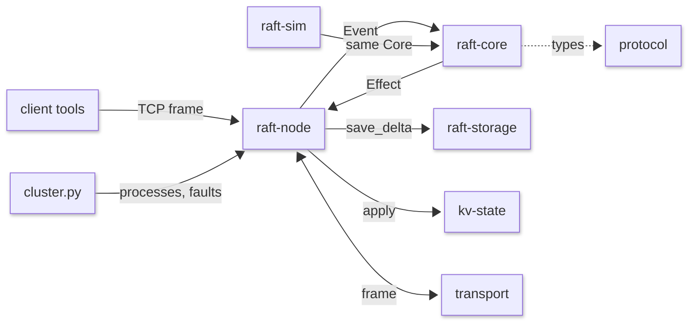
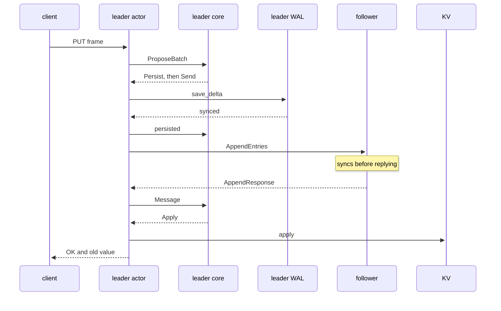

# Rust Raft KV Store

[](https://github.com/JiaChangGit/raft_kv_store/actions/workflows/ci.yml)

[中文版](README.zh-TW.md)

A key-value store replicated with Raft, written from scratch in Rust as a learning and portfolio project.
Raft is a consensus algorithm: it lets a few machines agree on the order of updates, so the store keeps accepting writes while a majority is alive and never returns contradictory reads.

What this implementation does:
- One Raft group of up to seven nodes; membership changes one server at a time.
- Snapshots and log compaction.
- Linearizable reads through ReadIndex.
- Group commit: the writes that arrive together share one sync to disk.
- The same `raft-core` runs inside a deterministic simulator and inside the real TCP nodes.

Most documents under `docs/` are in Traditional Chinese; [docs/GLOSSARY.md](docs/GLOSSARY.md) explains every term they use.

## What it does, stage by stage

| Stage | Added | Specification |
|---|---|---|
| V1 | Three fixed nodes: election, replication, commit, a write-ahead log, crash recovery, client deduplication, a deterministic simulator, fault-injecting proxies | [V1 report](docs/IMPLEMENTATION_REPORT.md) (historical) |
| S1 | WAL format 2: checksummed record headers, a file header, safe handling of a torn tail | [STORAGE_FORMAT_V2](docs/STORAGE_FORMAT_V2.md) |
| S2 | Snapshots, log compaction, chunked InstallSnapshot | [SNAPSHOT_COMPACTION](docs/SNAPSHOT_COMPACTION.md) |
| S3 | ReadIndex: a GET no longer enters the log | [READ_INDEX](docs/READ_INDEX.md) |
| S4 | Membership changes one server at a time; node IDs 1–7; the membership configuration lives in the log | [MEMBERSHIP](docs/MEMBERSHIP.md) |
| S5–S6 | Group commit, batched replication, writing only what changed; fixes from an independent review | [PERFORMANCE](docs/PERFORMANCE.md) |
| S9 | Documents, diagrams and a licence for publication, and a full acceptance rerun from scratch | — |
| S10 | A final review: three defects and one robustness problem fixed, tests for 12 checks that no test guarded, a broken demo and two broken lesson scripts repaired | [DEVELOPMENT](docs/DEVELOPMENT.md) |
| S12 | Tests for the last four unguarded checks that S10 left open | [DEVELOPMENT](docs/DEVELOPMENT.md) |
| S16 | Continuous integration on GitHub Actions, running the same steps as the clean rebuild | [DEVELOPMENT](docs/DEVELOPMENT.md) |

[docs/DEVELOPMENT.md](docs/DEVELOPMENT.md) explains the order of the stages, what was deliberately left out and what each review found.

## Architecture



`raft-core` is pure: it takes an `Event` and returns ordered `Effect`s, and never touches the clock, the network or the disk.
In `raft-node`, one actor thread owns the core, the WAL and the state machine; other threads only move frames and events.
A write follows this path on the leader:



[docs/ARCHITECTURE.md](docs/ARCHITECTURE.md) has four diagrams (components, a write, a ReadIndex read, adding a member), each with the files and functions it was traced from.

## Quick start

You need Linux (developed on WSL2 Ubuntu, with data on ext4), Rust through rustup (the version is pinned in `rust-toolchain.toml`) and Python 3.
[docs/SETUP.md](docs/SETUP.md) goes from installing the tools to a running cluster, with what to expect at each step and common errors (in Chinese).
Run everything from the repository root. If `cargo` is not on your PATH (common in non-login shells), run `. "$HOME/.cargo/env"` first.

```bash
python3 -m venv .venv
.venv/bin/python -m pip install -r requirements-dev.txt
cargo build --workspace --locked
```

Start three nodes, each in its own terminal. Only node 1 bootstraps, and only once for the whole cluster; the others start empty.
`--bootstrap` acts only on an empty data directory, so keeping it on a restart is harmless. The nodes keep printing JSON log lines; redirect them to a file if you like.

```bash
cargo run -p raft-node -- --id 1 --config config/cluster.toml --data-dir data/node-1 --bootstrap
cargo run -p raft-node -- --id 2 --config config/cluster.toml --data-dir data/node-2
cargo run -p raft-node -- --id 3 --config config/cluster.toml --data-dir data/node-3
```

After a few seconds, once node 1 is the leader, add nodes 2 and 3 to the membership configuration from another terminal, then write and read a key:

```bash
.venv/bin/python tools/kv_admin.py --config config/cluster.toml add 2
.venv/bin/python tools/kv_admin.py --config config/cluster.toml add 3
.venv/bin/python -m tools.kv_client --address 127.0.0.1:7201 --address 127.0.0.1:7202 --address 127.0.0.1:7203 --client-id 7 --sequence 0 Put x A
.venv/bin/python -m tools.kv_client --address 127.0.0.1:7201 --address 127.0.0.1:7202 --address 127.0.0.1:7203 --client-id 7 --sequence 1 Get x
```

What to expect:
- `add 2` replies `"status": "OK", "result": "1,2"`, then prints a warning that two nodes cannot tolerate a failure. It is a reminder, not an error.
- `add 3` replies `"result": "1,2,3"`.
- Put replies `"status": "OK", "result": null`; `null` means x had no previous value.
- Get replies `"result": "A"`.

A client sends one request at a time. After `TIMEOUT_UNKNOWN`, retry with the same client ID, sequence and content; a new request uses the next sequence. Put and Delete return the previous value.
`.venv/bin/python tools/kv_admin.py --config config/cluster.toml status` prints a summary of the cluster: the leader, the term, the members, where the membership configuration sits in the log and whether it is committed. `remove N` takes a node out.
To replace a failed node, add the new one first, then remove the old one. Do not re-add a node ID with a wiped data directory and do not bootstrap a second node: this version does not detect either mistake, and both can break safety.
[docs/HANDS_ON.md](docs/HANDS_ON.md) runs an election, a write, killing the leader and restarting it with one command, and explains where each number comes from (in Chinese).

## Verification

| What | How |
|---|---|
| Unit and integration tests | `cargo test --workspace`, `.venv/bin/python -m pytest -q tests` |
| Lints | `cargo fmt --all -- --check`, `cargo clippy --workspace --all-targets -- -D warnings` |
| Simulation | 1,000 seeds (a seed fixes every random choice, so a run can be repeated exactly) × 10,000 events, checking invariants, conditions that must hold at every step, such as at most one leader per term |
| Crashes | failpoints (test switches that make a process stop itself at a chosen point) between writing, syncing, acknowledging, committing, applying and replying; real processes killed with SIGKILL and restarted on the same data |
| Network faults | proxies that drop, delay, duplicate and reorder whole frames; histories checked for linearizability |
| Mutation testing | 82 planted bugs, each run in an isolated copy; every one must make a test fail |
| Lesson reproductions | the reproduction script of each of the 21 bug lessons still runs and reaches the saved conclusion (`bash scripts/run_lesson_repros.sh`) |
| CI | every push to main and every pull request runs format, clippy, the Rust tests, the Python tests and the client demo on GitHub Actions, the same steps as `scripts/clean_rebuild.py`; the simulation, benchmarks and mutation tests stay in the full acceptance |
| Acceptance contract | 18 phases in `acceptance/final.json`, run by `scripts/verify_gate.py`. P00–P08 are the nine phases of the original specification; S1–S6, S10, S12 and S16 added P10–P18, one each. P09 is not used |

Each phase that passes leaves a receipt (a file recording the commands, the results and the source fingerprint) under `artifacts/`, which is not under version control.
`.venv/bin/python scripts/status.py` shows the latest result of each phase and whether it matches the current source.
`bash scripts/final_acceptance.sh` reruns everything from the mutation tests to P18; it can resume after an interruption and stops if a source file changes. It took about 45 minutes on the author's machine.
The latest tag, `s16-ci-verified`, is created only after every phase passed on the exact source of that commit.

## What is not verified

- There is no formal proof, of Raft or of this code.
- There is no long soak test. Real-process linearizability checks look at no more than 24 operations at a time.
- The simulator's administrator sends one membership change at a time, and each seed has 64 client operations.
- The reviewer of S1 had also worked on S1, so S1 never had a fully independent review.
- The bug lessons are drafts: nobody else has followed them yet.
- SIGKILL is not a power failure; a successful `sync_all` is trusted to mean the data is on disk.
- Membership operator mistakes (re-adding a wiped node, bootstrapping twice) are not detected.
- Performance numbers come from one WSL machine and say nothing about other hardware.
- The diagrams were checked only as Mermaid source; no renderer works on the author's machine.

## Documents

In this order: [setup](docs/SETUP.md), [architecture](docs/ARCHITECTURE.md), [one PUT through the whole system](docs/LEARNING_GUIDE.md) and the [bug lessons](docs/lessons/README.md).
[docs/FAQ.md](docs/FAQ.md) has questions to check your understanding. [docs/README.md](docs/README.md) sorts every document into five groups: current guides, specifications, records, historical versions and original materials.
Records keep the paths of the author's machine as they were written.

## About AI tools

Most of the code, tests and documents were written by AI coding assistants under the author's direction. The author set the scope, approved the specification of every stage, spot-checked results and did every outward action (push, release) themselves.
Correctness does not rest on the writer's word: every feature has to pass the tests and acceptance listed above, and each of the three independent reviews was done by a reviewer who had not worked on the part under review, except for S1 (see below).

## Licence

MIT; see [LICENSE](LICENSE).
