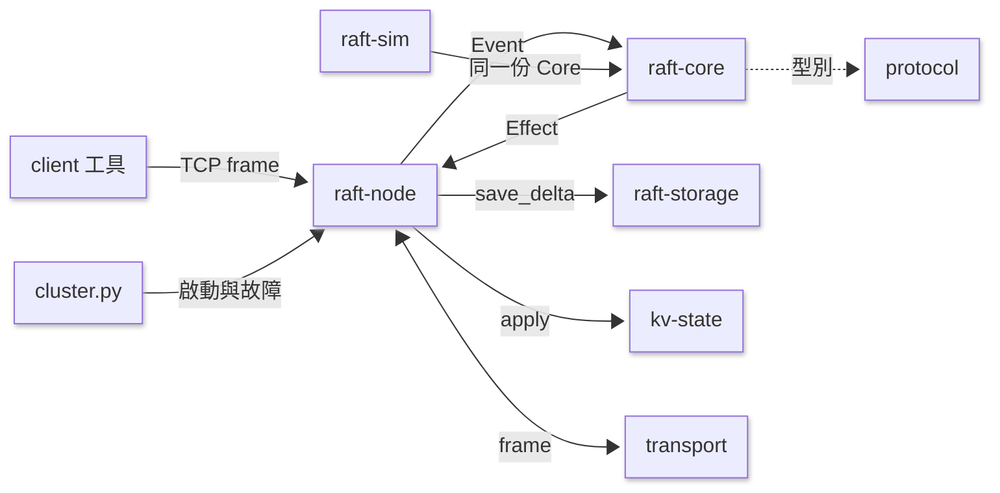
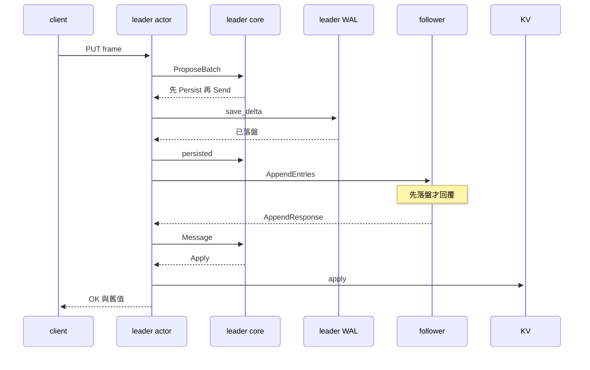

# Rust Raft KV Store

[English](README.md)

用 Rust 從零實作、以 Raft 複製的 key-value store，是學習與面試展示用的專案。
Raft 是一種共識演算法：讓幾台機器對「資料依什麼順序更新」取得一致，只要多數機器還活著，就能繼續寫入，而且讀不到互相矛盾的結果。

這份實作做到的事：
- 一個 Raft group，最多七台，成員一次增減一台。
- 會建立快照、壓縮 log。
- GET 走 ReadIndex，讀到的結果是線性一致的。
- 同一輪的多筆寫入合併成一次落盤（group commit）。
- 同一份 `raft-core` 同時用在可重現的模擬器，以及真正透過 TCP 溝通的節點。

第一次看到 Raft、WAL、ReadIndex 這些名詞，可以先查 [名詞表](docs/GLOSSARY.md)。

## 各階段做了什麼

| 階段 | 加了什麼 | 規格 |
|---|---|---|
| V1 | 固定三台：選舉、複製、commit、WAL、當機後回復、client 去重、可重現的模擬器、注入網路故障的 proxy | [V1 實作報告](docs/IMPLEMENTATION_REPORT.md)（歷史文件） |
| S1 | WAL 格式 2：每筆 record 的 header 有 checksum、檔頭、安全處理寫到一半的尾巴 | [STORAGE_FORMAT_V2](docs/STORAGE_FORMAT_V2.md) |
| S2 | 快照、log 壓縮、分塊傳送的 InstallSnapshot | [SNAPSHOT_COMPACTION](docs/SNAPSHOT_COMPACTION.md) |
| S3 | ReadIndex：GET 不再寫進 log | [READ_INDEX](docs/READ_INDEX.md) |
| S4 | 成員變更，一次一台；節點編號 1～7；成員設定存在 log 裡 | [MEMBERSHIP](docs/MEMBERSHIP.md) |
| S5～S6 | group commit、批次複製、落盤只寫變動的部分；獨立審查後的修正 | [PERFORMANCE](docs/PERFORMANCE.md) |
| S9 | 整理文件、架構圖與授權，並從頭重跑完整驗收 | — |
| S10 | 最後一次複查：修正三個缺陷與一個健壯性問題，為審查找到的 12 段沒有測試把關的檢查補上測試，修好壞掉的示範與教學腳本 | [開發歷程](docs/DEVELOPMENT.md) |

每個階段為什麼這樣排、刻意不做什麼、每次審查找到什麼，寫在 [開發歷程](docs/DEVELOPMENT.md)。

## 架構



`raft-core` 是純邏輯：收一個 `Event`，回傳有順序的 `Effect`，從不碰時鐘、網路或磁碟。
`raft-node` 裡由一個 actor 執行緒擁有 core、WAL 與狀態機，其他執行緒只負責搬 frame 和事件。leader 上的一次寫入是這樣走的：



[docs/ARCHITECTURE.md](docs/ARCHITECTURE.md) 有四張圖（元件、一次寫入、一次 ReadIndex 讀取、加入一個成員），每張都附上追蹤時對照的檔案與函式。

## 快速開始

需要 Linux（開發環境是 WSL2 Ubuntu，資料放在 ext4）、用 rustup 安裝的 Rust（版本固定在 `rust-toolchain.toml`），以及 Python 3。
從安裝工具開始的完整步驟、每一步預期看到什麼、常見錯誤怎麼處理，見 [從零開始](docs/SETUP.md)。所有命令都在專案根目錄執行；
如果 `cargo` 不在 PATH 上（非登入的 shell 常見），先執行 `. "$HOME/.cargo/env"`。

```bash
python3 -m venv .venv
.venv/bin/python -m pip install -r requirements-dev.txt
cargo build --workspace --locked
```

開三個 terminal，各啟動一台。只有節點 1 帶 `--bootstrap`，整個叢集也只引導這一次；其他節點以空的資料目錄啟動。
`--bootstrap` 只對完全空白的資料目錄有作用，之後重啟時帶著也沒關係。節點會持續印出 JSON 格式的紀錄，可以導到檔案。

```bash
cargo run -p raft-node -- --id 1 --config config/cluster.toml --data-dir data/node-1 --bootstrap
cargo run -p raft-node -- --id 2 --config config/cluster.toml --data-dir data/node-2
cargo run -p raft-node -- --id 3 --config config/cluster.toml --data-dir data/node-3
```

等幾秒，節點 1 成為 leader 之後，在另一個 terminal 把節點 2、3 加進成員設定，再寫入並讀回一個 key：

```bash
.venv/bin/python tools/kv_admin.py --config config/cluster.toml add 2
.venv/bin/python tools/kv_admin.py --config config/cluster.toml add 3
.venv/bin/python -m tools.kv_client --address 127.0.0.1:7201 --address 127.0.0.1:7202 --address 127.0.0.1:7203 --client-id 7 --sequence 0 Put x A
.venv/bin/python -m tools.kv_client --address 127.0.0.1:7201 --address 127.0.0.1:7202 --address 127.0.0.1:7203 --client-id 7 --sequence 1 Get x
```

預期的結果：
- `add 2` 回 `"status": "OK", "result": "1,2"`，接著印一行警告：只有兩台時，任何一台故障都會讓叢集停下來。這是提醒，不是錯誤。
- `add 3` 回 `"result": "1,2,3"`。
- Put 回 `"status": "OK", "result": null`：`null` 表示 x 原本沒有值。
- Get 回 `"result": "A"`。

每個 client 一次只送一個請求。收到 `TIMEOUT_UNKNOWN` 時，用相同的 client ID、sequence 與內容重試；新的請求用下一個 sequence。Put 與 Delete 會回傳先前的值。
`.venv/bin/python tools/kv_admin.py --config config/cluster.toml status` 印出叢集的摘要：leader、term、成員、成員設定的位置與它是否已 commit。`remove N` 移除一台。
換掉故障的節點時，先加入新的，再移除舊的。有兩件事不要做：把清空過資料目錄的節點用原來的編號重新加入，以及讓第二台節點也用 `--bootstrap` 啟動。這一版偵測不到這兩種操作錯誤，做了可能破壞安全性，例如同一個 term 出現兩個 leader（原因見 [自問自答](docs/FAQ.md) Q20）。
[docs/HANDS_ON.md](docs/HANDS_ON.md) 用一行命令跑完選舉、寫入、終止 leader 再重新啟動，並解釋每個數字是怎麼來的。

## 驗證到哪裡

| 檢查 | 怎麼做 |
|---|---|
| 單元與整合測試 | `cargo test --workspace`、`.venv/bin/python -m pytest -q tests` |
| 格式與靜態檢查 | `cargo fmt --all -- --check`、`cargo clippy --workspace --all-targets -- -D warnings` |
| 模擬 | 1,000 個種子（決定隨機事件的數字，同一個種子能重跑出完全相同的過程），每個種子 10,000 個事件；每一步都檢查不變量，也就是任何時刻都必須成立的條件，例如同一個 term 最多一個 leader |
| 當機 | failpoint（讓 process 在指定位置自行終止的測試開關）設在寫入、同步、回覆 ACK、commit、套用、回覆 client 之間；真實 process 用 SIGKILL 終止，再以原資料目錄重啟 |
| 網路故障 | proxy 以完整的 frame 為單位丟棄、延遲、重複、調換順序；歷史紀錄做線性一致性檢查 |
| mutation 測試 | 78 個刻意植入的錯誤，各自在隔離的副本裡跑，每一個都必須讓某個測試失敗 |
| 教學的重現 | 21 篇 bug 教學的重現腳本都能執行，結論和保存的輸出相同（`bash scripts/run_lesson_repros.sh`） |
| 驗收契約 | `acceptance/final.json` 的 16 個階段，由 `scripts/verify_gate.py` 執行。P00～P08 是最初規格的九個階段，S1～S6 與 S10 依序各加了 P10～P16；P09 沒有使用 |

每個階段驗收通過後，會在 `artifacts/` 留下 receipt（記錄命令、結果與來源指紋的檔案）；`artifacts/` 不在版本控制內。
`.venv/bin/python scripts/status.py` 列出每個階段最近一次的結果，以及它是否對應目前的來源。
`bash scripts/final_acceptance.sh` 從 mutation 測試一路重跑到 P16，中斷後可以續跑，來源檔一變就停；在作者的機器上約 45 分鐘。
tag `s10-final-review-verified` 只在每個階段都對那個 commit 的來源通過後才建立。

## 沒有驗證的事

- 沒有形式化證明，不論是 Raft 本身還是這份程式。
- 沒有長時間的浸泡測試。真實 process 的線性一致性檢查，一次最多只看 24 個操作。
- 模擬器的管理者一次只送一個成員變更，每個種子只有 64 個用戶端操作。
- S1 的審查者也參與過 S1 的撰寫，S1 沒有經過完全獨立的審查。
- bug 教學都是草稿：還沒有第二個人照著做過。
- SIGKILL 不等於斷電；`sync_all` 成功就假設資料已經寫到磁碟上。
- 成員變更的操作錯誤（重新加入清空的節點、引導第二台）偵測不到。
- 效能數字只來自一台 WSL 機器，不能套到其他硬體。
- 架構圖只檢查過 Mermaid 圖源；作者的機器上沒有能用的渲染器。

## 文件

第一次讀，照這個順序：[從零開始](docs/SETUP.md)、[架構說明](docs/ARCHITECTURE.md)、[帶讀：跟著一筆 PUT 走完整個系統](docs/LEARNING_GUIDE.md)、[bug 教學](docs/lessons/README.md)。
讀完用 [自問自答](docs/FAQ.md) 檢查自己懂了沒有。[docs/README.md](docs/README.md) 把每份文件分成現行說明、規格、紀錄、歷史與原始材料五類。
紀錄類文件保留撰寫當時作者機器上的路徑。

## 關於 AI 工具

程式、測試與文件大多由 AI 程式助理在作者的規劃下撰寫。作者決定範圍、核准每個階段的規格、抽查結果，並自己做所有對外的操作（push、發布）。
正確與否不靠撰寫者自己說：每項功能都要通過上面列的測試與驗收；三次獨立審查的審查者都沒有參與被審查部分的實作，只有 S1 例外（見下方「沒有驗證的事」）。

## 授權

MIT，見 [LICENSE](LICENSE)。
