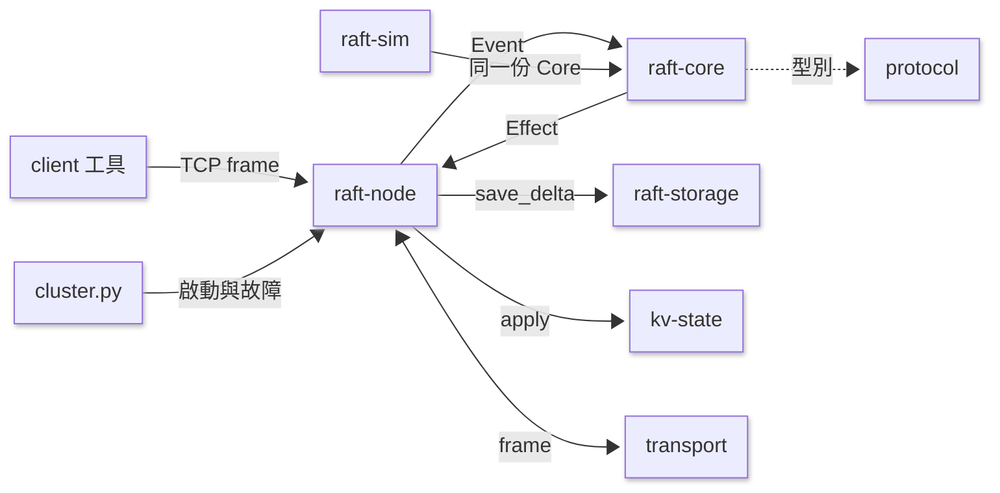

# Rust Raft KV Store

[English](README.md)

用 Rust 從零實作、以 Raft 複製的 key-value store，是學習與面試展示用的專案。
它跑一個最多七台的 Raft group，成員一次增減一台；會建立快照並壓縮 log；GET 走 ReadIndex，讀到的結果是線性一致的；寫入以 group commit 合併落盤。
同一份 `raft-core` 同時用在可重現的模擬器，以及真正透過 TCP 溝通的節點。

大部分的程式、測試與文件是 AI 模型在作者指揮下寫的；[怎麼做的](#怎麼和-ai-一起做)寫在最後，也寫了這個做法的限制。

## 各階段做了什麼

| 階段 | 加了什麼 | 規格 |
|---|---|---|
| V1 | 固定三台：選舉、複製、commit、WAL、當機後回復、client 去重、可重現的模擬器、注入網路故障的 proxy | [V1 實作報告](docs/IMPLEMENTATION_REPORT.md)（歷史文件） |
| S1 | WAL 格式 2：每筆 record 的 header 有 checksum、檔頭、安全處理寫到一半的尾巴 | [STORAGE_FORMAT_V2](docs/STORAGE_FORMAT_V2.md) |
| S2 | 快照、log 壓縮、分塊傳送的 InstallSnapshot | [SNAPSHOT_COMPACTION](docs/SNAPSHOT_COMPACTION.md) |
| S3 | ReadIndex：GET 不再寫進 log | [READ_INDEX](docs/READ_INDEX.md) |
| S4 | 成員變更，一次一台；節點編號 1～7；設定存在 log 裡 | [MEMBERSHIP](docs/MEMBERSHIP.md) |
| S5～S6 | group commit、批次複製、落盤只寫變動的部分；獨立審查後的修正 | [PERFORMANCE](docs/PERFORMANCE.md) |
| S7～S8 | 研究用來開發本專案的 AI 框架（不屬於 KV store 本身） | [framework-study/](framework-study/README.md) |
| S9 | 這次的公開整理 | [PUBLIC_RELEASE](docs/PUBLIC_RELEASE.md) |

## 架構



`raft-core` 是純邏輯：收一個 `Event`，回傳有順序的 `Effect`，從不碰時鐘、網路或磁碟。
`raft-node` 裡由一個 actor 執行緒擁有 core、WAL 與狀態機，其他執行緒只負責搬 frame 和事件。leader 上的一次寫入是這樣走的：


[docs/ARCHITECTURE.md](docs/ARCHITECTURE.md) 有四張圖（元件、一次寫入、一次 ReadIndex 讀取、加入一個成員），每張都附上追蹤時對照的檔案與函式。

## 快速開始

需要 Linux（開發環境是 WSL2 Ubuntu，資料放在 ext4）、用 rustup 安裝的 Rust（版本固定在 `rust-toolchain.toml`），以及 Python 3。所有命令都在專案根目錄執行。

```bash
python3 -m venv .venv
.venv/bin/python -m pip install -r requirements-dev.txt
cargo build --workspace --locked
```

開三個 terminal，各啟動一台。只有節點 1 帶 `--bootstrap`，整個叢集也只引導這一次；其他節點以空的資料目錄啟動。

```bash
cargo run -p raft-node -- --id 1 --config config/cluster.toml --data-dir data/node-1 --bootstrap
cargo run -p raft-node -- --id 2 --config config/cluster.toml --data-dir data/node-2
cargo run -p raft-node -- --id 3 --config config/cluster.toml --data-dir data/node-3
```

在另一個 terminal 把節點 2、3 加進設定，再寫入並讀回一個 key：

```bash
.venv/bin/python tools/kv_admin.py --config config/cluster.toml add 2
.venv/bin/python tools/kv_admin.py --config config/cluster.toml add 3
.venv/bin/python -m tools.kv_client --address 127.0.0.1:7201 --address 127.0.0.1:7202 --address 127.0.0.1:7203 --client-id 7 --sequence 0 Put x A
.venv/bin/python -m tools.kv_client --address 127.0.0.1:7201 --address 127.0.0.1:7202 --address 127.0.0.1:7203 --client-id 7 --sequence 1 Get x
```

每個 client 一次只送一個請求。收到 `TIMEOUT_UNKNOWN` 時，用相同的 client ID、sequence 與內容重試；新的請求用下一個 sequence。Put 與 Delete 會回傳先前的值。
`tools/kv_admin.py ... status` 列出各節點的狀態，`remove N` 移除一台。換掉故障的節點時，先加入新的，再移除舊的。
不要把清空資料目錄的節點編號重新加入，也不要讓第二台節點引導：這一版偵測不到這兩種操作錯誤，而它們都可能破壞安全性。
[docs/HANDS_ON.md](docs/HANDS_ON.md) 帶你實際看一次選舉、寫入、終止 leader 再重新啟動。

## 驗證到哪裡

| 檢查 | 怎麼做 |
|---|---|
| 單元與整合測試 | `cargo test --workspace`、`.venv/bin/python -m pytest -q tests` |
| 格式與靜態檢查 | `cargo fmt --all -- --check`、`cargo clippy --workspace --all-targets -- -D warnings` |
| 模擬 | 1,000 個種子，每個種子 10,000 個事件，由獨立的不變量觀察者檢查（`raft-sim`） |
| 當機 | 在寫入、同步、回覆 ACK、commit、套用、回覆 client 之間設 failpoint；真實 process 用 SIGKILL 終止，再以原資料目錄重啟 |
| 網路故障 | proxy 以完整的 frame 為單位丟棄、延遲、重複、調換順序；歷史紀錄做線性一致性檢查 |
| mutation 測試 | 63 個刻意植入的錯誤，各自在隔離的副本裡跑，每一個都必須讓某個測試失敗 |
| 驗收契約 | `acceptance/final.json` 的 15 個階段（P00～P08、P10～P15），由 `scripts/verify_gate.py` 執行 |

`.venv/bin/python scripts/status.py` 列出每個階段最近一次的結果，以及它是否對應目前的來源。
`bash scripts/final_acceptance.sh` 從 mutation 測試一路重跑到 P15，中斷後可以續跑，來源檔一變就停；在作者的機器上約 45 分鐘。
tag `s9-public-verified` 只在每個階段都對那個 commit 的來源通過後才建立。receipt 與報告寫在 `artifacts/`，不在版本控制內。

## 沒有驗證的事

- 沒有形式化證明，不論是 Raft 本身還是這份程式。
- 沒有長時間的浸泡測試。真實 process 的線性一致性檢查，一次最多只看 24 個操作。
- 模擬器的管理者一次只送一個成員變更，每個種子只有 64 個用戶端操作。
- S1 只由同一個模型的另一個 session 審查過，沒有經過不同的模型。
- bug 教學都是草稿：還沒有第二個人照著做過。
- SIGKILL 不等於斷電；`sync_all` 成功就假設資料已經寫到磁碟上。
- 成員變更的操作錯誤（重新加入清空的節點、引導第二台）偵測不到。
- 效能數字只來自一台 WSL 機器，不能套到其他硬體。
- 架構圖只檢查過 Mermaid 圖源；作者的機器上沒有能用的渲染器。

## 文件

[docs/README.md](docs/README.md) 把每份文件分成現行說明、規格、紀錄與歷史四類。
入門可以從 [docs/LEARNING_GUIDE.md](docs/LEARNING_GUIDE.md)（跟著一筆 PUT 看完整個系統）或 [bug 教學](docs/lessons/README.md) 開始。
紀錄類文件保留撰寫當時作者機器上的路徑；`CLAUDE.md`、`AGENTS.md` 與 `.claude/` 是作者在本機給 AI 工具的設定。

## 怎麼和 AI 一起做

作者訂目標、每個階段開始前核准規格、抽查結果，所有對外的操作（push、PR、部署）都由作者自己做；規格、程式、測試、教學與報告由 AI 模型撰寫。
每個階段都照同樣的順序：規格、核准、先寫會失敗的測試、實作、模擬與故障測試、獨立審查、教學、驗收，最後在本機 commit 並打 tag。
三次獨立審查，審查者都不是寫出大部分受審內容的那個模型，各自找到了真正的缺陷：S1～S4 的一個回復缺陷、一個變弱的模擬器檢查與一個邊界缺陷；S5 有一個驗收階段從沒跑完，文件卻寫成已完成；框架的修改裡，一支使用次數統計工具會把私人對話紀錄裡的任意字原樣輸出。
限制也是真的：寫的和評的常是同一個模型；實驗每個條件只跑一兩次；有紀錄啟動目錄的 session 全都從專案的上一層啟動，所以專案的權限規則從沒載入，「框架唯讀」「不 push」靠的是模型自己遵守。
細節見 [docs/AI_COLLABORATION.md](docs/AI_COLLABORATION.md)；對 AI 框架本身的研究在 [framework-study/](framework-study/README.md)。

## 授權

MIT，見 [LICENSE](LICENSE)。
