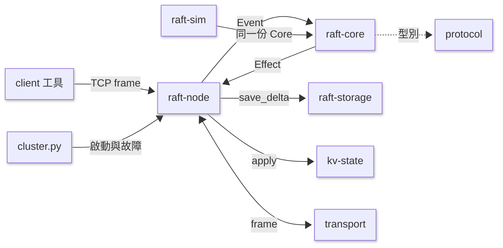
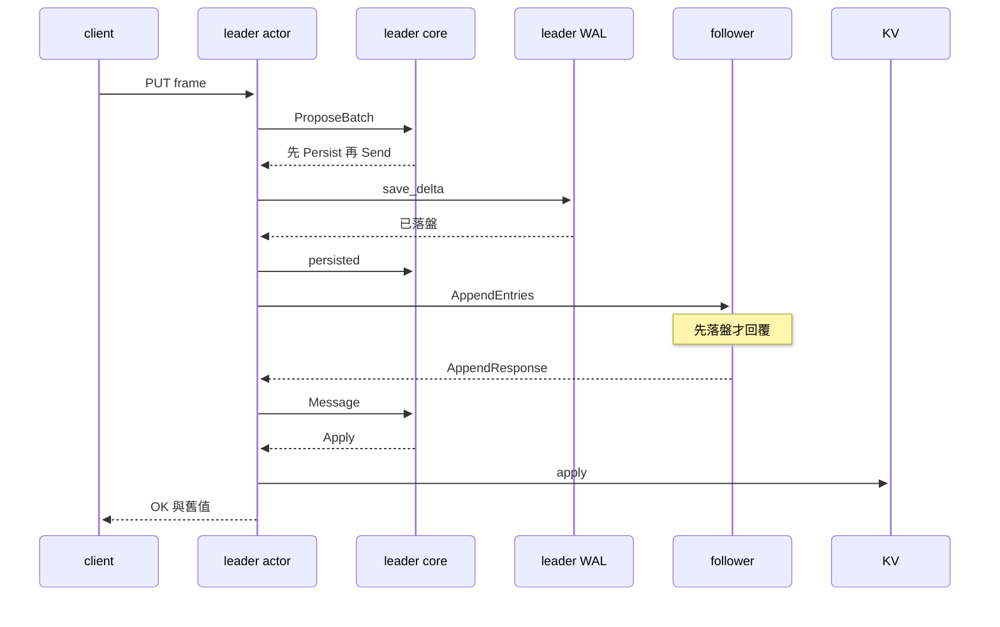
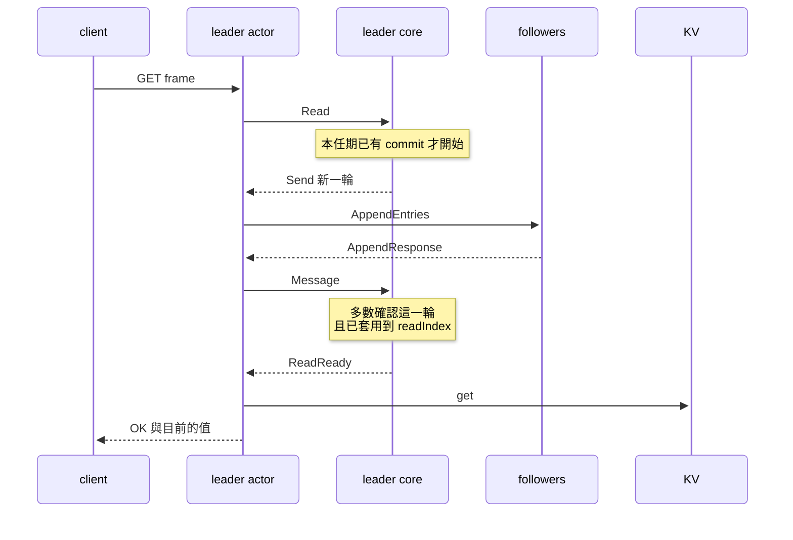
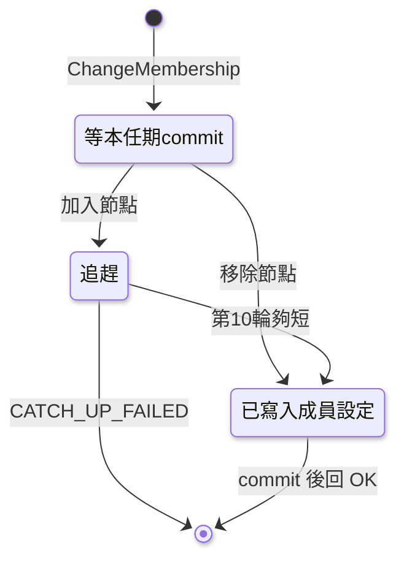

# 架構說明

這份文件用四張圖說明系統怎麼運作：元件、一次寫入、一次讀取、加入一個成員。圖和表都是**讀程式得到的靜態追蹤**（2026-11-16，S9；讀取的部分在 2026-11-17 依 S10 的修正更新），不是某一次執行的紀錄；
表中寫的是檔案與函式名稱，沒有寫行號，因為行號會隨版本移動。圖沒有畫的部分：選舉、快照傳送（InstallSnapshot）、逾時與重試、各種失敗回覆。

## 元件

| 圖中的名稱 | 實際位置 | 負責 |
|---|---|---|
| client 工具 | `tools/kv_client.py`、`tools/kv_admin.py` | 送 PUT／GET／DELETE；加入、移除成員與查狀態 |
| raft-node | `crates/raft-node` | 一個 actor 執行緒擁有 core、WAL 與 KV；TCP、計時器、group commit、回覆 client |
| raft-core | `crates/raft-core` | 純函式式的共識邏輯：收 `Event`，產生有順序的 `Effect`；不碰時鐘、網路或檔案 |
| raft-storage | `crates/raft-storage` | WAL 格式 2：只寫這一步變動的部分（`Delta`）、同步、回復、快照安裝 |
| kv-state | `crates/kv-state` | KV 狀態機，以及每個 client 最新一筆寫入的去重紀錄 |
| transport | `crates/raft-transport` | 有長度上限的 frame 讀寫 |
| protocol | `crates/raft-protocol` | RPC、ID、成員設定 `Voters` 與各種上限，供其他 crate 共用 |
| raft-sim | `crates/raft-sim` | 虛擬時間、模擬磁碟、故障排程與不變量檢查；用的是同一份 `raft-core` |
| cluster.py | `tools/cluster.py` 等 | 測試用：啟動多個 process、經 proxy 注入網路故障；`tools/linearizability.py` 檢查歷史紀錄 |

## 一次寫入

leader 收到一筆 PUT，到回覆 client 為止。圖中只畫一個 follower；實際上 leader 對每個 follower 各送一份。

| 步驟 | 程式 |
|---|---|
| client 送出 PUT | `raft-node` 的 `client_listener`：讀 frame、`canonical()` 檢查格式，以 `Input::Client` 交給 actor，等它回覆 |
| 收集同一輪的寫入 | `Actor::run` 一次取走已經到達的輸入（最多 256 個）；寫入先收集起來，再由 `Actor::propose` 切成批次（每批最多 256 筆、512 KiB），送出 `Event::ProposeBatch` |
| 寫進 log、準備複製 | `Core::propose` 把每筆寫入加進 log，`replicate_all`／`replicate` 產生 AppendEntries；`Core::seal` 為這一步產生唯一的 `Effect::Persist`，排在所有訊息之前 |
| 落盤 | `Actor::execute` 遇到 `Effect::Persist`，呼叫 `Wal::save_delta`；成功後 `Core::persisted` 更新 `durable_index` 與自己的 match，並試著推進 commit |
| 送到 follower | `Effect::Send`：每個 RPC 一條執行緒，`write_frame` 送出、`read_frame` 等回覆，再以 `Input::Peer` 回到 actor |
| follower 收到 | `peer_listener` → `Event::Message` → `Core::message` 的 AppendEntries 分支：核對 term、leader、`prev_log_index` 與每筆 entry，必要時截掉衝突的尾巴；follower 的回覆排在 follower 自己的 `Persist` 之後，所以回覆時資料已經落盤 |
| leader 決定 commit | AppendResponse 分支先核對 `rpc_id`、term、epoch，再更新 match；`Core::advance_commit` 只直接 commit 本任期的 entry，而且要目前成員設定的多數已經落盤 |
| 套用與回覆 | `Core::apply_committed` 依序產生 `Effect::Apply`；`StateMachine::apply` 套用並回傳舊值；leader 用 `Actor::reply_request` 回覆等待中的 client |

## 一次讀取（ReadIndex）

GET 不寫進 log。leader 記下讀取時的 commit index，再確認自己仍被多數承認，才從 KV 回答。

| 步驟 | 程式 |
|---|---|
| 收到 GET | `Actor::run`：GET 不進寫入的批次，記在 `reads`，送出 `Event::Read` |
| 開始一輪確認 | `Core::read`（不是 leader 就回 `NOT_LEADER`）→ `Core::start_read_round`：本任期還沒有 commit 的 entry 時先等；否則 readIndex 設為目前的 commit index、輪次加一，`replicate_all` 送出帶新輪次的請求。最後 `Core::read` 再呼叫一次 `finish_reads`：只有一台 voter 時不必等任何回覆，當下就回答（教學 20） |
| 收集確認 | AppendResponse 分支：同一個 term 的回覆，不論成功與否，都記進 `acked_round` |
| 回答 | `Core::finish_reads`：目前成員設定的多數確認了這一輪、而且 `last_applied` 已到 readIndex，才產生 `Effect::ReadReady`；`Actor::execute` 再檢查一次已套用的位置，用 `StateMachine::get` 回答 |
| 沒有回答的情況 | 失去 leader 身分時 `Core::fail_reads` 回 `NOT_LEADER`；client 等太久時 actor 送 `Event::CancelRead` 把它忘掉 |

## 加入一個成員

一次只改一台。新節點先追上 log，追上了才寫入新的成員設定。成員設定一寫進 log 就生效：之後的多數依新的成員設定計算。

| 步驟 | 程式 |
|---|---|
| 送出請求 | `tools/kv_admin.py add N` → `client_listener` 解析成 `Input::Membership`；`Actor::run` 先確認 N 在位址表裡，否則回 `INVALID_ARGUMENT` |
| 受理 | `Core::change_membership`：不是 leader 回 `NOT_LEADER`；已有變更進行中回 `CHANGE_IN_PROGRESS` |
| 等本任期 commit | `Core::proceed_change`：leader 要先在本任期 commit 一筆 entry，才處理成員變更（raft-dev 郵件在 2015 年補上的規則，教學 08）；之後它確認最新的成員設定已經 commit |
| 追趕 | `Phase::CatchingUp` 與 `Core::catch_up_progress`：固定 10 輪，第 10 輪少於 4 次心跳才算追上；整個過程超過 100 次心跳就放棄，回 `CATCH_UP_FAILED` |
| 寫入成員設定 | `Core::append_config` 把 `Command::Config` 加進 log，並調整要複製的對象 |
| 完成 | `Core::after_commit`：成員設定 commit 後產生 `Effect::MembershipDone`，actor 回 OK；leader 自己不在新的成員設定裡時，在這裡退位 |

規格與證明的界線見 [成員變更規格](MEMBERSHIP.md)；儲存格式見 [WAL 格式 2](STORAGE_FORMAT_V2.md)；讀取的推導見 [ReadIndex 規格](READ_INDEX.md)；group commit 見 [效能規格](PERFORMANCE.md) §6。
作者的機器（WSL）上，Mermaid 的命令列渲染工具 `mmdc` 無法執行，所以四張圖只檢查過圖源；GitHub 支援直接顯示 Mermaid 區塊，實際的顯示要 push 後才能確認。
