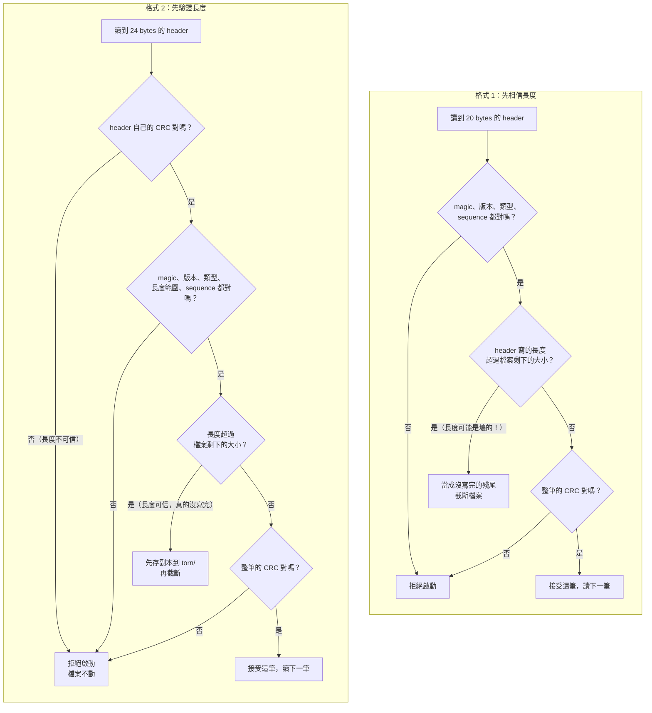

# 磁碟上一個數字壞掉，節點就忘了自己投過票

狀態：草稿

> 這篇的命令與輸出都實際執行過（2026-11-12），但還沒有第二個人照著做一遍；有人做過之後才會改成「完成」。
> 讀者設定：會寫一點程式、沒做過分散式系統。讀完你應該能自己重現這個 bug、說出根因，並在兩分鐘內講給別人聽。

發現日期：2026-11-10（獨立審查時發現第一種情況），2026-11-12 重現並找到第二種情況　｜　發現方式：審查程式碼後實際執行驗證　｜
影響的版本：Git tag `v1-baseline-verified-20261112`（儲存格式 1）　｜　修正：Git tag `s1-storage-format-verified`（儲存格式 2）

## 1. 一句話說後果

節點存在磁碟上的 log 檔裡，只要有**一個長度欄位**的值壞掉，節點重新啟動時不會報錯，
而是默默把後面的資料全部刪掉，然後像一台全新的機器一樣繼續運作——包括忘記自己已經投過的票。

這篇會帶你做四件事：用一行命令在舊版程式上親眼看到資料消失；沿著程式找出是哪一個判斷出錯；
理解這為什麼會破壞 Raft 最基本的安全保證；最後看修正後的程式如何拒絕同樣的毀損，以及我們怎麼確定它真的修好了。

## 2. 需要的背景

只列這篇用得到的概念。已經熟悉的可以跳過。

**Raft 與節點。** 這個專案是三台機器（節點）組成的叢集，一起保存同一份 key-value 資料。
Raft 是讓它們對「資料的順序」達成一致的演算法。只要三台裡有兩台（多數）同意，事情就算定案。

**term（任期）與投票。** Raft 把時間切成一段段任期，每個任期最多只有一位 leader。
要當 leader 得拿到多數票，而**每個節點在同一個任期只能投一票**。這條規則是「一個任期不會有兩位 leader」的基礎。

**log 與 WAL。** 每個節點把收到的操作依序記成 log。log、目前的任期、這個任期投給了誰，這三樣東西必須寫進磁碟，
因為節點隨時可能當機重開，重開後得想起來。存這些東西的檔案叫 WAL（write-ahead log，預寫日誌）：先寫進檔案，才對外回覆。

**durable（已落盤）。** 程式呼叫「寫入」時，資料通常只到作業系統的記憶體。要再呼叫一次 fsync（在 Rust 裡是 `sync_all`），
作業系統才保證資料已經交給磁碟。本專案的規則是：fsync 成功之後，才可以回覆「我投給你了」或「我收到了」。

**record 與 header。** WAL 是一筆一筆接在一起的 record。每筆的開頭有固定長度的 header，裡面記著「接下來的內容有多長」。
讀檔的程式靠這個長度知道一筆在哪裡結束、下一筆從哪裡開始。就像一疊沒有信封的信，每封信第一行寫著「本信共 91 個字」。

**CRC（檢查碼）。** 把一段資料算成一個 4 bytes 的數字，跟資料存在一起。讀回來時重算一次，數字不同就代表資料壞了。
它用來抓意外毀損，不是加密，擋不住故意竄改。

**殘尾（torn tail）。** 程式正在寫一筆 record 時被強制終止，檔案尾端就會留下半筆。這很正常，而且這半筆可以放心丟掉：
因為 fsync 還沒完成，程式還沒對任何人回覆過「我寫好了」。

**fail closed。** 發現資料不對勁時，選擇「拒絕啟動、什麼都不改」，而不是「猜一個看起來合理的狀態繼續跑」。
對 Raft 來說，一台停下來的節點是安全的（另外兩台仍是多數）；一台帶著錯誤記憶繼續跑的節點才危險。

## 3. 親手重現

需要：Linux 或 WSL、Git、Rust 工具鏈（版本由專案的 `rust-toolchain.toml` 指定）。在專案根目錄執行：

```bash
docs/lessons/01-wal-length-corruption/repro.sh
```

大約十幾秒（第一次要下載並編譯相依套件，會久一些）。腳本只在一個暫存目錄裡寫東西，結束時自動刪除；
它不會動到你的工作目錄。完整的實際輸出存在 [expected-output.txt](expected-output.txt)，下面逐段說明。

**第 1、2 步：取出舊版程式，寫入兩筆資料。** 腳本用 `git archive` 把舊版（tag `v1-baseline-verified-20261112`）
解到暫存目錄並編譯出一個小工具 `wal_probe`。它做的事很單純：開啟資料目錄、把任期設成你給的數字、加一筆 log、存檔。

```text
DURABLE 1
DURABLE 2
   raft.wal is 230 bytes: 2 records, each 20 (header) + 91 (payload) + 4 (CRC)
     {"term":1,"voted_for":1,"truncate_from":1,"append":[{"index":1,"term":1,"command":"NoOp"}]}
     {"term":2,"voted_for":1,"truncate_from":2,"append":[{"index":2,"term":2,"command":"NoOp"}]}
```

現在磁碟上有兩筆已落盤的 record，節點處於任期 2。第一筆 record 的 header 是這 20 個 bytes：

```text
52 46 54 31   01 00   01 00   5b 00 00 00   01 00 00 00 00 00 00 00
R  F  T  1    版本 1   類型 1   長度 = 91      sequence = 1
```

`5b` 是十六進位的 91。這四個 bytes 就是這篇的主角。

**第 3 步（案例 A）：改壞第一筆的長度，然後重新啟動。** 腳本把那四個 bytes 從 91 改成 65536，
模擬磁碟上的資料意外毀損，然後用舊版程式以「任期 1」再啟動一次。

```text
DURABLE 1
   the old code started normally. raft.wal is now 115 bytes:
     {"term":1,"voted_for":1,"truncate_from":1,"append":[{"index":1,"term":1,"command":"NoOp"}]}
BUG REPRODUCED (A): the node had durably reached term 2, forgot both records, and accepted term 1 again.
```

要注意三件事：程式**沒有報任何錯**；檔案從 230 bytes 變成 115 bytes，原本的兩筆都不見了；
而且節點原本已經到任期 2，現在卻接受了任期 1——正常的程式會拒絕讓任期倒退，它沒拒絕，因為它已經不記得自己到過任期 2。

**第 4 步（案例 B）：改壞最後一筆的長度。** 這次只把第二筆的長度從 91 改成 92，只差 1。
腳本同時跑一個沒有毀損的對照組，兩邊都接著寫入任期 3：

```text
   control (no damage), after writing term 3:
     {"term":1,...,"append":[{"index":1,"term":1,"command":"NoOp"}]}
     {"term":2,...,"append":[{"index":2,"term":2,"command":"NoOp"}]}
     {"term":3,...,"append":[{"index":3,"term":3,"command":"NoOp"}]}
   damaged, after writing term 3:
     {"term":1,...,"append":[{"index":1,"term":1,"command":"NoOp"}]}
     {"term":3,"voted_for":1,"truncate_from":2,"append":[{"index":2,"term":3,"command":"NoOp"}]}
BUG REPRODUCED (B): the durable entry (index 2, term 2) is gone; index 2 now holds a term 3 entry.
```

對照組有三筆，index 2 是任期 2 的那筆。毀損的那邊只有兩筆，index 2 被換成了任期 3 的新資料。
那筆任期 2 的資料明明已經 fsync 過，節點可能已經告訴別人「我收到了」，現在卻消失得無影無蹤。

**第 5 步：對舊版程式跑一個回歸測試，確認它會失敗。** 這個測試（[v1_red_test.rs](v1_red_test.rs)）
寫的是我們想要的規則：長度壞掉的 WAL 必須被拒絕，而且檔案不能被改。

```text
   the damaged WAL was opened: durable state went from (term 2, 2 entries) to Ok((0, 0))
   test result: FAILED. 0 passed; 1 failed; ...
RED: the test fails on format 1, so it really detects this bug.
```

先看到測試失敗很重要：這證明測試真的抓得到這個 bug。一個從來沒失敗過的測試，你無法確定它有沒有在檢查東西。

**第 6 步：用現在的程式重做兩個案例。**

```text
   raft.wal is 318 bytes: 80 (file header) + 2 records, each 24 (header) + 91 (payload) + 4 (CRC)
   case A: refused -> "WAL record header checksum mismatch; refusing repair"
            raft.wal is byte-for-byte unchanged
   case B: refused -> "WAL record header checksum mismatch; refusing repair"
            raft.wal is byte-for-byte unchanged
FIXED: format 2 refuses both cases and does not touch the file.
```

新版拒絕啟動，並指出是 header 的檢查碼不符；檔案一個 byte 都沒變。

## 4. 為什麼會這樣

節點啟動時要「回復」：從頭把 WAL 一筆一筆讀回來。讀到檔案尾端時，它得分辨兩種情況：

- 最後一筆只寫了一半（上次被強制終止）→ 正常，丟掉這半筆就好。
- 資料壞了 → 不正常，應該拒絕啟動。

舊版程式判斷「只寫了一半」的方法是：**看 header 寫的長度，比檔案剩下的大小還長，就當作沒寫完。**
這是舊版 `crates/raft-storage/src/lib.rs` 裡的實際程式（第 243～253 行）：

```rust
let payload_len = check_header(&record_header[..available], next_sequence)?;
// ...
let record_len = (HEADER_LEN + payload_len + 4) as u64;
if length - offset < record_len {
    self.truncate_tail(offset)?;   // 截斷檔案
    break;
}
```

而 `check_header` 檢查了 magic、版本、類型、sequence，對長度卻只檢查「介於 1 和 2 MiB 之間」：

```rust
if !(8..12).contains(&index) && bytes[index] != expected[index] {   // 第 8～11 個 byte（長度）被跳過
    return Err(/* ... */);
}
// ...
if length == 0 || length > MAX_RECORD_PAYLOAD {
    return Err(invalid("WAL record length out of bounds"));
}
```

把案例 A 的數字代進去：

| 變數 | 值 | 說明 |
|---|---:|---|
| `offset` | 0 | 正在讀第一筆 |
| `length` | 230 | 整個檔案的大小 |
| `payload_len` | 65536 | 被改壞的長度；介於 1 和 2 MiB 之間，所以通過檢查 |
| `record_len` | 65560 | 20 + 65536 + 4 |
| `length - offset < record_len` | 230 < 65560，成立 | 判定為「沒寫完的殘尾」 |

於是程式執行 `truncate_tail(0)`：把檔案從 offset 0 截斷，整個檔案變成空的。接著它以「空白節點、任期 0」的狀態繼續，
寫入任期 1 的資料時自然不會覺得任期倒退。

案例 B 一樣：`offset` 是 115、剩下 115 bytes、`record_len` 是 20 + 92 + 4 = 116。115 < 116，成立，於是從 115 截斷，最後一筆消失。

你可能會問：每筆 record 不是有 CRC 嗎？有，但它放在 record 的**最後面**，要把整筆讀完才能驗。
而程式在讀完之前就必須先決定「這筆有沒有寫完」，這個決定用的正是還沒被驗證過的長度。
這就是根因：**用一個還不能信任的數字，去做一個不可逆的決定（刪資料）。**

下圖左邊是舊版的判斷流程，右邊是修正後的。差別只在「驗證長度」和「使用長度」的先後。



舊版的想法其實有一半是對的：如果長度是可信的，那麼「長度超過檔案剩餘」確實只可能是寫到一半被終止。
錯在它沒有先確認長度可信。順帶一提，長度被改**小**、或改大但還在檔案範圍內時，舊版會正確地拒絕，
因為那種情況下它會讀完一筆並算出 CRC 不符。只有「改大到超出檔案」這一種會出事，所以這個 bug 藏得很好。

## 5. 為什麼嚴重

Raft 論文的 Figure 2 列出每個節點必須保存的三樣東西：`currentTerm`（目前任期）、`votedFor`（這個任期投給誰）、`log[]`，
並註明要在回覆 RPC 之前寫進穩定儲存（"Updated on stable storage before responding to RPCs"）。
這個 bug 讓節點把三樣全部忘掉。忘掉之後會發生什麼，取決於論文裡的兩條規則。

**規則一：每個節點在一個任期只投一票。** 論文 §5.2："Each server will vote for at most one candidate in a given term"，
並由此得到 Election Safety（Figure 3）："at most one leader can be elected in a given term"。

一個具體的壞結局（以下是依規則推演的劇本，沒有用三個節點實際跑出來）：

1. 節點 1、2、3。任期 5，節點 2 參選。節點 1 把票投給節點 2 並寫入磁碟；節點 2 加上自己的票共兩票，成為任期 5 的 leader。
2. 節點 1 當機。它的 WAL 有一個長度欄位壞了。重開後，舊版程式把 log 截掉，節點 1 回到「任期 0、沒投過票」。
3. 節點 3 因為網路問題一直沒收到節點 2 的訊息，於是也在任期 5 參選，向節點 1 要票。
4. 節點 1 不記得自己在任期 5 投過票，而且它的 log 是空的，任何人的 log 都不比它舊，於是投給節點 3。
5. 節點 3 也拿到兩票。**任期 5 現在有兩位 leader。** 兩位可以各自讓不同的資料「定案」在同一個位置，三台機器的資料從此不一致。

**規則二：已經定案的資料不會消失。** 論文 Figure 3 的 Leader Completeness：一筆 log 一旦在某個任期被 commit，
之後每一任 leader 的 log 裡都會有它。這條性質靠的是「多數節點保有這筆資料，而當選需要多數票」。
如果一筆資料只存在節點 1 和節點 2（兩台已是多數，所以已定案），而節點 1 把它弄丟了，那麼沒有這筆資料的節點 3
就能靠節點 1 的票當選，接著用自己的 log 覆蓋掉它。對用戶端來說，就是一筆已經回覆「成功」的寫入消失了。

所以這不只是「一台節點壞掉」的可用性問題。一台**知道自己壞掉而停下來**的節點是安全的；
這個 bug 的問題在於節點不知道自己壞了，還繼續參與投票。

這個 bug 要觸發，需要磁碟上的資料剛好在長度欄位發生毀損，機率不高。但儲存系統處理的正是這種低機率事件，
而且專案原本的文件寫著「毀損會被拒絕」，這種情況下的實際行為卻相反。

## 6. 怎麼修

核心修改只有一個：**給 header 自己一個 CRC，並且在使用長度之前先驗它。**

新格式的 record header 從 20 bytes 變成 24 bytes，多出來的 4 bytes 是前 20 bytes 的 CRC。
修正後的檢查（`crates/raft-storage/src/lib.rs` 的 `check_header`）：

```rust
fn check_header(bytes: &[u8; HEADER_LEN], sequence: u64) -> io::Result<usize> {
    let stored = u32::from_le_bytes(bytes[20..24].try_into().expect("four checksum bytes"));
    if crc32c(&bytes[..20]) != stored {
        return Err(invalid("WAL record header checksum mismatch; refusing repair"));
    }
    // 通過之後，才去看 magic、版本、類型、長度範圍、sequence
    // ...
}
```

回復的主迴圈裡，「長度超過檔案剩餘 → 殘尾」的判斷還在，但現在它排在 `check_header` 之後，
用的是驗證過的長度。完整規則寫在 [儲存格式 2 的規格](../../STORAGE_FORMAT_V2.md) §5.2。

考慮過的其他做法：

| 做法 | 為什麼沒選 |
|---|---|
| 完全不截斷，任何不完整都拒絕啟動 | 最安全，但每次程式被強制終止（很常見）都要人工處理才能重開 |
| 把長度存兩份互相比對 | 比 CRC 弱：兩份同時壞成一樣的值就抓不到，也保護不了 header 的其他欄位 |
| 另外用一個檔案記錄「目前有效的長度」 | 每次寫入要多一次 fsync，而且兩個檔案之間又有新的不一致要處理 |
| 像 LevelDB 那樣切成固定區塊，壞了可以跳到下一塊繼續讀 | 對 Raft 沒用：中間少一筆 log 是不能接受的，「跳過壞掉的部分」本身就不安全 |

既然要改格式，同一次也做了三件相關的事：

- **截斷之前先留副本。** 被判定為殘尾的那段位元組會先存到 `torn/` 目錄，存好才截斷。
  萬一判斷還是錯了，資料至少還在，人可以查。副本存不進去就不截斷，直接拒絕啟動。
- **檔案開頭加一個檔頭。** 記錄格式版本、節點與叢集，拿錯檔案會被擋下。
- **初始化改成可以接續。** 舊版若在第一次啟動的中途被終止，目錄會永遠打不開。
  新版把身分檔 `node.meta` 留到最後才寫，於是每個中斷點都能判斷該怎麼接下去。

## 7. 怎麼證明修好了

只跑一次「改壞長度、看它拒絕」是不夠的。這裡用了四層證據，都在 `crates/raft-storage/` 裡。

**第一層：把兩個案例變成固定的測試。** `reproduced_length_corruption_fails_closed_unchanged`
重做案例 A 和 B，要求開啟失敗、錯誤訊息是 header 檢查碼不符、檔案內容不變。

**第二層：不只測我們想到的那兩種。** `every_single_bit_flip_fails_closed_unchanged`
拿一個有三筆 record 的檔案，把**每一個 bit** 輪流翻轉一次（檔頭、每個 header 欄位、資料、兩種 CRC 都包含），
每次都要求拒絕啟動且檔案不變。`seeded_multibyte_corruption_never_accepts_or_shortens`
再用固定的亂數種子做一萬次「隨機位置、隨機改 1 到 64 個 bytes」，要求沒有任何一次被接受或讓檔案變短。

**第三層：正常的殘尾仍然要能處理。** 修正不能把原本正確的行為弄壞。`truncated_wal_tail_safe`
把最後一筆 record 從每一個位置切斷，要求每次都能啟動、回到前一筆的狀態，而且 `torn/` 裡有內容相符的副本。
`real_process_partial_write_is_preserved_then_truncated` 用真的 process：讓它寫到一半時被 `SIGKILL`，再重開檢查。

**第四層：確認測試真的有在檢查（mutation 測試）。** `scripts/mutation_check.py` 在隔離的副本裡故意把程式改壞，
一次改一處，然後要求指定的測試失敗。和這個 bug 直接相關的三種改法：

| 故意植入的錯誤 | 必須失敗的測試 |
|---|---|
| 略過 header 的 CRC 檢查 | 逐一翻轉每個 bit 的測試 |
| header CRC 不符時改成截斷檔案 | 案例 A、B 的測試 |
| 先比對檔案剩餘大小、再驗 CRC（也就是舊版的寫法） | 案例 A、B 的測試 |

三種都被抓到。如果哪天有人把檢查順序改回去，測試會擋下來。

自己執行：

```bash
cargo test -p raft-storage          # 儲存層的全部測試
python3 scripts/mutation_check.py   # 全部植入測試，約需數分鐘
```

還有一個叢集層面的測試 `tests/integration/test_wal_corruption.py`：啟動三個真實的 process，停掉一台並改壞它的 WAL，
確認它拒絕啟動、檔案不變，另外兩台繼續正常服務；把原本的 bytes 放回去之後，那台節點可以正常回到叢集。

首次失敗的紀錄：第 3 節第 5 步的輸出（測試在舊版程式上失敗）就是，保存在 [expected-output.txt](expected-output.txt)。

## 8. 還沒解決的事

- **檔案被截短偵測不到。** 如果檔案剛好在兩筆 record 之間被截斷，剩下的部分看起來就是一份比較短的合法 log。
  每筆各自的 CRC 無法知道「後面本來還有東西」。這需要另外的機制（例如在別處記錄預期的筆數），目前沒有做。
  有一個測試 `boundary_truncation_is_documented_as_undetected` 專門把這個現況記下來。
- **CRC 不是萬能的。** CRC32C 保證抓到單一 bit 錯誤和 32 bits 以內的連續錯誤；其他型態的毀損大約有四十億分之一的機率剛好算出相同的值。
  它也擋不住故意竄改。
- **只測了 process 被終止，沒測斷電。** 斷電時磁碟可能留下全零或亂碼的區塊。新版遇到這些會拒絕啟動（有測試），
  但「真的斷電之後會留下什麼」沒有實際驗證過。
- **拒絕啟動之後怎麼辦，目前要靠人。** 沒有修復工具。而且把節點資料清空再用同一個編號加回叢集並不安全，
  原因和這個 bug 一樣：它會忘記投過的票。
- **舊格式的資料不能直接用。** 新版程式看到格式 1 的資料目錄會拒絕，也不提供轉換。這是刻意的取捨：這個專案只維護最後一版。
- 第 5 節的兩個壞結局是依 Raft 規則推演的，沒有用三個節點實際跑出「兩位 leader」。

## 9. 自我檢查與練習

先自己想，再看 [answers.md](answers.md)。

1. 案例 A 裡，如果把長度改成 3,000,000（超過 2 MiB 的上限）而不是 65536，舊版程式會怎麼反應？為什麼？
2. 舊版程式遇到「長度被改小」（例如 91 改成 90）時會正確地拒絕啟動。它是在哪一步發現的？
3. 新版程式裡，如果把「驗證 header CRC」和「比對長度是否超過檔案剩餘」這兩步的順序對調，案例 A 會發生什麼事？
4. 為什麼「process 被強制終止時留下的半筆 record 可以放心刪掉」？這個推論依賴程式的哪一條規則？
5. 一台因為資料毀損而拒絕啟動的節點，和一台帶著被截斷的 log 繼續運作的節點，為什麼前者對叢集比較安全？

**動手練習：自己當一次 mutation 測試。**

- 起點：把專案複製一份到別的目錄（不要改原本的）。
- 目標：在副本的 `crates/raft-storage/src/lib.rs` 裡找到 `check_header`，把檢查 header CRC 的那個 `if` 條件改成永遠不成立。
  先預測：`cargo test -p raft-storage` 會有哪些測試失敗？然後實際跑一次。
- 怎麼知道做對了：至少 `every_single_bit_flip_fails_closed_unchanged` 與 `reproduced_length_corruption_fails_closed_unchanged`
  會失敗。看失敗訊息裡第一個被接受的是「第幾個 byte 的第幾個 bit」，對照規格的位元組配置，說出它是哪個欄位、為什麼偏偏是它先出事。

## 10. 面試時怎麼講

**兩分鐘版本**

- **情境**：我做了一個三節點的 Raft key-value store，每個節點把任期、投票和 log 寫進自己的 WAL。
- **怎麼發現**：做獨立審查時我注意到，回復程式用 record header 裡的長度來判斷「最後一筆是不是沒寫完」，
  但這個長度沒有被任何檢查碼保護。我寫了一個重現：把長度改大到超出檔案，節點重開後沒有報錯，直接把後面的資料全部截掉。
- **根因**：用一個還沒驗證的值做了不可逆的決定。CRC 在 record 最後面，要讀完才驗得到，而截斷的決定在那之前就做了。
- **為什麼嚴重**：節點忘記自己投過的票和已確認的 log，同一個任期就可能選出兩位 leader，已定案的資料也可能被覆蓋。
  這是安全性問題，不只是可用性問題。
- **修法與取捨**：給 header 自己一個 CRC，先驗再用。我考慮過完全不截斷，但那會讓每次正常的當機都要人工介入；
  也考慮過可以跳過壞區塊的格式，但 Raft 的 log 中間不能少，所以沒意義。另外加了截斷前先留副本。
- **怎麼驗證**：先讓回歸測試在舊版上失敗；然後窮舉翻轉整個檔案的每一個 bit、做一萬次固定種子的隨機毀損；
  再用 mutation 測試把檢查順序故意改回去，確認測試會擋下來。
- **學到什麼**：「資料壞了」和「資料沒寫完」是兩件事，分辨它們的依據本身必須先被驗證。
  另外，文件原本寫著「毀損會被拒絕」，實際上有例外——宣稱要用測試去對，不能只靠讀程式。

**可能的追問**

- *「CRC 夠嗎？為什麼不用雜湊？」* 目的是抓意外毀損，不是防竄改。CRC32C 對單一 bit 和短的連續錯誤有保證，計算也便宜。
  要防惡意修改得用帶金鑰的驗證，那是另一個威脅模型。也要老實說：其他型態的毀損有約 2⁻³² 的漏判機率。
- *「如果檔案被截短在兩筆之間，你抓得到嗎？」* 抓不到，這是已知限制，而且有測試把它記錄下來。
  要解決需要外部的錨點，例如另外記錄已落盤的筆數，或靠 Raft 本身：其他節點的 log 會讓落後的節點補回來，
  但那救不了「忘記投票」這件事。
- *「節點拒絕啟動之後呢？」* 目前靠人處理，另外兩台仍是多數所以服務不中斷。不能直接清空資料重新加入，
  因為那同樣會讓它忘記投過的票；正確的做法需要成員變更（把它移除，再以新身分加入），這是專案後面的階段。
