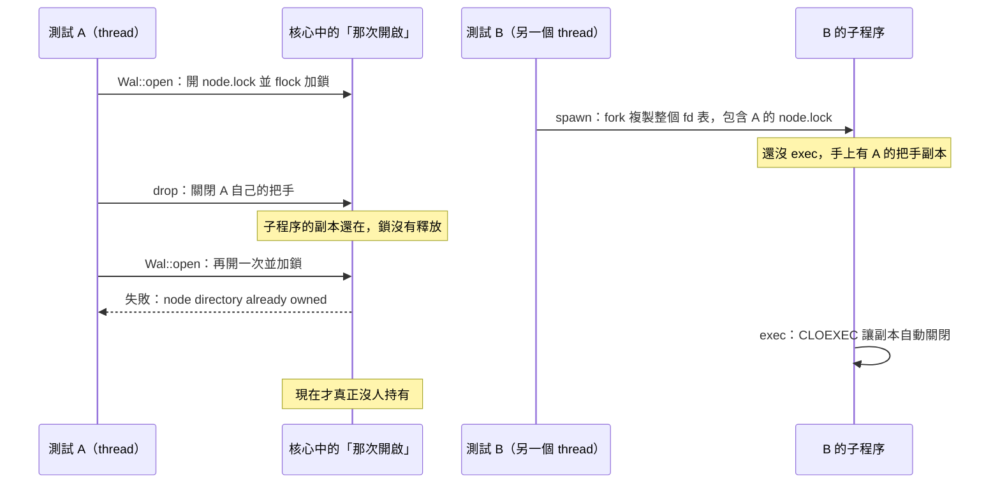

# 測試偶爾說「目錄已被佔用」，但明明只有自己在用

狀態：草稿

> 這篇的命令與輸出都實際執行過（2026-11-13），還沒有第二個人照著做一遍。
> 讀者設定：會寫程式、知道什麼是檔案，但沒碰過 `fork`、檔案鎖這些作業系統的細節。

發現日期：2026-11-13　｜　發現方式：新寫的測試第一次和其他測試一起跑時失敗　｜
影響範圍：只有測試程式 `crates/raft-storage/tests/crash_process.rs`，正式的節點程式不受影響　｜　修正：commit `6555fb9`

## 1. 一句話說後果

一個測試平常都會過，偶爾卻失敗，錯誤訊息說資料目錄「已經被別的程式佔用」；可是那時候根本沒有別的程式在用它。

這種「有時過、有時不過」的測試叫 flaky test。它最大的傷害不是那一次失敗，而是大家學會「失敗就重跑」，之後真的 bug 也被重跑蓋過去。
這篇會帶你親眼看到鎖是怎麼被「借走」的，並說明為什麼修測試、而不是修正式程式。

## 2. 需要的背景

**檔案描述子（file descriptor，簡稱 fd）。** 程式開啟一個檔案時，作業系統給它一個小整數當作把手，之後讀寫都透過這個把手。
同一個檔案可以同時有好幾個把手。

**檔案鎖 `flock`。** 本專案每個節點的資料目錄裡有一個 `node.lock`。節點啟動時對它加上「獨占鎖」，
目的是防止兩個程式同時寫同一份 WAL（那會毀掉資料）。加鎖時用的是「不等待」模式：拿不到就立刻回報錯誤 `node directory already owned`。
關鍵細節：**`flock` 的鎖綁在「開啟的檔案」本身，而不是綁在某個程式。** 只要還有任何一個把手指向那次開啟，鎖就還在。

**`fork` 與 `exec`。** Linux 上產生子程序分兩步：`fork` 先把目前程式複製一份（包含所有開著的把手），
`exec` 再把這份複製換成另一個程式。這兩步之間有一段很短的時間，子程序手上握著父程序所有把手的副本。

**`CLOEXEC`。** 開檔時可以標記「在 exec 時自動關閉」。Rust 開的檔案都有這個標記，所以子程序一 exec，那些副本就關掉了。
但在 exec 之前的那一小段時間，副本還在。

**`cargo test` 會平行執行測試。** 同一個測試程式裡的多個測試，預設在同一個 process 裡的不同 thread 同時跑。
所以「這個測試開著的檔案」和「那個測試 fork 出的子程序」可能在同一瞬間存在。

## 3. 親手重現

需要 Linux 或 WSL、Rust、Python 3；`strace` 可有可無。在專案根目錄執行：

```bash
docs/lessons/02-flaky-lock-inherited-by-child/repro.sh
```

約 15 秒。它只在暫存目錄裡工作，結束時刪除。完整輸出在 [expected-output.txt](expected-output.txt)。

**第 1 步：確認用的是哪一種鎖。** 用 `strace` 觀察真正的程式呼叫了什麼系統呼叫：

```text
   flock(3, LOCK_EX|LOCK_NB)               = 0
```

`LOCK_EX` 是獨占，`LOCK_NB` 是不等待。這證實 Rust 的 `File::try_lock` 在 Linux 上用的是 `flock`。

**第 2 步：把機制放大成必然發生。** [flock_demo.py](flock_demo.py) 先加鎖，再 fork 一個子程序，並故意讓子程序等一秒才 exec。
這一秒內，父程序關掉自己的把手、再開一次並重新加鎖：

```text
   parent: locked
   parent: closed its descriptor
   parent: re-lock FAILED while the child has not exec'd yet
   parent: re-locked after the child exec'd and exited
```

父程序已經關了自己的把手，卻拿不回鎖，因為子程序手上的副本還指向同一次開啟。子程序 exec 之後，副本被自動關閉，鎖才回來。

**第 3 步：真正的測試，修正前後各跑 40 次。** 腳本從目前的程式取出一份副本，拿掉修正（下一節會說明修正是什麼），重複執行整個測試程式：

```text
   without serialization: 20 failures in 40 runs
   example: install_before_snapshot_rename: second open: node directory already owned: ...
   with serialization:    0 failures in 40 runs
```

這是隨機現象，每次數字都不同。開發時實際量到的有：單獨跑這個測試 0/30、和其他測試一起跑 1/30、某次 2/5、教學腳本裡 20/40 與 23/40。
不管多少，「沒修時偶爾失敗、修了以後 0 次」是一致的。

## 4. 為什麼會這樣

出事的測試是 `real_process_crash_during_snapshot_install_recovers`。它在一個暫存目錄裡讓子程序寫到一半被終止，然後：

```rust
let (state, wal_bytes) = {
    let wal = Wal::open(&data, 1).unwrap();   // 加鎖
    // ...檢查...
};                                            // 離開區塊，wal 被釋放，把手關閉
let again = Wal::open(&data, 1)              // 立刻再開一次，又要加鎖
```

同一個測試程式裡還有另外三個測試，它們會 spawn `wal_probe`、`snapshot_probe` 這些子程序。如果時間剛好這樣交錯：



測試 B 的子程序跟測試 A 的目錄毫無關係，它只是在錯誤的時間被 fork 出來，順手帶走了一份把手。

為什麼舊的三個測試沒出過事？它們每次開啟之後就結束，沒有「關掉又立刻重開」的動作；新的測試多了「重開一次，確認結果相同」這個檢查，才踩到這個時間窗。

## 5. 為什麼嚴重

先說清楚：**這不影響正式執行的節點。** `raft-node` 不會 spawn 子程序，所以不會有別人在 fork 時帶走它的鎖；
這也不是 Raft 安全性的問題。嚴重的地方在於：

- **測試失去可信度。** 一個偶爾失敗的測試，會讓人習慣性重跑。下一次它失敗時，可能是真的 bug，卻被當成「又是那個不穩的測試」。
- **它很像真的 bug。** 錯誤訊息「目錄已被佔用」正是防止兩個程式同時寫 WAL 的保護在說話。第一反應很容易是懷疑 `Wal::open` 或 `install` 沒有把鎖放掉，
  然後去改正式程式。這篇的重點之一，就是在動手修之前先確認原因。
- **將來可能變成正式程式的問題。** 如果之後節點會 spawn 輔助程式（例如備份工具），同樣的機制就可能讓節點重啟時誤判目錄被佔用。
  那會是可用性問題（節點拒絕啟動），不是資料錯誤，因為這個保護在拿不到鎖時選擇的是拒絕。

## 6. 怎麼修

| 做法 | 評估 |
|---|---|
| **讓同一個測試程式裡的這幾個測試依序執行**（採用） | 原因只存在於「測試程式同時開鎖又 spawn 子程序」；依序執行就沒有重疊。四個測試合計只要約 0.2 秒，變慢可以忽略。正式程式不動 |
| 在 `Wal::open` 拿不到鎖時重試一小段時間 | 等於修改正式程式來遷就測試；而且會讓「真的有兩個程式在搶同一個目錄」晚一點才被發現 |
| 改用 POSIX `fcntl` 記錄鎖 | 這種鎖屬於「程式」，fork 出的子程序不會繼承，確實能避開。但它有另一個著名的陷阱：同一個程式裡只要關掉任何一個指向該檔案的把手，鎖就整個消失。為了測試換掉正式程式的鎖，風險比問題大 |
| 讓子程序在 exec 前不要拿到那些把手 | Rust 已經設了 `CLOEXEC`，問題就出在 exec 之前；要更早關掉需要在 fork 後執行自訂程式碼，複雜且容易出錯 |

修正寫在 `crates/raft-storage/tests/crash_process.rs`：

```rust
static SERIAL: std::sync::Mutex<()> = std::sync::Mutex::new(());
fn serial() -> std::sync::MutexGuard<'static, ()> {
    SERIAL.lock().unwrap_or_else(|poisoned| poisoned.into_inner())
}

#[test]
fn real_process_crash_during_snapshot_install_recovers() {
    let _serial = serial();   // 這個測試執行期間，其他會 spawn 子程序的測試都在等
    // ...
}
```

`unwrap_or_else(|poisoned| poisoned.into_inner())` 的意思是：就算前一個測試失敗而讓 mutex 進入「poisoned」狀態，後面的測試仍然照常執行，
不會因為一個失敗連帶讓其他測試都失敗。四個測試都加上了這一行。

## 7. 怎麼證明修好了

- **原因有直接證據**：第 3 節第 1 步的 `strace` 證實是 `flock`；第 2 步的實驗把時間窗放大到一秒，讓它每次都發生。
  另外用 `strace -f -e trace=clone3,execve` 觀察真正的測試程式如何產生子程序：

  ```text
  clone3({flags=CLONE_VM|CLONE_VFORK|CLONE_CLEAR_SIGHAND, exit_signal=SIGCHLD, ...})
  execve(".../target/debug/wal_probe", ...)
  ```

  這是 glibc 的 `posix_spawn`：flags 裡沒有 `CLONE_FILES`，代表子程序拿到的是一份**複製的** fd 表，
  直到 `execve` 才依 `CLOEXEC` 關掉。時間窗就在這兩行之間。
- **修正前後的對照**：同一份程式、同一台機器，拿掉修正時 40 次失敗 20 次，加上修正後 0 次。開發當時另外連跑 40 次也是 0 次。
- **首次失敗的原始輸出**保存在 `artifacts/audit/s2-flaky-lock/`（`failing-run.txt`、`rates.txt`、修正前的測試檔與環境資訊）。這個目錄被 Git 忽略，只存在開發機上。

要注意，第 3 步屬於統計證據：沒修時跑出 0 次失敗並不代表原因不存在，只是運氣好；修了之後若出現任何一次失敗，就代表還有別的問題。

## 8. 還沒解決的事

- 只修了這一個測試程式。目前專案裡同時「在測試 process 內開 WAL 鎖」又「spawn 子程序」的只有它；Python 的叢集測試雖然會 spawn 節點，但 Python 那一方不持有鎖。
  將來若有新的測試同時做這兩件事，要用同樣的方式處理。
- 沒有自動檢查能防止有人以後漏加這一行。目前只靠測試檔開頭的註解說明原因。
- 實際失敗率差異很大（1/30 到 23/40），沒有進一步量測是什麼因素影響時間窗的大小。

## 9. 自我檢查與練習

解答在 [answers.md](answers.md)。

1. 父程序明明已經關了自己的把手，為什麼還拿不回鎖？如果改用「綁在程式上」的鎖，結果會怎樣？
2. 為什麼這個問題只在「和其他測試一起跑」時出現，單獨跑這個測試就不會？
3. Rust 開的檔案都設了 `CLOEXEC`，為什麼還會發生？
4. 為什麼不在 `Wal::open` 裡加上「拿不到鎖就重試一秒」？請說出至少一個壞處。
5. 原本的三個測試也在同一個測試程式裡，為什麼一直沒出事？

**動手練習：讓時間窗消失再出現。**

- 起點：`flock_demo.py`。
- 目標：先預測：把子程序的 `time.sleep(1.0)` 改成 `0`，連跑 20 次，「re-lock FAILED」會出現幾次？再實際跑，並試 `0.01`、`0.1`。
- 怎麼知道做對了：你能解釋實際結果，以及它和真正的 Rust 測試「只是偶爾失敗」之間的差別。提示：比較「子程序從 fork 走到 exec」與「父程序關檔再重開」各要多久。

## 10. 面試時怎麼講

**兩分鐘版本**

- **情境**：我的 Raft 專案用檔案鎖防止兩個 process 同時寫同一份 WAL。我新增一個 crash 測試後，它大約每幾十次失敗一次，錯誤是「目錄已被佔用」。
- **怎麼查**：先確認不是正式程式漏放鎖——單獨跑 30 次都過，跟其他測試一起跑才失敗，所以懷疑是測試之間的互相影響。
  用 `strace` 確認鎖是 `flock`，再寫一個 fork 後延遲 exec 的小實驗，把現象變成每次都會發生。
- **根因**：`flock` 的鎖跟著「開啟的檔案」走。另一個測試 fork 子程序時複製了所有 fd，在 exec 之前子程序握著我的鎖的副本，所以我關掉再重開時拿不到。
- **修法與取捨**：讓會 spawn 子程序的那幾個測試依序執行。沒有去改正式程式的加鎖邏輯，因為正式節點不 spawn 子程序，而「拿不到就重試」會削弱防止雙寫的保護。
- **怎麼驗證**：修正前後同條件各跑 40 次，20 次失敗對 0 次失敗；原始輸出都有保存。
- **學到什麼**：遇到 flaky test 先找出時間窗並把它放大，而不是重跑到通過；以及「看起來像正式程式的 bug」不一定是。

**可能的追問**

- *「那為什麼不改用 fcntl 鎖？」* 它不會被 fork 繼承，但同一個 process 關掉任一個指向該檔案的 fd 就會釋放鎖，這在大型程式裡很危險；為了測試換鎖，風險大於收益。
- *「怎麼確定正式程式不會遇到？」* 節點本身不 spawn 子程序；整合測試用 Python 啟動節點，Python 那方不持有鎖。若將來加入會 spawn 的功能，要重新評估。
- *「flaky test 的一般處理原則？」* 先保留失敗輸出，量測失敗率，找出和時間或順序有關的共享資源，把時間窗放大成可重現，再決定修測試還是修程式。
