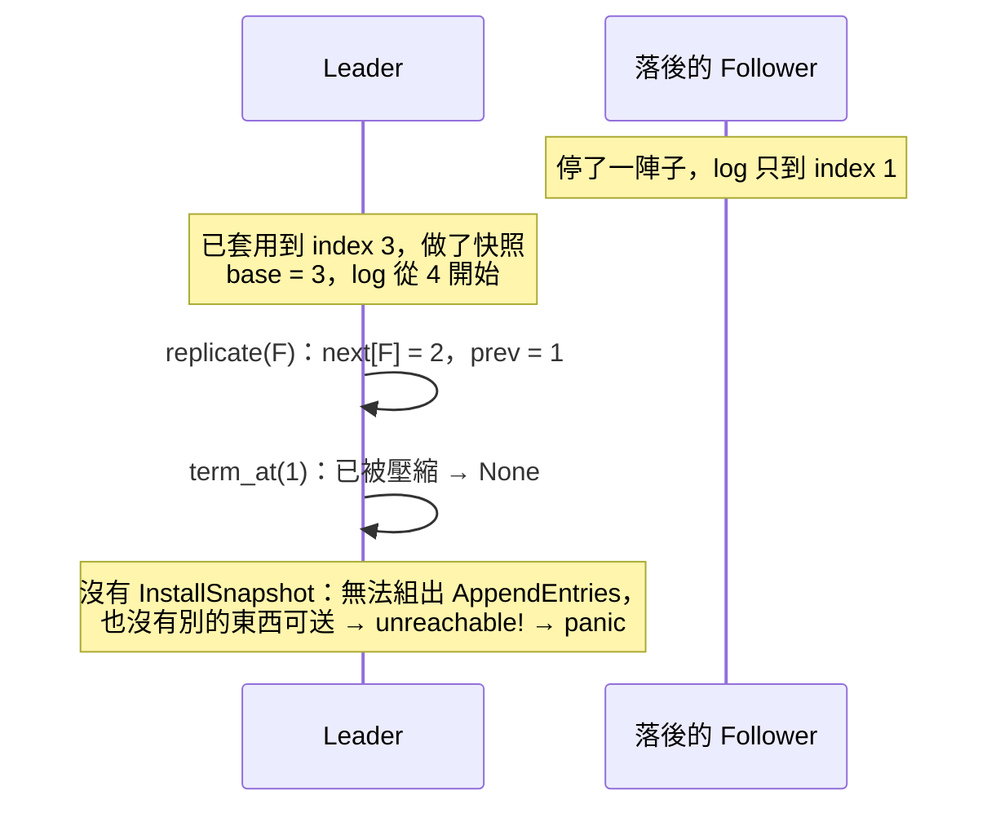

# 開啟 log 壓縮的那一刻，leader 就沒東西可以送了

狀態：草稿

> 這篇的命令與輸出都實際執行過（2026-11-13），還沒有第二個人照著做一遍。
> 讀者設定：讀過 [教學 01](../01-wal-length-corruption/README.md) 的背景，知道 Raft 的 leader 會把 log 複製給 follower。

發現日期：2026-11-13　｜　發現方式：S2 步驟 4 完成後跑模擬器　｜　影響的版本：從未 commit 的中間狀態　｜
修正：commit `a5023d7`（步驟 4 與 5 一起提交）

## 1. 一句話說後果

只要 log 開始被壓縮，遲早會有一個落後的 follower 需要 leader 已經丟掉的資料；這時候 leader 沒有任何東西可以送，
在本專案的程式裡它會當場停止（panic），在沒有防護的程式裡則可能永遠追不上、甚至讀錯資料。

這篇的「bug」不是某一行寫錯，而是**功能上線的順序錯了**。Raft 的作者在博士論文裡預先警告過這件事，我們照著規格做，還是親眼撞上了。
你會重現它、看懂 leader 卡在哪一步，並理解為什麼「壓縮」和「傳送快照」必須同時存在。

## 2. 需要的背景

**log 與 index。** leader 把每個寫入記成一筆 log entry，編號從 1 開始，叫 index。follower 的 log 要和 leader 一樣。

**AppendEntries 的一致性檢查。** leader 送 entry 給 follower 時，會附上「前一筆的 index 與 term」（`prev_log_index`、`prev_log_term`）。
follower 先確認自己在那個位置有一樣的 entry，才接受新的。對不上就拒絕，leader 往前退一筆再試。這是 Raft 保證「log 一樣」的方法。
leader 為每個 follower 記一個 `next`：下一筆要從哪裡送起。

**快照與壓縮（snapshot / log compaction）。** log 會一直變長。做法是把「已經套用到狀態機的部分」存成一份快照，然後丟掉對應的 log。
丟掉之後，log 從快照後面開始，這個起點叫 **base**（本專案的用語）：base 記著快照涵蓋的最後一筆的 index 與 term。

**InstallSnapshot。** 論文 Figure 13 定義的 RPC：leader 需要的 entry 已經被丟掉時，就把整份快照傳給 follower。

**模擬器。** 本專案的 `raft-sim` 用同一份 Raft 核心程式，在虛擬時間裡跑三台節點，隨機注入丟訊息、延遲、crash，
每一步都檢查安全性不變量。它能在幾秒內跑出真實環境很少遇到的情況，例如「某台節點落後很多」。

## 3. 親手重現

需要 Linux 或 WSL、Rust、Python 3。在專案根目錄執行：

```bash
docs/lessons/03-compaction-without-install-snapshot/repro.sh
```

約 10 秒（第一次編譯較久）。它把目前的程式取出兩份到暫存目錄，結束時刪除。完整輸出在 [expected-output.txt](expected-output.txt)。

**第 1 步：準備兩份程式。** 其中一份把 leader「改送快照」的那一行換回步驟 4 當時的樣子：

```rust
// 現在的程式
return self.send_snapshot_chunk(peer, effects);
// 換回步驟 4 當時（還沒有 InstallSnapshot）
unreachable!("log compaction is not enabled yet; entry {prev} was discarded")
```

**第 2 步：開著壓縮、沒有 InstallSnapshot，跑 60 個種子。**

```text
   thread 'main' (80653) panicked at crates/raft-core/src/lib.rs:412:13:
   reason: log compaction is not enabled yet; entry 2 was discarded
BUG REPRODUCED: a leader needed an entry it had already compacted away.
```

模擬器很快就遇到一個 leader 要送 entry 給 follower，卻發現前一筆（index 2）已經被自己壓縮掉了。

**第 3 步：同樣的模擬，換成有 InstallSnapshot 的版本。**

```text
   passed 60/60 seeds, 180000 events
   snapshots taken 3420, installed through InstallSnapshot 524
   invariants checked: I1, I2, I3, I4, I5, I6, I7
```

60 個種子全部通過。其中有 524 次是落後的節點透過 InstallSnapshot 追上的——就是第 2 步裡讓程式停住的那種情況。

## 4. 為什麼會這樣

leader 每次要複製給 follower p 時，都會做這件事（`crates/raft-core/src/lib.rs` 的 `replicate`）：

```rust
let next = self.next[p];
let prev = next - 1;
let Some(prev_log_term) = self.state.term_at(prev) else {
    // 前一筆已經被壓縮掉了
    return self.send_snapshot_chunk(peer, effects);
};
```

`term_at` 是 S2 步驟 1 加上的介面：查詢的 index 若已被壓縮，回傳 `None`。這正是我們想要的——讓「已經丟掉」成為呼叫端必須處理的情況。
步驟 1 時壓縮還沒開，所以這裡先寫成 `unreachable!`，意思是「理論上不會發生」。

以第 2 步的實際情況代入：



為什麼單元測試抓不到？因為這條路徑需要三件事同時發生：壓縮真的丟掉了 log、有 follower 落後到 base 之前、而且它在此時需要被複製。
單元測試通常只驗證「壓縮後 log 對不對」，不會剛好製造出落後的 follower。只有模擬器這種把整個叢集跑起來、還隨機讓節點停機的測試才會走到。

這正是博士論文 §5.1.3 寫的：

> "Until this point, we could only test the saving, loading, and transferring snapshots in isolation, but when log entries can be safely
> discarded, these can all start to be exercised in system-wide tests. … implementers should consider the order in which to implement
> and test these components carefully."

我們的規格（§12）照這段話安排了順序：先讓所有存取都安全（步驟 1），最後才開啟丟棄。但規格把「本機壓縮」（步驟 4）和
「InstallSnapshot」（步驟 5）分成兩步，並要求每一步結束時全部測試通過——實際上步驟 4 單獨存在時，模擬器必然失敗。
**規格本身的切分是錯的**，這是這次真正學到的地方。

## 5. 為什麼嚴重

這是**可用性**問題，不是資料錯誤：

- 本專案用 `unreachable!` 讓 leader 直接停止（fail-stop）。三台中停掉 leader，剩下兩台會重新選舉；但新的 leader 若也壓縮過，
  遇到同一個落後的 follower 又會停止。叢集可能反覆失去 leader，直到那台 follower 被移走。
- 如果沒有這層防護，而是像許多初版實作那樣直接用陣列位置 `log[prev - 1]` 取資料，壓縮後這個位置會指到錯誤的 entry 或越界。
  送出錯誤的 `prev_log_term` 會讓一致性檢查失去意義，那就可能變成安全性問題。本專案在步驟 1 把 log 欄位設成私有、強制經過 `term_at`，
  就是為了不讓這種情況靜悄悄地發生。
- 落後的 follower 不只是「慢的節點」。S4 要加入新節點時，新節點的 log 是空的，一定落在 leader 的 base 之前；沒有 InstallSnapshot，新節點永遠加不進來。

## 6. 怎麼修

修法就是把 InstallSnapshot 做出來（規格 §9），並和本機壓縮放在同一個 commit：

- leader 發現前一筆已被壓縮，就分塊傳送目前的快照，依 follower 回報的 `next_offset` 繼續，逾時就重送同一塊；傳送期間若又做了新快照，從新快照的開頭重來。
- follower 依論文 Figure 13 依序收塊、檢查長度與 CRC，全部收到後**先把快照與新的 WAL 寫入磁碟，再回覆成功**。
- 另一個相關情況也一併處理：follower 自己做了快照，leader 卻從更早的位置送 AppendEntries。快照內的 entry 已 commit，合法 leader 必然有相同內容，
  所以 follower 把它們當作相符，只檢查 base 那一筆的 term（規格 §9.4）。少了這條，leader 的 `next` 會一路退到 base 之前，永遠對不上。

考慮過的其他做法：

| 做法 | 為什麼沒選 |
|---|---|
| 照原規格先提交步驟 4，但模擬器暫時關掉壓縮 | 可以讓測試通過，但等於提交一個「開了就會出事」的功能，而且關掉壓縮的模擬器根本沒在測它 |
| 壓縮時保留一段 log（例如最後 1000 筆）給落後的節點 | 能減少需要送快照的次數，但不能消除；落後更多或新加入的節點仍然需要快照 |
| 只讓 leader 做快照，再推給所有 follower | 論文 §7 討論過：浪費頻寬，而且 leader 的程式更複雜；follower 自己就有做快照需要的資料 |

## 7. 怎麼證明修好了

- **單元測試**（`crates/raft-core/src/snapshot_tests.rs`）：`leader_sends_snapshot_chunks_in_order_and_resumes` 驗證 leader 在需要的 entry 已壓縮時改送快照、
  依序送完後回到 AppendEntries；`append_entries_that_start_before_the_base_count_as_matching` 驗證 §9.4；
  `follower_installs_only_after_the_snapshot_is_durable` 驗證先落盤後回覆。
- **模擬器**：1,000 個種子 × 10,000 個事件，壓縮頻率依種子分成「每筆都壓縮」、每 2、3、5、8 筆，以及不壓縮的對照組。
  結果記在 `artifacts/reports/simulation.json`，連同它所對應的來源指紋。
- **三個真實 process**：`tests/integration/test_snapshot.py::test_lagging_follower_catches_up_via_snapshot` 停掉一台 follower、
  寫入到 leader 已壓縮過它需要的位置，再把它啟動，確認它經由 InstallSnapshot 追上，且歷史通過線性一致性檢查。
- **Mutation**：`s2_no_append_before_base_rule` 拿掉 §9.4 的處理，對應的測試會失敗。
- **首次失敗**：第 3 節第 2 步就是當時的失敗重現。當時的原始輸出只在對話紀錄中，沒有另存檔案；`repro.sh` 是用目前的程式把同一行改回去重建出來的。

## 8. 還沒解決的事

- 快照在節點的 actor 裡同步產生與安裝，期間節點不處理其他事件。資料很大時可能拖過選舉逾時。目前只記錄耗時，沒有量測上限。
- 快照是整份重送，沒有斷點續傳到磁碟：follower 收到一半時重啟，要從頭再收。
- 傳送速度沒有調校；論文也指出這通常不是關鍵，因為需要快照的節點本來就沒參與 commit。
- 規格的步驟切分錯誤已在本篇與 commit 訊息中記錄；規格文件 §12 本身未改寫，保留當時的原文以便對照。
- 模擬器只檢查安全性，不檢查活性。第 9 節的練習實際顯示：拿掉 §9.4 的處理後，模擬器 60 個種子全部通過，只有單元測試抓得到。

## 9. 自我檢查與練習

解答在 [answers.md](answers.md)。

1. leader 的 `term_at(prev)` 回傳 `None` 有哪兩種可能？在 `replicate` 裡，為什麼只可能是其中一種？
2. 為什麼單元測試沒有在步驟 4 抓到這個問題，模擬器卻立刻抓到？
3. 如果實作是直接用 `log[prev - 1]` 取資料，壓縮後會發生什麼？為什麼這可能比 panic 更糟？
4. follower 自己做了快照（base 是 10），leader 送來 `prev_log_index = 7` 的 AppendEntries。沒有 §9.4 的處理時，接下來會怎樣？
5. 「每一步結束時所有測試都要通過」這條規則本身沒錯，那規格錯在哪裡？

**動手練習：讓模擬器替你找另一個缺口。**

- 起點：`repro.sh` 建出的兩份副本做法。
- 目標：在副本的 `crates/raft-core/src/lib.rs` 裡，把 §9.4 那段的條件 `if prev_log_index < base.index` 改成 `if false && prev_log_index < base.index`，
  然後跑 `cargo test -p raft-core append_entries_that_start_before_the_base` 和 60 個種子的模擬。
- 怎麼知道做對了：單元測試會失敗。先預測模擬器會不會失敗，再實際跑；解釋你看到的結果（提示：想想「卡住」和「違反不變量」的差別，以及模擬器檢查的是哪一種）。

## 10. 面試時怎麼講

**兩分鐘版本**

- **情境**：我在 Raft 專案加 log 壓縮。照博士論文的建議，先把 log 的存取全改成會回報「已被壓縮」的介面，再一步步開啟功能。
- **發生什麼**：本機壓縮做完、還沒做 InstallSnapshot 時跑模擬器，第一個落後的 follower 就讓 leader 停住——它要送的前一筆已經被自己丟掉，沒有任何東西可送。
- **根因**：不是哪行程式寫錯，而是功能切分錯了。壓縮會製造出「只有快照能救」的情況，所以壓縮和 InstallSnapshot 必須同時上線。論文其實預先警告過這點。
- **為什麼重要**：這是可用性問題；落後或新加入的節點永遠追不上。如果實作直接用陣列位置取 log，還可能送出錯誤的 prev term，變成安全性問題。
  我事先把 log 欄位設成私有，所以它是明確的 panic，而不是靜悄悄的錯誤。
- **修法與驗證**：分塊實作 InstallSnapshot，並處理 AppendEntries 起點在 follower 快照之前的情況；用 1,000 個種子的模擬器（包含每筆都壓縮）、
  真實三 process 的落後節點測試、以及 mutation 測試驗證。
- **學到什麼**：把「不應該發生」寫成明確的失敗，讓測試能抓到；規劃增量交付時，要檢查每一步單獨存在時是否成立，而不只是最後的成品。

**可能的追問**

- *「為什麼不讓 leader 保留一段 log 就好？」* 可以減少送快照的次數，但不能消除；新加入的節點 log 是空的，一定需要快照。
- *「快照傳到一半 leader 換人怎麼辦？」* 新 leader 有自己的快照與 term；follower 收到不同身分（term、位置、長度、CRC）的分塊就丟掉進行中的接收，從頭開始。
- *「follower 回覆成功之前一定要寫磁碟嗎？」* 要。leader 收到成功就把它的進度設成快照位置；如果 follower 只放在記憶體裡就回覆，當機後它會比 leader 以為的更舊。
