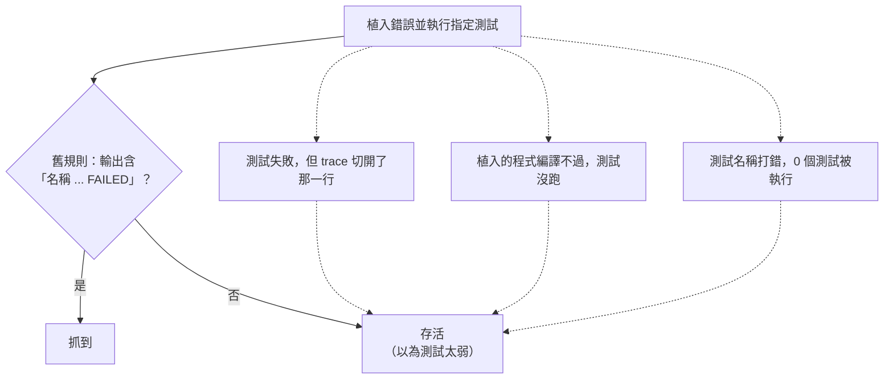

# 檢查測試的工具，自己也會說錯話

狀態：草稿

> 這篇的命令與輸出都實際執行過（2026-11-13），還沒有第二個人照著做一遍。
> 讀者設定：知道什麼是單元測試；不需要懂 Raft。

發現日期：2026-11-13　｜　發現方式：S2 驗收前執行 mutation 測試，兩個案例被報為「存活」　｜
影響範圍：`scripts/mutation_check.py`（驗證工具），不影響節點程式　｜　修正：本篇所在的 commit

## 1. 一句話說後果

mutation 測試工具報告「有兩個故意植入的錯誤沒被測試抓到」，等於指控那兩個測試太弱；但實際上一個測試早就失敗了，另一個根本沒有執行。

工具說錯話，後果有兩種：一是白白去「加強」本來就有效的測試；更糟的是另一個方向——工具若把沒執行的測試說成「抓到了」，
我們就會以為某條安全規則有測試保護，其實沒有。這篇帶你看三個讓工具說錯話的原因，以及現在它怎麼分辨。

## 2. 需要的背景

**mutation 測試（突變測試）。** 測試通過，不代表它真的在檢查東西。mutation 測試的做法是：在程式的副本裡**故意植入一個錯誤**（例如把「先驗證再截斷」改成「先截斷再驗證」），
然後跑指定的測試。測試失敗，叫做「抓到」（detected）；測試仍然通過，叫做「存活」（survived），代表這個測試擋不住這種錯誤。
本專案的 `scripts/mutation_check.py` 有 25 個這樣的案例，驗收契約要求每一個都被抓到。

**錨點（anchor）。** 工具靠「在原始碼裡找到一段文字，換成另一段」來植入錯誤。這段要被換掉的原文就是錨點，它在檔案中必須剛好出現一次。

**libtest 的輸出。** `cargo test` 執行測試時，會印出 `test 名稱 ... ok` 或 `test 名稱 ... FAILED`，最後印出 `test result: ...` 與失敗清單。
測試裡用 `println!` 印的東西預設會被「攔截」起來，只在失敗時顯示。但**直接寫到程序 stdout 的內容攔截不到**——本專案節點的 trace 就是這樣寫的。

## 3. 親手重現

需要 Linux 或 WSL、Rust、Python 3。在專案根目錄執行：

```bash
docs/lessons/04-mutation-checker-false-survivors/repro.sh
```

約 10 秒。它把目前的程式取出一份到暫存目錄，結束時刪除。完整輸出在 [expected-output.txt](expected-output.txt)。

**第 2a 步：兩份開發時實際捕捉到的輸出。** [observed-1.txt](observed-1.txt)、[observed-2.txt](observed-2.txt) 是 `saturated_pool_spin` 這個植入錯誤在兩次真實執行時的輸出
（原始檔約 50 MB，大部分是 trace；這裡只保留 libtest 自己的行，篩選方式寫在檔頭）。關鍵的一行：

```text
     test tests::saturated_outbound_pool_does_not_starve_status ... {"commit_index":2,"details":{"event":
   old rule : SURVIVED
   new rule : detected
```

`test 名稱 ... ` 後面本來應該接 `FAILED`，卻被一行節點的 trace 插進來。舊的判斷規則是「輸出中有沒有 `名稱 ... FAILED` 這串字」，於是判為存活。
但同一份輸出裡，測試的 panic 訊息與結尾的失敗清單都清清楚楚：測試確實失敗了。

**第 2b 步：即時再跑一次。** 這一次剛好沒被切開，新舊規則都判對：

```text
     test tests::saturated_outbound_pool_does_not_starve_status ... FAILED
   old rule : detected
   new rule : detected
```

這就是它難抓的原因：交錯是隨機的。S1 驗收時跑過一次，碰巧沒被切開，所以當時通過了。

**第 3 步：一個為舊版程式寫的植入錯誤。**

```text
   compiler: error[E0061]: this function takes 4 arguments but 3 arguments were supplied
   old rule : SURVIVED
   new rule : build_error
```

S2 讓 `write_atomically` 多了一個參數，這個植入錯誤的程式碼還照舊版寫，編譯不過，測試根本沒跑。舊規則沒有區分，報成「存活」。

**第 4 步：一個漂走的錨點。**

```text
   S1 anchor of wal_ignore_file_header occurs 0 times in the current source
```

S2 把 `check_file_header(&header, node_id)?;` 改成 `let start = check_file_header(&header, node_id)?;`，原本的錨點就找不到了。
工具會報錯停下，但它是跑到第 12 個案例才發現，前面 11 個案例的時間都白費了。

## 4. 為什麼會這樣

三個原因，根源相同：**工具用「輸出長得像什麼」來推斷「發生了什麼」，而且只想到一種情況。**



1. **輸出交錯。** 節點的 `trace` 用 `io::stdout().lock()` 直接寫入，不經過 libtest 的攔截；而 libtest 會把一行結果分好幾次寫出。
   兩邊同時寫，trace 就可能落在「`test 名稱 ... `」與「`FAILED`」之間。原本 S1 的版本還加了 `--nocapture`，讓測試自己的輸出也直接印出，交錯更容易發生。
2. **編譯失敗被當成「存活」。** 舊規則只看 libtest 的結果；編譯失敗時根本沒有結果，於是落入「沒看到 FAILED」的那一邊。
3. **錨點依賴原文。** 錨點是一段固定文字，只要那一行被重構，植入就失效。

還有一個這次沒有實際發生、寫練習時才想到的情況：測試名稱打錯，`cargo test` 會執行 0 個測試並且**成功結束**，舊規則一樣報成「存活」。第 9 節的練習會實際跑一次。

## 5. 為什麼嚴重

這不影響節點的正確性，但它破壞的是「我們怎麼知道測試有效」這件事：

- **假的存活**會讓人去改一個本來就有效的測試，甚至懷疑起它保護的那條規則。這次兩個被點名的測試，一個保護「連線池滿了也不能餓死狀態查詢」，一個保護「已用過的節點遺失 WAL 時必須拒絕啟動」，都是重要的保護。
- **反方向更危險。** 如果工具把「沒執行」當成「抓到」，驗收就會在沒有任何證據的情況下通過。舊工具在這點上做對了：編譯失敗不算抓到。這次的修正保留了這個保守的方向，只是把原因說清楚。
- **驗收依賴它。** 契約的階段 10、11 要求 mutation 報告中每個案例都被抓到，工具誤報會直接擋住驗收，或者讓人想去「放寬」它。

## 6. 怎麼修

| 問題 | 修法 |
|---|---|
| 輸出交錯 | 不再依賴單一一行。三種訊號任一出現就算抓到：結果行 `test 名稱 ... FAILED`、panic 訊息 `thread '名稱' panicked at`、結尾失敗清單中的 `    名稱`。這三者都指名是哪個測試。也拿掉了 `--nocapture` |
| 編譯失敗 | 判定為 `build_error`，與「存活」分開報告。它同樣不算抓到 |
| 測試名稱錯誤 | 輸出中完全沒有 `test 名稱 ... ` 時，判定為 `test_not_run` |
| 錨點漂移 | 在執行任何案例之前，先檢查全部錨點都剛好出現一次；另有單元測試在每次 `pytest` 時檢查 |

另外加了 `mutation_check.py 案例名稱 ...` 只跑指定案例的選項，方便修正後快速確認；這種部分執行的報告會標示 `partial`，不會覆寫驗收用的報告。

判定的核心（`scripts/mutation_check.py`）：

```python
def classify(test, stdout, stderr):
    if re.search(r"^error(\[E\d+\])?: could not compile", stderr, re.MULTILINE):
        return "build_error"
    name = rf"(\S+::)?{re.escape(test)}"
    both = stdout + "\n" + stderr
    signals = [rf"^test {name} \.\.\. FAILED$", rf"thread '{name}' (\(\d+\) )?panicked at", rf"^    {name}$"]
    if any(re.search(signal, both, re.MULTILINE) for signal in signals):
        return "detected"
    if not re.search(rf"^test {name} \.\.\. ", both, re.MULTILINE):
        return "test_not_run"
    return "survived"
```

沒有選擇的做法：讓 libtest 輸出 JSON（目前要 nightly 的不穩定選項）；或改掉節點 trace 的寫法（那是正式程式的行為，為了測試工具去改它不划算）。

## 7. 怎麼證明修好了

- `scripts/test_mutation_check.py` 有 6 個測試，涵蓋：一般的失敗；**這次實際觀察到的被切開輸出**，以及名稱只出現在失敗清單中的情況（同一個測試）；
  名字相近的別的測試失敗（不能算數）；0 個測試被執行；編譯失敗；以及全部 25 個錨點在目前的程式中都剛好出現一次。
- 第 3 節的第 2a、3 步是確定性的：同一份真實輸出，舊規則判錯、新規則判對。
- 修正後只跑那兩個案例：兩個都判為「抓到」。之後的完整執行（25 個案例）結果記在 `artifacts/reports/mutations.json`，它所對應的來源指紋也寫在裡面。

## 8. 還沒解決的事

- 判定仍然依賴 libtest 的文字格式。Rust 改變輸出格式時，`test_mutation_check.py` 會失敗提醒，但不會自動適應。
- 「抓到」只代表指定的測試失敗，不代表它是**因為這個植入錯誤**而失敗；理論上也可能是同時發生的其他問題。目前沒有比對失敗訊息的內容。
- 錨點仍是字串比對。重構常常讓它失效，只是現在會在一開始就報錯。
- **S3 期間又發生一次（2026-11-13）**：為了確認新的模擬器不變量 I8 有效，我寫了一個臨時腳本植入「不等本任期 entry commit」的錯誤。
  `cargo fmt` 已把那個條件拆成兩行，錨點不符，Python 回報 `AssertionError`；但外層命令沒有因此中止，繼續執行了**未修改的**程式，回報 300/300 通過。
  若只看最後一行，會得出「I8 抓不到這種錯誤」的錯誤結論。修正錨點後重跑，第 1 個種子就被抓到。正式的 `mutation_check.py` 不會有這個問題（它先檢查所有錨點），
  但臨時實驗同樣需要「植入失敗就整個失敗」。

## 9. 自我檢查與練習

解答在 [answers.md](answers.md)。

1. 為什麼 `println!` 印的東西不會切開 libtest 的結果行，節點的 trace 卻會？
2. 編譯失敗時，為什麼「判為存活」比「判為抓到」安全？那為什麼還要另外標成 `build_error`？
3. 新規則接受三種訊號。如果只接受 panic 訊息，會漏掉哪種失敗的測試？
4. 為什麼錨點檢查要在「執行任何案例之前」做，而不是在每個案例開始時？
5. 一個植入錯誤被判為「抓到」，就一定代表那個測試對這種錯誤有效嗎？

**動手練習：一個打錯字的測試名稱。**

- 起點：在專案根目錄。
- 目標：先預測：`cargo test -p kv-state older_sequence_after_newer_is_rejected_without_efect`（少了一個 f）會怎樣結束？舊規則與新規則各會怎麼判？再實際執行，並用 `classify` 判斷它的輸出。
- 怎麼知道做對了：你能說出 cargo 的結束碼、執行了幾個測試，以及新規則給出的判定和理由。

## 10. 面試時怎麼講

**兩分鐘版本**

- **情境**：我用 mutation 測試確認安全規則真的有測試保護：故意植入錯誤，要求對應的測試失敗。驗收前它報告兩個植入錯誤「存活」。
- **怎麼查**：先看原始輸出，而不是相信報告。一個測試其實有失敗，panic 訊息和失敗清單都在，只是節點的 trace 直接寫 stdout，切開了 libtest 的結果行；另一個植入錯誤是為舊版程式寫的，根本編譯不過。
- **根因**：工具用單一一行文字推斷結果，沒有區分「沒執行」與「執行後通過」。
- **修法**：用三種都會指名測試的訊號判定「抓到」；把編譯失敗與測試沒執行分別標出來；在開始前先檢查所有錨點。並用這次實際捕捉到的輸出寫成回歸測試。
- **學到什麼**：驗證工具也要被驗證，而且它的錯誤方向很重要——寧可把「不確定」報成失敗，也不能把「沒證據」報成通過。

**可能的追問**

- *「mutation 測試的成本很高，值得嗎？」* 本專案只植入挑選過的錯誤（25 個），每個對應一條安全規則；它回答的是「這條規則有沒有測試在保護」，這比覆蓋率更直接。
- *「為什麼不用現成的 mutation 工具？」* 現成工具會產生大量隨機變異，難以對應到具體的安全規則；這裡需要的是「這條規則若被破壞，這個測試會不會失敗」。
- *「怎麼避免錨點一直失效？」* 開始前全部檢查只是讓它早點報錯。更根本的做法是把錨點放在不常變動、語意明確的位置，或用語法層級的修改代替文字取代；目前沒有做。
