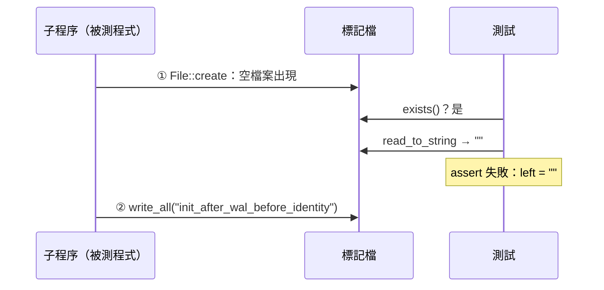

# 檔案已經存在，不代表內容已經寫好

狀態：草稿

> 這篇的命令與輸出都實際執行過（2026-11-13），還沒有第二個人照著做一遍。
> 讀者設定：知道程式怎麼開檔、寫檔；不需要懂 Raft。建議先讀 [教學 01](../01-wal-length-corruption/README.md) 第 2 節的「殘尾」。

發現日期：2026-11-13　｜　發現方式：S2 完整驗收的階段 11 出現一次失敗　｜
影響範圍：測試用的中斷點機制（`crates/raft-storage/src/lib.rs` 的 `failpoint`），從 V1 就存在；正式執行不會用到　｜
修正：本篇所在的 commit

## 1. 一句話說後果

一個從 V1 用到現在的 crash 測試偶爾會失敗，錯誤是「讀到的標記是空字串」：測試看到標記檔已經存在就去讀，而被測的程式還沒把內容寫進去。

這個 bug 本身很小，但它和本專案的 WAL 設計是同一個道理：**「檔案存在」和「檔案內容完整」是兩件事。** WAL 的初始化、快照、身分檔都用「先寫暫存檔、再 rename」來處理這件事；
這個測試用的標記檔卻漏了。

## 2. 需要的背景

**中斷點（failpoint）與標記檔。** 為了測試「程式在某一步被強制終止後能不能回復」，儲存層在幾個關鍵位置埋了中斷點。
測試透過環境變數告訴子程序「停在哪一步」，子程序到達時寫一個**標記檔**，內容是那一步的名稱，然後原地等待。
測試看到標記檔出現，就知道子程序停在正確的位置，再對它送 SIGKILL。

**建立檔案不等於寫入。** `File::create` 會先在目錄裡產生一個空檔案，`write_all` 才寫入內容。兩者之間，任何人去看都會看到一個存在、但是空的檔案。

**rename 是原子的。** 在同一個檔案系統內，`rename(a, b)` 要嘛還沒發生（`b` 不存在或是舊的），要嘛已經完成（`b` 就是完整的新檔），不會被看到一半。
所以「寫完暫存檔再 rename 成正式名字」能保證：看得到正式名字，就看得到完整內容。

**輪詢（polling）。** 測試用一個迴圈每隔 5 毫秒檢查一次標記檔是否存在。

## 3. 親手重現

需要 Linux 或 WSL、Rust、Python 3。在專案根目錄執行：

```bash
docs/lessons/05-marker-seen-before-written/repro.sh
```

約 10 秒。它把目前的程式取出兩份到暫存目錄，結束時刪除。完整輸出在 [expected-output.txt](expected-output.txt)。

**第 0 步：實際發生過的那一次。** [observed-failure.txt](observed-failure.txt) 是驗收階段 11 保存下來的原始輸出：

```text
   thread 'real_process_crash_during_initialization_recovers' (35105) panicked at crates/raft-storage/tests/crash_process.rs:130:5:
   assertion `left == right` failed
     left: ""
    right: "init_after_wal_before_identity"
```

測試預期標記內容是 `init_after_wal_before_identity`，讀到的卻是空字串。同一個測試幾分鐘前在階段 10 才通過。

**第 1～3 步：把時間窗拉大。** 一份副本放回舊的寫法（原地建立再寫入），另一份是現在的寫法（寫暫存檔再 rename）。
兩份都在各自的「兩個動作之間」插入 300 毫秒的等待（用環境變數 `RAFT_WAL_MARKER_GAP_MS` 控制，正常執行不會設定）：

```text
== 2. Old version, 300 ms between creating and writing the marker
   result: FAIL
   assertion `left == right` failed
     left: ""

== 3. Current version, 300 ms between writing and renaming the marker
   result: pass
```

舊寫法每次都失敗；新寫法即使在 rename 前等了 300 毫秒，測試也只會看到「還不存在」或「完整」兩種狀態。

## 4. 為什麼會這樣

舊的中斷點程式（從 tag `v1-baseline-verified-20261112` 起就是這樣）：

```rust
if let Ok(marker) = std::env::var("RAFT_WAL_FAILPOINT_MARKER")
    && let Ok(mut file) = File::create(marker)   // ① 空檔案出現了
{
    let _ = file.write_all(name.as_bytes());     // ② 內容才寫進去
    let _ = file.sync_all();
}
```

測試端（`crates/raft-storage/tests/crash_process.rs`）：

```rust
while !marker.exists() && Instant::now() < deadline {   // 每 5 ms 看一次
    std::thread::sleep(Duration::from_millis(5));
}
assert_eq!(fs::read_to_string(marker).unwrap(), boundary); // 看到就讀
```



失敗需要測試的某一次輪詢剛好落在 ① 與 ② 之間。這段時間通常只有微秒，而測試每 5 毫秒才看一次，所以極少撞上。
第 9 節的練習實際量過：在舊寫法中再多等 1 毫秒，10 次都沒失敗；多等 10 毫秒（超過輪詢間隔），10 次全部失敗。
這也解釋了為什麼它從 V1 到現在一直沒被發現：S2 的完整驗收把這類測試跑了很多次（每個階段都重跑前面階段的測試），才終於撞上一次。

## 5. 為什麼嚴重

**對正式程式沒有影響**：中斷點只在測試設定環境變數時才會啟動，正常執行的節點不會寫標記檔。也不是 Raft 的安全性問題。

但它有三個實際的代價：

- **驗收被擋下。** 驗收要求每個具名測試都通過，一次偶發失敗就讓整輪約 40 分鐘的驗收重來。
- **誤導除錯方向。** 這個測試驗證的是「初始化在任何一步被中斷都能接續」。看到它失敗，第一個懷疑會是初始化的回復邏輯壞了，而那正是 S1 的重點功能；真正的原因卻在測試的工具上。
- **它是設計原則的反例。** 本專案在 WAL 上花了很多力氣處理「寫到一半」：S1 的殘尾判定、S2 的快照「先寫暫存檔再 rename」。同一個專案裡卻有一個檔案沒照這個原則寫，
  而且從第一版就在。這提醒我們：原則要套用到所有「別人會讀的檔案」，包括只給測試看的。

## 6. 怎麼修

讓標記檔和專案裡其他重要檔案一樣，先寫暫存檔、再 rename：

```rust
if let Ok(marker) = std::env::var("RAFT_WAL_FAILPOINT_MARKER") {
    let temporary = format!("{marker}.tmp");
    if let Ok(mut file) = File::create(&temporary) {
        let _ = file.write_all(name.as_bytes());
        let _ = file.sync_all();
        marker_failpoint_gap();               // 只在教學重現時拉大時間窗
        let _ = fs::rename(&temporary, &marker);
    }
}
```

| 其他做法 | 為什麼沒選 |
|---|---|
| 測試端改成「等到內容不是空的才讀」 | 只修了讀的一方；另一個讀者（或將來的新測試）還是會踩到。而且「內容不是空的」也不等於「內容完整」 |
| 測試看到檔案後再多等一下 | 用時間猜測，換一台慢的機器就不夠了 |
| 改用 pipe 或 socket 通知 | 可以，但比現在的機制複雜得多；rename 已經足以保證完整性 |

`marker_failpoint_gap` 只讀取環境變數 `RAFT_WAL_MARKER_GAP_MS`，沒有設定時什麼都不做。它存在的目的是讓第 3 節能確定地重現問題、並證明修正在最壞的時機下仍然成立。

## 7. 怎麼證明修好了

- 第 3 節的第 2、3 步是確定性的：同樣插入 300 毫秒，舊寫法必定失敗、新寫法必定通過。
- 修正後，`crash_process` 的 4 個真實 process 測試連跑 3 次都通過；設定 300 毫秒等待時也通過。
- 修正後重新執行的完整驗收（階段 00～11）結果記在 `artifacts/acceptance-final/`；以 `scripts/status.py` 核對。
- 原始失敗的輸出與 receipt 保存在 `artifacts/audit/s2-marker-race/`（被 Git 忽略，只在開發機上）。

## 8. 還沒解決的事

- 只修了儲存層的中斷點。`raft-node` 另有一套中斷點，它的運作方式不同（讀取控制檔、到達時直接結束 process，由 Python 測試檢查結束碼），沒有標記檔，因此沒有同樣的問題；但沒有逐一檢查其他測試工具是否還有「存在即完整」的假設。
- 沒有自動檢查能發現這類問題。它在 V1 就存在，靠的是大量重複執行才撞上一次。
- 偶發失敗發生的頻率沒有量測；只知道在大量重跑中出現過一次。

## 9. 自我檢查與練習

解答在 [answers.md](answers.md)。

1. 為什麼 rename 能解決這個問題，而「先寫入再 `sync_all`」不能？
2. 測試每 5 毫秒才看一次。如果改成不停地檢查（不睡），這個 bug 會更容易還是更難出現？
3. WAL 的殘尾判定（教學 01）和這個 bug 有什麼共同點？
4. 為什麼不把測試端改成「讀到空字串就重讀」？
5. 這個 bug 從 V1 就存在，為什麼直到 S2 才第一次出現？

**動手練習：時間窗要多大才會出事？**

- 起點：`repro.sh` 建出的「舊版本」副本做法。
- 目標：先預測，再把 `RAFT_WAL_MARKER_GAP_MS` 分別設為不設定、`1`、`10`，各跑 10 次 `real_process_crash_during_initialization_recovers`，數失敗次數。
- 怎麼知道做對了：你能用測試的輪詢間隔解釋結果，並說出真實情況下這個時間窗大約有多長。

## 10. 面試時怎麼講

**兩分鐘版本**

- **情境**：我的 Raft 專案用中斷點測試 crash 回復：子程序到達指定步驟時寫一個標記檔，測試看到標記就殺掉它。完整驗收時，一個從第一版就有的測試第一次失敗，讀到的標記是空字串。
- **根因**：子程序是「建立檔案、再寫內容」，測試是「看到檔案存在就讀」。兩者之間有一個極短的時間窗，平常 5 毫秒一次的輪詢很少撞上。
- **怎麼確認**：在兩個動作之間插入可設定的等待，讓失敗變成必然；再用同樣的等待證明修正後不會再發生。
- **修法**：和專案裡的 WAL、快照一樣，先寫暫存檔再 rename，讓「看得到」等於「寫完了」。
- **學到什麼**：「檔案存在」和「內容完整」是兩件事；這個原則要套用到所有會被別人讀的檔案，不只是資料檔。另外，偶發失敗要先把時間窗放大成可重現，而不是重跑到通過。

**可能的追問**

- *「為什麼 rename 是原子的？」* 在同一個檔案系統中，rename 只是改目錄項目指向哪個 inode，作業系統保證其他程序看到的是改之前或改之後；跨檔案系統就不是了，所以暫存檔要放在同一個目錄。
- *「需要 fsync 目錄嗎？」* 對資料檔需要（本專案的 WAL 與快照都會同步目錄），因為要保證斷電後 rename 仍然生效。標記檔只給同一台機器上正在執行的測試看，不需要跨越斷電，所以沒有同步目錄。
- *「還有哪裡可能有同樣的問題？」* 任何「一方寫檔、另一方輪詢讀檔」的地方都要檢查，例如設定檔熱重載、工作佇列的檔案交接。
