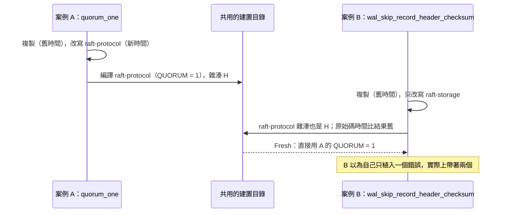

# 原始碼寫的是 2，執行的卻是 3：共用建置目錄的 mutation 互相污染

狀態：草稿

> 這篇的命令與輸出都實際執行過（2026-11-13），還沒有第二個人照著做一遍。
> 讀者設定：會用 `cargo build`；不需要懂 Raft。建議先讀 [教學 04](../04-mutation-checker-false-survivors/README.md) 第 2 節的 mutation 測試介紹。

發現日期：2026-11-13　｜　發現方式：S3 驗收前執行 mutation 測試，30 個案例中有 28 個報告編譯失敗　｜
影響範圍：`scripts/mutation_check.py`，以及 S1、S2 時期以它產生的 mutation 報告　｜　修正：本篇所在的 commit

## 1. 一句話說後果

mutation 測試會為每個案例複製一份程式、植入一個錯誤、再編譯執行；但所有案例共用同一個 cargo 建置目錄，結果**後面的案例會悄悄執行前面案例植入了錯誤的程式碼**。

這次是因為後果太明顯才被發現：一個案例把 `QUORUM` 改成 1，之後幾乎每個案例都在編譯時撞上 `QUORUM - 2` 溢位。
更麻煩的是它在 S1、S2 時期就存在，只是當時沒有東西會編譯失敗——那些「全部抓到」的報告裡，有些案例可能其實是被前一個案例的錯誤弄失敗的。

## 2. 需要的背景

**cargo 的建置目錄（target directory）。** cargo 把編譯結果放在 `target/`，下次編譯時重用沒有變動的部分。
環境變數 `CARGO_TARGET_DIR` 可以讓多個專案共用同一個建置目錄，省去重複編譯第三方套件的時間。

**cargo 怎麼判斷「不用重新編譯」。** 每個 crate 的編譯結果有一個識別雜湊（在編譯命令中以 `-C metadata=...` 出現）。
對工作區內的 crate，這個雜湊**不包含它在磁碟上的絕對位置**，所以同一個專案的兩份複本會得到一樣的雜湊，共用建置目錄時就會指向同一份編譯結果。
接著 cargo 比較原始碼檔案的修改時間與上次編譯的時間：原始碼沒有比較新，就認為結果仍然有效（`Fresh`）。

**保留修改時間的複製。** Python 的 `shutil.copytree` 預設使用 `copy2`，會把原檔的修改時間一起複製過去。複本的檔案時間因此是「原檔當初被修改的時間」，通常比任何一次編譯都早。

## 3. 親手重現

需要 Linux 或 WSL、Rust、Git。在專案根目錄執行：

```bash
docs/lessons/06-mutants-sharing-a-build-directory/repro.sh
```

約 20 秒。它在暫存目錄建立兩份複本，結束時刪除。完整輸出在 [expected-output.txt](expected-output.txt)。

**第 1 步：植入錯誤的複本。** `mutant` 把 `QUORUM` 改成 3，用共用的建置目錄編譯並執行 `quorum_is_two_of_three`：

```text
   source: 6:pub const QUORUM: usize = 3;
   copy mutant, target dir 'shared': cargo says 'Compiling raft-protocol'; test FAIL
```

測試失敗是應該的：這個複本確實植入了錯誤。

**第 2 步：完全沒改過的複本，保留舊的修改時間，用同一個建置目錄。**

```text
   source: 6:pub const QUORUM: usize = 2;
   copy clean, target dir 'shared': cargo says 'Fresh raft-protocol'; test FAIL
   thread 'quorum_is_two_of_three' (149277) panicked at crates/raft-sim/tests/foundation.rs:35:9:
   assertion failed: has_quorum(&pair)
```

原始碼明明寫著 2，cargo 卻說 `Fresh`，沒有重新編譯；測試執行的是 `mutant` 留下的 `QUORUM = 3`，所以失敗了。

**第 3 步：同一份乾淨的複本，改用自己的建置目錄。**

```text
   copy clean, target dir 'own': cargo says 'Compiling raft-protocol'; test pass
```

**第 4 步：為什麼會共用。**

```text
   mutant (step 1):         metadata=2ef2aa09102a885f
   clean  (step 3, own dir): metadata=2ef2aa09102a885f
   identical: in a shared target directory they occupy the same files
```

兩份複本在不同的目錄，cargo 給它們的 `raft-protocol` 同一個雜湊。

## 4. 為什麼會這樣

`mutation_check.py` 原本的做法：

```python
work = destination / name
shutil.copytree(ROOT / "crates", work / "crates")     # copy2：保留原檔的修改時間
...
path.write_text(source.replace(original, mutated, 1))  # 只有被植入的那個檔案是新的時間
env["CARGO_TARGET_DIR"] = str(destination / "build")  # 所有案例共用
```



每個案例只會重新編譯「自己改寫過的那個 crate」以及依賴它的 crate；其他 crate 都沿用最近一次編譯的結果，而那個結果可能來自別的案例。

這次 S3 在 core 加了 `acks.get(QUORUM - 2)`。`quorum_one` 把 `QUORUM` 改成 1，`1 - 2` 在編譯期就溢位；之後每個沿用這份 `raft-protocol` 的案例都編譯失敗，問題才浮出水面。
實驗也確認了因果：同一個案例單獨跑時被正確抓到；排在 `quorum_one` 之後就變成編譯失敗。

## 5. 為什麼嚴重

**它削弱的是「測試有效」的證據。** mutation 測試的意義是「這個錯誤**單獨**存在時，指定的測試會失敗」。若案例 B 其實同時帶著 A 的錯誤：

- B 的測試失敗，可能是 A 的錯誤造成的；B 的「抓到」就不能證明那個測試擋得住 B 的錯誤。
- 反過來，A 的錯誤也可能掩蓋 B 的錯誤，讓某個案例看起來「存活」。

S1、S2 的完整 mutation 執行都是這種共用方式。案例順序固定，排在最前面的四個依序改的是 `raft-protocol`（`quorum_one`）、`raft-core`（`unsafe_old_term_commit`）、
`raft-sim`（`reversed_queue`）、`raft-node`（`saturated_pool_spin`），所以之後的案例都可能沿用其中幾個錯誤。**哪些「抓到」是真的、哪些是被污染的，事後已無法逐一區分。**
只用少數案例的那幾次（S2 收尾時的兩個案例、S3 的五個案例）推論上沒有受到影響：前者兩個案例改的 crate 互不依賴，後者每個案例都改寫並重新編譯同一個 `raft-core`。
這是推論，沒有逐一驗證。修正後重新執行的完整報告，才是第一份每個案例都隔離的證據。

**附帶發現：一個不安全的預設值。** 讓這件事浮現的那行程式，本身也有問題：

```rust
let confirmed = acks.get(QUORUM - 2).copied().unwrap_or(u64::MAX);
```

取不到值時預設為 `u64::MAX`，意思是「所有回合都已確認」。目前固定三台節點，`acks` 一定有兩個元素，這個分支不會走到；
但 S4 改成依成員設定計算多數後，若回覆的 follower 不夠，這個預設值會讓 leader 在**沒有多數確認**的情況下回覆讀取。已改為取不到就是 0（什麼都沒確認）。

## 6. 怎麼修

| 做法 | 評估 |
|---|---|
| **每個案例使用自己的建置目錄**（採用） | 完全不依賴修改時間，正確性由結構保證。實測冷編譯：單一 crate 約 5～6 秒，整個工作區約 11 秒；30 個案例多花幾分鐘 |
| 複製時不保留修改時間（`shutil.copy`） | 實測有效：在前一個案例編譯之後才複製的檔案時間較新，cargo 會重新編譯（練習有實測）。但它依賴時間順序，換個執行方式就可能失效 |
| 每個案例後清除工作區 crate 的編譯結果 | 可以，但要知道哪些檔案屬於工作區 crate，比獨立目錄更容易出錯 |

另外加了一道**對照組**：在植入任何錯誤之前，先用未修改的複本，把每個被指名的測試都跑一次，必須全部通過。
這樣「植入後失敗」才能歸因於植入的錯誤；若對照組本身失敗，整個執行就停下來。

```python
def cargo_test(work, test, package):
    env["CARGO_TARGET_DIR"] = str(work / "target")     # 每個複本自己的建置目錄
    ...
    shutil.rmtree(work / "target", ignore_errors=True)  # 只刪這次建立的目錄
```

## 7. 怎麼證明修好了

- 第 3 節第 2、3 步是確定性的：同一份乾淨的複本，共用建置目錄時測試失敗，獨立建置目錄時通過。
- 修正後再跑造成污染的那一對案例（`quorum_one` 之後接 `wal_skip_record_header_checksum`）：兩個都正確判定為「抓到」，對照組兩個測試都通過。
- 修正後的完整 mutation 報告（`artifacts/reports/mutations.json`）記有 `"isolation"` 欄位、對照組的結果，以及它所對應的來源指紋。

## 8. 還沒解決的事

- S1、S2 tag 所附的 mutation 證據是在共用建置目錄下產生的，無法事後重建當時的隔離結果；只能以修正後、對目前來源的完整報告為準。這點也記在各階段規格的補記中。
- `unwrap_or(0)` 這個修正在目前固定三台節點的設定下無法用測試觸發（`acks` 永遠夠長）。要等 S4 的成員設定能改變節點數時，才能寫出對應的測試。已列入 S4 的待辦。
- 獨立建置目錄讓每個案例都重新編譯第三方套件，耗時比共用時多；目前規模可以接受。

## 9. 自我檢查與練習

解答在 [answers.md](answers.md)。

1. 兩份複本放在不同的目錄，為什麼 cargo 會認為它們的編譯結果可以共用？
2. 第 2 步的 `clean` 複本，如果修改時間是「現在」而不是舊的，結果會怎樣？
3. 為什麼對照組要在植入錯誤**之前**跑，而不是只看植入後有沒有失敗？
4. `unwrap_or(u64::MAX)` 在固定三台節點時不會出事，為什麼還要改？
5. 如果某個 mutation 案例在污染下被報為「抓到」，能不能說「那個測試一定沒用」？

**動手練習：修改時間的作用。**

- 起點：`repro.sh` 的做法。
- 目標：先預測，再實際做：在 `mutant` 用共用建置目錄編譯**之後**，才建立一份乾淨的複本，**不**保留舊的修改時間，然後用同一個共用建置目錄執行 `quorum_is_two_of_three`。cargo 會說 `Fresh` 還是 `Compiling`？測試會過嗎？
- 怎麼知道做對了：你能說出結果，並解釋為什麼「不保留修改時間」只在特定的時間順序下才有效。

## 10. 面試時怎麼講

**兩分鐘版本**

- **情境**：我用 mutation 測試驗證安全規則：每個案例複製一份程式、植入一個錯誤，要求指定的測試失敗。為了省時間，所有案例共用 cargo 的建置目錄。
- **發生什麼**：某次加了一行 `QUORUM - 2` 之後，30 個案例裡 28 個編譯失敗——它們根本沒改 `QUORUM`，卻都看到 `QUORUM = 1`。
- **根因**：同一個工作區的兩份複本，cargo 給它們同一個編譯雜湊；複製時又保留了舊的修改時間，所以 cargo 認為別的案例留下的結果仍然有效。每個案例其實帶著前面案例的錯誤。
- **修法**：每個案例用自己的建置目錄，並先跑一次沒植入錯誤的對照組。實測冷編譯只要 5～11 秒，代價很小。
- **學到什麼**：快取是正確性的風險來源；驗證工具要能證明「這次的結果只來自這次的輸入」。另外，這個 bug 之前的報告看起來全部正常，正是因為污染沒有讓任何東西明顯壞掉——要誠實地說，那些舊報告的證據力比我們以為的弱。

**可能的追問**

- *「為什麼 cargo 的雜湊不含路徑？」* 讓同一份程式在不同位置編譯出相同的結果（可重現建置）是刻意的設計；問題在我們把它和「保留舊修改時間的複製」組合起來使用。
- *「那 CI 共用快取安全嗎？」* CI 通常從乾淨的 checkout 開始，檔案時間是新的，而且同一時間只有一份原始碼；危險在於同一個快取目錄被多份**內容不同**的原始碼輪流使用。
- *「怎麼知道舊報告哪些是真的？」* 無法事後區分。能做的是用修正後的工具重跑，並在文件中標明舊證據的限制。
