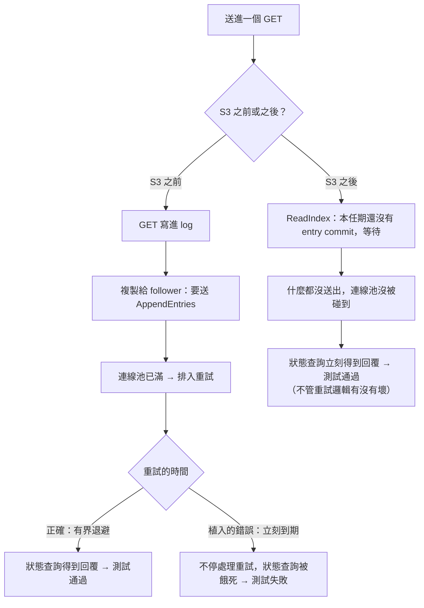

# 測試還是綠的，但它已經不測它該測的東西了

狀態：草稿

> 這篇的命令與輸出都實際執行過（2026-11-13），還沒有第二個人照著做一遍。
> 讀者設定：讀過 [教學 04](../04-mutation-checker-false-survivors/README.md) 第 2 節的 mutation 測試介紹；知道 S3 讓 GET 不再寫進 log 即可，不需要懂 ReadIndex 的細節。

發現日期：2026-11-13　｜　發現方式：隔離後的第一次完整 mutation 執行，一個植入錯誤「存活」　｜
影響範圍：`crates/raft-node/src/main.rs` 的測試 `saturated_outbound_pool_does_not_starve_status`　｜　修正：本篇所在的 commit

## 1. 一句話說後果

S3 改了 GET 的運作方式之後，有一個測試在完全沒被修改的情況下，**失去了它要保護的那條規則**：它照樣通過，卻再也抓不到它本來該抓的錯誤。

沒有任何測試失敗、沒有任何警告。發現它的是 mutation 測試：故意把那條規則改壞，這個測試卻沒有反應。這篇帶你看一個測試是怎麼「悄悄變成空殼」的，以及為什麼只有 mutation 測試看得出來。

## 2. 需要的背景

**這個測試在保護什麼。** 節點對其他節點送 RPC 時，最多同時開 128 條連線（連線池）。連線池滿了，新的 RPC 要稍後重試。
工程強化階段發現過一個 bug：重試被排在「立刻到期」，節點可能不停地處理重試，餓死其他請求（例如狀態查詢）。
修正後改成有界的退避；這個測試就是要確認：**連線池滿的時候，排在後面的狀態查詢仍然會被回覆。**
（依 `docs/ENGINEERING_HARDENING.md` 的紀錄，這個 bug 是用「直接構造連線池已滿的 actor」的回歸測試驗證的，沒有用 128 條真實的慢連線重現完整路徑。）

**這個測試怎麼製造情境。** 它把連線池的計數直接設成「已滿」，讓節點以 leader 身分啟動，然後送進一個用戶端請求——這個請求會讓 leader 想要把資料複製給 follower，於是撞上已滿的連線池、進入重試。
接著送一個狀態查詢，要求 1 秒內得到回覆。

**S3 改了什麼。** S3 之前，GET 和寫入一樣會寫進 log、複製給 follower；S3 之後，GET 走 ReadIndex：新上任的 leader 要先等自己任期的 entry commit，期間讀取只是**等待**，不會送出任何東西。

**mutation 測試。** 在副本裡故意植入一個錯誤，要求對應的測試失敗。這裡植入的是當初那個 bug：把重試時間改回 `Instant::now()`（立刻到期）。

## 3. 親手重現

需要 Linux 或 WSL、Rust、Git。在專案根目錄執行：

```bash
docs/lessons/07-test-silently-stopped-testing/repro.sh
```

約 1 分鐘（要建置三個版本）。它在暫存目錄工作，結束時刪除。完整輸出在 [expected-output.txt](expected-output.txt)。

腳本對三個版本各做兩件事：不植入錯誤執行一次（對照組），以及植入「立刻重試」的錯誤後再執行一次。同時數一數節點試著送出了幾個 RPC。

```text
== s2-snapshot-compaction-verified  (before S3: the test sends a GET, and a GET is replicated)
   control (no mistake planted): test pass; RPCs the node tried to send: 2
   with the busy-retry mistake planted: test FAIL -> mistake detected

== 54ff116  (after S3, before the fix: the test sends a GET, a GET is a ReadIndex read)
   control (no mistake planted): test pass; RPCs the node tried to send: 0
   with the busy-retry mistake planted: test pass -> mistake NOT detected

== HEAD  (current: the test sends a Put)
   control (no mistake planted): test pass; RPCs the node tried to send: 2
   with the busy-retry mistake planted: test FAIL -> mistake detected
```

看中間那一組：測試本身一個字都沒改，對照組照樣通過，但節點送出的 RPC 變成 0。沒有 RPC，就不會碰到連線池，也就不會進入重試——植入的錯誤根本沒有被執行到，所以測試也就抓不到它。

## 4. 為什麼會這樣

測試的關鍵幾行（修正前）：

```rust
core.role = Role::Leader;                                     // 直接設成 leader
let mut actor = Actor { outbound_active: Arc::new(AtomicUsize::new(CONNECTIONS)), /* 連線池已滿 */ .. };
tx.send(Input::Client(ClientRequest { operation: Operation::Get { key: "x".into() }, .. }, client_tx));
tx.send(Input::Status(status_tx));
let status = status_rx.recv_timeout(Duration::from_secs(1))  // 狀態查詢必須在 1 秒內回覆
    .expect("pool saturation must not starve queued status");
```



這個測試的有效性建立在一個**沒有寫出來的假設**上：「送一個 GET，leader 就會去複製」。S3 讓這個假設不再成立。
測試的斷言只檢查「狀態查詢有沒有回覆」，不檢查「重試路徑有沒有被走到」，所以假設失效時，它不會失敗，只會變成永遠通過。

為什麼之前沒發現？S3 之後的前兩次完整 mutation 執行，都被 [教學 06](../06-mutants-sharing-a-build-directory/README.md) 的建置污染干擾：
一次報告為編譯失敗，另一次是在共用建置目錄下執行。把每個案例隔離之後的第一次執行，它才以「存活」出現。

## 5. 為什麼嚴重

- **它保護的是一個真實找到過的 bug。** 「連線池滿時重試排成立刻到期，餓死其他請求」是工程強化階段的審查發現，而這個測試是它唯一的回歸測試。
  這個測試失效之後，若有人不小心把重試改回去，所有測試仍會通過。
- **綠燈的意義被悄悄改變了。** 測試報告沒有任何變化，看的人無從得知。這比測試失敗更危險：失敗的測試會有人去修，失效的測試不會。
- **改動和失效之間沒有明顯的關聯。** S3 改的是讀取的語意，這個測試是關於連線池與重試；檢查「S3 會影響哪些測試」時，很難想到它。
  S3 的規格與實作時都有逐一檢查用到 GET 的 Python 測試，但這個 Rust 測試把 GET 當成「製造複製工作的工具」，不是在測試 GET 本身，因此被漏掉了。

## 6. 怎麼修

讓測試直接送一個**寫入**：寫入一定會寫進 log、一定會觸發複製，不依賴讀取的實作方式。並在測試裡寫明為什麼用寫入。

```rust
// A write, so that the leader must replicate into the saturated pool.
// Until S3 this was a GET, which also replicated; since S3 a GET waits
// for ReadIndex and sends nothing, so the test stopped exercising the pool.
operation: Operation::Put { key: "x".into(), value: "v".into() },
```

| 其他做法 | 為什麼沒選 |
|---|---|
| 讓測試先完成 commit，GET 才會真的送出確認回合 | 可以，但讓測試依賴 ReadIndex 的細節，將來讀取再改時又可能失效 |
| 在測試裡加一個斷言：「節點確實試著送出了 RPC」 | 值得做，能讓這類失效直接以失敗出現；但需要讓測試能觀察到這件事。目前先以 mutation 測試把關，列為後續改進 |
| 不改，只依賴 mutation 測試 | mutation 測試已經抓到了，但它不在每次 `cargo test` 時執行；測試本身應該是有效的 |

## 7. 怎麼證明修好了

- 第 3 節的三組對照是確定性的：修正後節點又會送出 2 個 RPC，植入的錯誤又會被抓到。
- 修正後連續 3 次單獨執行這個 mutation 案例，3 次都判定為「抓到」，對照組都通過。
- 隔離後的完整 mutation 報告（`artifacts/reports/mutations.json`）中，這個案例判定為「抓到」。

## 8. 還沒解決的事

- 測試仍然沒有直接斷言「重試路徑被走到」。下一次有改動讓寫入不再觸發複製時，同樣的事可能再發生；目前靠 mutation 測試在驗收時發現。
- 這次是 mutation 測試剛好有一個案例對應這個測試，才被發現。沒有對應 mutation 案例的測試，若也以類似方式失效，不會被發現。
- 第 9 節的練習逐一檢查了其他用到 GET 的測試，結論是它們仍然有效；但那是人工判斷，不是自動檢查。

## 9. 自我檢查與練習

解答在 [answers.md](answers.md)。

1. 這個測試在 S3 之後為什麼會「永遠通過」，而不是「永遠失敗」？
2. 對照組（沒有植入錯誤）在三個版本都通過。為什麼只看對照組看不出問題？
3. 「送一個 GET，leader 就會去複製」這個假設寫在測試的哪裡？
4. 如果要讓這種失效直接以測試失敗呈現，可以在測試中多加什麼斷言？
5. 為什麼 S3 的規格在檢查「受影響的測試」時漏掉了它？

**動手練習：找出其他可能悄悄失效的測試。**

- 起點：`grep -rn '"Get"' tests/integration tools` 與 `grep -rn "Operation::Get" crates`。
- 目標：逐一判斷每個用到 GET 的測試，在 S3 之後是否仍然測到它原本要測的東西。特別注意那些把 GET 當成「工具」而不是「測試對象」的地方，例如用 GET 回覆的 `committed_index` 等待其他節點追上。
- 怎麼知道做對了：你能對每一個說出判斷依據；和解答的結論比對。

## 10. 面試時怎麼講

**兩分鐘版本**

- **情境**：我把 Raft 的讀取改成 ReadIndex，GET 不再寫進 log。改完之後所有測試都通過。
- **怎麼發現**：驗收時的 mutation 測試報告一個植入錯誤「存活」——那是一個保護「連線池滿時不能餓死其他請求」的回歸測試。
- **根因**：那個測試用 GET 來製造「leader 要去複製」的情境。ReadIndex 之後，新 leader 的 GET 只是等待、不送任何東西，連線池根本沒被用到。測試的斷言只看結果，所以變成永遠通過。
- **怎麼確認**：在三個版本上各跑一次對照組與植入錯誤，並數節點送出的 RPC：2、0、2。同一個測試在 S3 前後，一個抓得到錯誤、一個抓不到。
- **修法**：改用寫入製造複製工作，並在測試裡寫明這個前提。
- **學到什麼**：測試會因為不相干的改動而悄悄失效，綠燈不代表它還在保護什麼。mutation 測試問的是「有錯誤時它會不會失敗」，這是對照組回答不了的問題；而沒有寫出來的前提，就是失效的起點。

**可能的追問**

- *「怎麼避免下一次？」* 讓測試同時斷言它的前提成立（例如確實嘗試過 RPC 並進入重試），前提消失時測試就會失敗；另外讓 mutation 測試涵蓋每一條重要規則。
- *「你怎麼確定其他測試沒有同樣的問題？」* 我逐一檢查了所有用到 GET 的測試，判斷它們把 GET 當成測試對象還是工具；結論與依據都記在教學的解答裡。但那是人工判斷，不是自動保證。
- *「mutation 測試為什麼之前沒抓到？」* 它其實在 S3 之後第三次完整執行才報出來；前兩次被建置目錄的污染干擾，這是另一個 bug，修好之後才看到這個。
