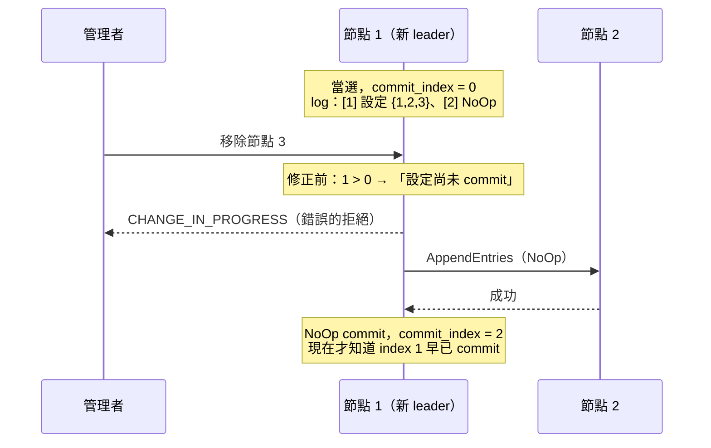

# 剛選出的 leader，把早就 commit 的設定當成「還在進行中」

狀態：草稿

> 這篇的命令與輸出都實際執行過（2026-11-13），還沒有第二個人照著做一遍。
> 讀者設定：知道 Raft 有 leader、log 與「commit」；不需要讀過成員變更的規格，第 2 節會補上。

發現日期：2026-11-13　｜　發現方式：單元測試（新寫的測試第一次執行就失敗）　｜
影響的版本：S4 開發中的程式，修正前沒有任何 commit 含有這個錯誤（重現腳本以 patch 還原）　｜　修正：commit `eebe7b8` 起；重現以 `62e61d1` 為準

## 1. 一句話說後果

叢集剛換 leader 時，任何增減節點的請求都會被拒絕，理由是「已經有變更在進行中」——但其實什麼都沒有在進行。

錯的不是某一行計算，而是**兩個檢查的先後順序**：程式在 leader 還不知道哪些 entry 已 commit 的時候，就去判斷「有沒有尚未 commit 的設定」。
這篇帶你用一行命令看到它，再看為什麼新 leader 在那一刻「不可能知道」，以及順序對調之後為什麼就對了。

## 2. 需要的背景

**設定（configuration）存在 log 裡。** 哪些節點有投票權，記在一筆特殊的 log entry 裡，例如 `Config {1,2,3}`。
成員變更就是 leader 附加一筆新的設定 entry。規則之一：前一筆設定 entry commit 之前，不能開始下一個變更（博論 §4.1）。
所以程式需要問：「log 裡有沒有尚未 commit 的設定 entry？」有的話就回 `CHANGE_IN_PROGRESS`。

**commit index：「我知道已經 commit 到哪裡」。** 每個節點有一個數字 `commit_index`。它只存在記憶體裡（論文 Figure 2 把它列為 volatile state），
節點剛啟動或剛當選時，它從快照的位置（沒有快照就是 0）開始，之後只會往上加。
關鍵在「我知道」：一筆 entry 可能已經 commit 了，但這個節點還不知道。好比你寄出的掛號信已經送到，但回執還沒寄回來——信送到了，你卻還不能確定。

**新 leader 什麼時候才知道？** Raft 規定 leader 只靠「數副本」來 commit **自己任期**的 entry（博論 §3.6.2）：
"Raft never commits log entries from previous terms by counting replicas. Only log entries from the leader's current term are committed by counting replicas;
once an entry from the current term has been committed in this way, then all prior entries are committed indirectly"。
論文還特別說，就算舊 entry 已經存在**每一台**上、其實可以安全地判定 commit，"Raft takes a more conservative approach for simplicity"。
所以新 leader 上任時會先附加一筆 NoOp，等它 commit，才知道之前的一切都已 commit。

**2015 年的修正。** 成員變更還有一條規則（raft-dev 郵件，2015）：
"a leader may not append a new configuration entry until it has committed an entry from its current term"。
也就是說，leader 本來就**必須**等 NoOp commit 之後才能處理成員變更。這條規則是本篇的解法的一半。

## 3. 親手重現

需要 Linux 或 WSL、Rust、Git。在專案根目錄執行：

```bash
docs/lessons/08-judged-before-the-term-commit/repro.sh
```

約 1～2 分鐘（要建置兩個版本）。它在暫存目錄工作，結束時刪除。完整輸出在 [expected-output.txt](expected-output.txt)。

腳本取出 commit `62e61d1`（已修正）的程式碼兩份，其中一份把檢查改回修正前的順序，然後各執行一次測試
`a_new_leader_waits_for_a_committed_entry_of_its_term`。這個測試建立三台都已有 `Config {1,2,3}`（index 1）的叢集，讓節點 1 當選後**立刻**要求移除節點 3。

```text
== before the fix: 'uncommitted configuration?' is judged first
   test a_new_leader_waits_for_a_committed_entry_of_its_term: FAIL
   the request waits instead of failing: [(40, Err("CHANGE_IN_PROGRESS"))]

== after the fix (62e61d1): wait for a committed entry of this term, then judge
   test a_new_leader_waits_for_a_committed_entry_of_its_term: pass
```

看第一段的最後一行：請求 40 得到 `CHANGE_IN_PROGRESS`。但這個叢集裡沒有任何變更在進行，唯一的設定 entry 在三台節點上都有。

## 4. 為什麼會這樣

修正前，leader 收到請求時是這樣檢查的（`crates/raft-core/src/lib.rs` 的 `change_membership`）：

```rust
let (index, _) = self.configuration().expect("a leader has a configuration");
if self.pending_change.is_some() || index > self.commit_index {
    return effects.push(fail("CHANGE_IN_PROGRESS"));   // 「有尚未 commit 的設定」
}
// ……登記請求，之後才等本任期的 entry commit（2015 修正）
```

帶入測試中的數值：

| 項目 | 值 |
|---|---|
| 最新設定 entry 的 index | 1（三台都有，實際上早就 commit） |
| 節點 1 當選後的 log | index 1 = 設定（term 1）、index 2 = NoOp（term 2，還沒送出去） |
| 節點 1 的 `commit_index` | **0**（剛當選，還不知道任何 entry 已 commit） |
| 判斷 `index > commit_index` | `1 > 0` → 「設定尚未 commit」→ 拒絕 |



錯誤在於把 `commit_index < x` 讀成「x **沒有** commit」。它真正的意思是「我**不知道** x 已 commit」。
在 leader 自己任期的 entry commit 之前，這兩件事差很多：新 leader 對任何之前的 entry 都「不知道」。

為什麼會寫成這個順序？規格草稿（`docs/MEMBERSHIP.md` §7 的初版）就是這樣排的：先檢查「有沒有進行中的變更」，再處理 2015 修正的等待。
寫的時候把「log 裡有沒有未 commit 的設定」當成 log 的一個客觀性質，忘了 leader 對 commit 的認知在當選後的一段時間內必然落後。
測試照規格寫，程式照規格寫，是測試的斷言（「請求應該等待，而不是失敗」）和規格的步驟互相矛盾，才在第一次執行時暴露出來。

## 5. 為什麼嚴重

**先說清楚：這不是安全性問題。** 它只會拒絕本來安全的變更，不會放行不安全的變更；資料不會因此遺失或分歧。

它是可用性與正確回報的問題：

- **每次換 leader 後都會發生。** 從當選到 NoOp commit 之間（正常情況下幾毫秒；若 follower 很慢或暫時連不上多數，可能更久），所有成員變更都被拒絕。
- **錯誤訊息是錯的。** `CHANGE_IN_PROGRESS` 告訴操作者「有別的變更在跑，等它完成」。會自動重試的工具（例如本專案的 `tools/cluster.py`）看不出問題；
  不重試的呼叫者會得到錯誤的結論。而需要換 leader、換節點的時候，往往正是叢集出狀況、操作者最需要正確資訊的時候。
- **背後的誤解更危險（推論）。** 同一個「commit index 在當選後落後」的事實，也是 S3 的 ReadIndex 必須先等 NoOp commit 的原因。
  如果某個檢查把「不知道」當成「已 commit」，結果就不只是誤拒，而是放行：例如在舊任期未 commit 的設定還可能生效時就附加新設定，那正是 2015 年反例的起點。

## 6. 怎麼修

既然 2015 修正要求 leader 本來就得先等本任期的 entry commit，就**先等，再判斷**：

```rust
// change_membership：只剩「同時只處理一個請求」的檢查
if self.pending_change.is_some() {
    return effects.push(fail("CHANGE_IN_PROGRESS"));
}
self.pending_change = Some(PendingChange { id, change, phase: Phase::WaitForTermCommit });
self.proceed_change(effects);

// proceed_change：本任期有 entry commit 之後才繼續
if !self.committed_in_term() {
    return; // 等待；下一次 commit 時再進來
}
let (index, voters) = self.configuration().expect("a leader has a configuration");
if index > self.commit_index {
    // 到了這裡，之前任期的 entry 都已 commit；還沒 commit 的設定
    // 只可能是這個 leader 在本任期為先前（已取消）的請求附加的
    return …CHANGE_IN_PROGRESS;
}
```

等到本任期的 NoOp commit 之後，leader 的 `commit_index` 已經涵蓋了所有之前任期的 entry，`index > commit_index` 才真的代表「尚未 commit」。

| 其他做法 | 為什麼沒選 |
|---|---|
| 把 `commit_index` 寫進磁碟，重啟或當選時就知道 | 新 leader 的問題不是重啟，而是「別人 commit 的它還不知道」；而且博論 §4.1 特意避免要求節點把 commit index 落盤 |
| 照舊回 `CHANGE_IN_PROGRESS`，讓呼叫者重試 | 這就是 bug 的行為；狀態碼會誤導操作者 |
| 新增一個狀態碼，例如「還沒準備好」 | 可行，郵件也說 "rejecting or delaying" 都可以；但等待更好用（一個請求一個答案），也和 ReadIndex 的做法一致 |

規格 `docs/MEMBERSHIP.md` §7 的步驟順序也一起改正了。

## 7. 怎麼證明修好了

- `a_new_leader_waits_for_a_committed_entry_of_its_term`（`crates/raft-core/src/membership_tests.rs`）：新 leader 的 NoOp 還沒 commit 時送出請求，
  斷言 (1) 沒有附加任何設定 entry（2015 修正），(2) 請求**沒有**立刻得到答案，(3) NoOp commit 後變更完成。修正前在 (2) 失敗，訊息附上實際得到的答案。
- `change_requests_are_checked_and_one_runs_at_a_time`：確認修正沒有把檢查拿掉。本任期已 commit 之後，log 中真的有未 commit 的設定（請求已取消、entry 還在）時，仍然回 `CHANGE_IN_PROGRESS`；commit 之後下一個變更才能進行。
- Mutation 案例 `s4_judge_uncommitted_before_term_commit`：把「設定尚未 commit」的判斷搬回等待之前，上面第一個測試必須失敗。
- 首次失敗的紀錄：2026-11-13 第一次執行 `cargo test -p raft-core` 時，`membership_tests.rs:471` 的斷言 "the request waits instead of failing" 失敗（當時的訊息還沒有附上答案；第 3 節的輸出是後來加上答案後重跑的）。

## 8. 還沒解決的事

- 等待本身沒有上限：若新 leader 一直無法 commit 它的 NoOp（例如連不上多數），請求會一直等到節點程式的 15 秒期限，回覆 `TIMEOUT_UNKNOWN`。這是預期行為，但等待的時間不是由 core 決定。
- 「本任期 commit 之後，未 commit 的設定只可能是自己附加的」依賴 Raft 的「每個 term 最多一個 leader」。這由選舉的測試與模擬器的 I1 保證，本篇沒有另外測。
- 這次是新寫的測試剛好問了「請求應該等待」，才在第一次執行時發現。若測試只檢查「最後有沒有完成」，配合會重試的工具，這個錯誤可能一直不會被注意到。

## 9. 自我檢查與練習

解答在 [answers.md](answers.md)。

1. 測試裡三台節點都存有 index 1 的設定，為什麼新 leader 的 `commit_index` 還是 0？
2. 如果把判斷反過來寫成「不知道就當作已 commit」，會發生什麼事？
3. 為什麼等本任期的 NoOp commit 之後，`index > commit_index` 就真的代表「尚未 commit」？
4. 這個錯誤影響的是安全性還是可用性？用一句話說明判斷依據。

**動手練習：錯誤只存在於哪段時間？**

- 起點：`repro.sh` 用的兩個版本（修正前與修正後），以及測試 `a_new_leader_waits_for_a_committed_entry_of_its_term`。
- 目標：寫一個測試的變形，先把 NoOp 送到節點 2 並把回覆送回 leader（`deliver_one(1, 2)`、`deliver_one(2, 1)`，讓 commit 推進），**之後**才送出移除請求。
  預測兩個版本各會怎麼回覆，再實際執行。
- 怎麼知道做對了：你能說出兩個版本在這個變形下是否有差別、為什麼；和解答的實測結果比對。

## 10. 面試時怎麼講

**兩分鐘版本**

- **情境**：我在 Raft KV store 上實作一次一台的成員變更。規則之一是前一個設定 entry commit 之前不能開始下一個，所以 leader 要檢查「log 裡有沒有未 commit 的設定」。
- **怎麼發現**：我先寫了一個測試：新 leader 剛當選、NoOp 還沒 commit 時收到變更請求，預期請求要等待。第一次執行就失敗，leader 回了「已有變更在進行中」。
- **根因**：新 leader 的 commit index 在自己任期的 entry commit 之前是落後的，它不是「沒 commit」，而是「不知道」。我在等待之前就用它判斷，把「不知道」當成了「沒有」。
- **修法與取捨**：2015 年的修正本來就要求先等本任期的 entry commit，所以把判斷移到等待之後；這時落後的問題已經消失。沒有選擇把 commit index 落盤，因為問題不在重啟。
- **怎麼驗證**：修正前後各跑同一個測試；另加一個測試確認真正未 commit 的設定仍然會擋下變更；再加一個 mutation 案例把錯誤植回去。
- **學到什麼**：分散式系統裡很多數字代表的是「我知道的下限」而不是事實本身。用它判斷之前要先問：此刻這個下限可靠嗎？

**可能的追問**

- *「這會造成資料遺失嗎？」* 不會。它只會錯誤地拒絕，不會錯誤地放行；我在教學裡把它歸為可用性與回報正確性的問題。
- *「為什麼不乾脆把 commit index 寫進磁碟？」* 問題不是重啟後忘記，而是別的節點 commit 的東西新 leader 還沒聽說；落盤也解決不了。而且論文的設計刻意不需要落盤 commit index。
- *「你怎麼知道其他地方沒有同樣的錯？」* 我逐一檢查了 core 裡所有用 commit index 做判斷的地方（2026-11-13）：ReadIndex 與成員變更都先等本任期 commit；
  其餘的用法在 commit index 落後時只會偏向保守——被移除的節點多參選一次、不在設定中的 leader 晚一點退位、follower 多安裝一次已涵蓋的快照。這是人工檢查，不是自動證明。
