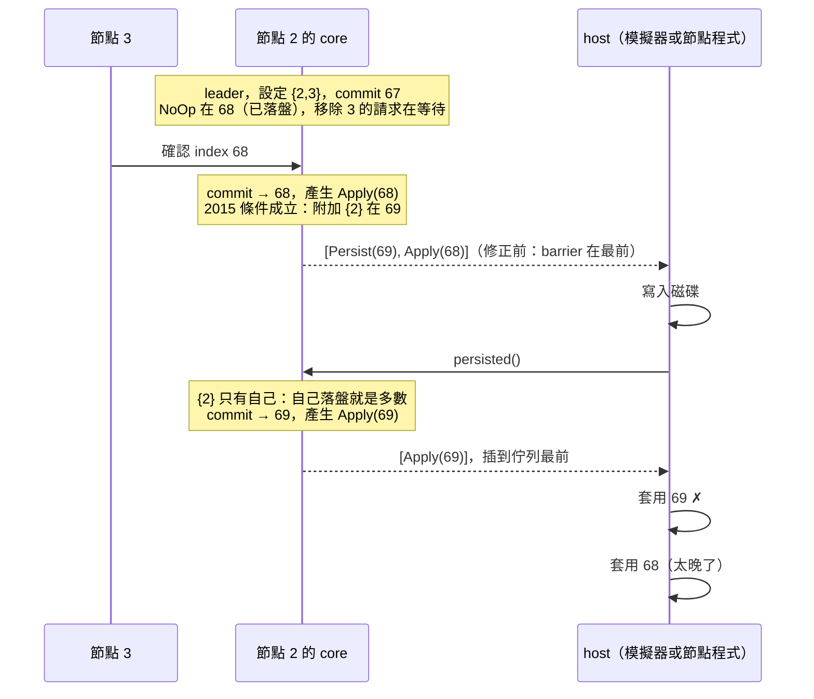

# 先 commit 的反而後套用：落盤 barrier 搶在 Apply 前面

狀態：草稿

> 這篇的命令與輸出都實際執行過（2026-11-13），還沒有第二個人照著做一遍。
> 讀者設定：知道 Raft 的 leader、commit 與「套用到狀態機」；第 2 節會補上本專案 core 的「效果清單」與「落盤 barrier」。

發現日期：2026-11-13　｜　發現方式：模擬器（成員變更工作負載第一次執行，100 個種子中第 28 個失敗）　｜
影響的版本：S4 開發中的程式，修正前沒有任何 commit 含有這個錯誤（重現腳本以 patch 還原）　｜　修正：commit `eebe7b8` 起；重現以 `62e61d1` 為準

## 1. 一句話說後果

節點先把 index 69 套用到狀態機，然後才套用 index 68。真實的節點程式遇到這種順序會在 KV 狀態機的檢查上直接停止（由程式碼推論，未在真實 process 上重現）。

這篇帶你用一行命令看到單元測試與模擬器各自抓到它，再沿著「效果清單」一步步看 68 是怎麼被 69 超車的，以及為什麼這個問題在 S4 之前不會發生。

## 2. 需要的背景

**效果清單（effects）。** 本專案的 `raft-core` 不碰磁碟也不碰網路。每收到一個事件（例如一則訊息），它回傳一串「請你照順序做這些事」的效果，
例如 `Persist`（把狀態寫進磁碟）、`Send`（送出訊息）、`Apply`（把一筆已 commit 的 entry 套用到 KV）。執行這些效果的程式叫 host（真實節點程式或模擬器）。

**落盤 barrier（durability barrier）。** Raft 要求「先落盤再說話」：投票、確認收到 entry 之前，相關狀態必須已經寫進磁碟（論文 Figure 2）。
本專案的做法是：一步裡只要改了要落盤的狀態，就產生一個 `Persist` 效果當作 barrier，放在依賴它的效果前面。
host 寫完磁碟後呼叫 `core.persisted(barrier)`，core 可能因此再產生新的效果（例如 leader 自己的這份已落盤，可能湊滿多數而 commit）。
兩個 host 都把這些「完成後的效果」**插到佇列最前面**先執行（`raft-node` 的 `queue.push_front`，模擬器的遞迴呼叫）。

**套用必須照順序。** 狀態機只能一筆接一筆往前套用。`kv-state` 直接檢查：
`assert_eq!(entry.index, self.applied_index + 1, "apply must consume an uninterrupted committed prefix")`。

**只有一台投票成員的設定。** S4 起可以把設定縮小到一台，例如 `{2}`。這時 leader 自己的一份就是多數（1 的多數是 1）：它自己落盤完，那筆 entry 就 commit 了。

## 3. 親手重現

需要 Linux 或 WSL、Rust、Git。在專案根目錄執行：

```bash
docs/lessons/09-apply-overtaken-by-its-barrier/repro.sh
```

約 4～6 分鐘（兩個版本，各建置一次測試與一次 release 模擬器）。它在暫存目錄工作，結束時刪除。完整輸出在 [expected-output.txt](expected-output.txt)。

腳本取出 commit `62e61d1`（已修正）兩份，其中一份把 barrier 放回效果清單的最前面（修正前的行為），各執行一次單元測試與 200 個種子的模擬器：

```text
== before the fix: the barrier goes first
   test applies_stay_in_order_when_a_barrier_commits_more: FAIL
   assertion `left == right` failed: the applies precede the barrier
     left: ["persist", "apply", "apply"]
    right: ["apply", "apply", "persist"]
   simulator: 28 of 200 seeds passed
   first failure: seed 28 after 3714 events: apply order/commit bound node=2 index=69

== after the fix (62e61d1): Applies first, then the barrier
   test applies_stay_in_order_when_a_barrier_commits_more: pass
   simulator: 200 of 200 seeds passed
```

要看的地方：

- 單元測試：修正前，那一步的效果順序是 `persist` 在兩個 `apply` 前面。
- 模擬器：種子 28 在第 3,714 個事件時，觀察者發現**節點 2 套用 index 69 時順序不對**。（模擬器遇到第一個失敗就停止，所以顯示「28 of 200」：種子 0～27 通過，28 失敗後不再往下跑。）
  這和開發時第一次發現的情形完全相同：同一個種子、同一個事件、同一個節點與 index。

## 4. 為什麼會這樣

沿著種子 28 的那一步走（數值取自當時的 trace）：

1. 節點 2 是 term 57 的 leader，設定是 `{2,3}`，`commit_index = 67`；它剛當選時附加的 NoOp 在 index 68，已落盤、還沒 commit。
2. 模擬器裡的管理者剛要求「移除節點 3」。依 2015 修正，leader 要先等本任期的 entry（index 68）commit，所以請求在等待。
3. 節點 3 對 index 68 的確認到了。**這一步**裡：
   - commit 推進到 68 → 產生 `Apply(68)`。
   - 2015 的條件現在成立 → 附加設定 `{2}`，放在 index 69 → 狀態改了，需要一個 barrier。
4. 修正前，`seal()` 把 barrier 插在清單**最前面**：`[Persist(69), Apply(68)]`。
5. host 先執行 `Persist(69)`，寫完呼叫 `persisted()`。新設定是 `{2}`，節點 2 自己這份已落盤就是多數 → commit 推進到 69 → 產生 `Apply(69)`。
6. host 把 `Apply(69)` 插到佇列最前面先執行，然後才輪到原本清單裡的 `Apply(68)`。69 比 68 先套用。



**為什麼 S4 之前不會發生？** 「barrier 放最前面」的寫法從 V1 就有，一直沒出事，因為以前沒有任何一步同時滿足兩個條件：

- 這一步裡有 `Apply`（commit 推進了），**而且**
- 這一步的 barrier 完成時，leader 能再 commit 更多。

固定三台時，leader 的 commit 需要至少一個 follower 的確認，而 follower 只能在 leader 落盤、送出之後才確認，所以 barrier 完成時不可能再湊滿多數。
S4 讓「同一步裡附加一份只有自己一台的設定」成為可能，兩個條件第一次同時成立。這個順序規則原本是「碰巧成立」的，不是被保證的。

## 5. 為什麼嚴重

- **節點程式會停下來（推論）。** `raft-node` 用 `queue.push_front` 先執行完成後的效果（`main.rs:425`），`kv-state` 的 `apply` 在順序不對時 `assert` 失敗（`lib.rs:48`）。
  依程式碼，節點會在套用 69 時 panic 而結束。這次沒有在真實 process 上重現，因為要剛好在 NoOp 等待 commit 的那一步把設定縮成一台，時序很難用 Python 工具精準控制。
- **出事的正是唯一的投票成員。** 觸發條件是「把設定縮小到 leader 自己一台」，也就是那一刻叢集只靠這一台。它停下來，整個叢集就無法服務，直到它重啟。
- **不是資料遺失（推論）。** 69 在 panic 前已經落盤；重啟後節點從快照（或 0）重新得知 commit、依序套用，可以恢復。這一點依恢復流程推論，沒有在這個情境下實測。
- **它違反的是 host 與 core 之間的契約。** `Apply` 必須照 index 順序交給 host，這是狀態機正確的前提：論文 Figure 2 的伺服器規則要求套用的位置逐一前進
  （這裡是轉述；轉出的論文文字沒有包含圖中的表格，未能逐字核對），本專案的 `kv-state` 也以 `assert` 強制這一點。

## 6. 怎麼修

在 `seal()` 裡把這一步的所有 `Apply` 排到 barrier **前面**，其他效果維持原本的順序放在 barrier 後面：

```rust
// 修正前：barrier 插在最前面
effects.insert(0, Effect::Persist { barrier_id, state });

// 修正後：Apply 在前，barrier，然後其他效果
let (mut sealed, rest): (Vec<_>, Vec<_>) = effects
    .into_iter()
    .partition(|effect| matches!(effect, Effect::Apply(_)));
sealed.push(barrier);
sealed.extend(rest);
```

為什麼這樣是安全的：一步裡產生的 `Apply`，都是**這個 barrier 之前**就已經 commit 的 entry。commit 代表多數節點已經把它落盤，
套用它不依賴這次 barrier 要寫的任何東西。訊息與回覆才依賴 barrier（例如「我收到了」必須在落盤之後才能說），它們仍然留在 barrier 後面。

| 其他做法 | 為什麼沒選 |
|---|---|
| 改 host：完成後的效果排到佇列**後面**執行 | 要同時改節點程式與模擬器，而且是一條很容易被下一個 host 寫錯的隱性規則；修在 core 裡，所有 host 自動正確 |
| 在 `persisted()` 裡不要 commit | 單一投票成員就再也無法前進 |
| 禁止把設定縮成一台 | 拿掉一個合法的操作；而且把問題藏起來，沒有修掉順序規則本身 |

修正的代價：follower 收到「新 entry＋新的 commit index」時，現在會先套用、再落盤自己的副本。這是安全的，因為那些 entry 已經 commit（多數已落盤）；
但它改變了一個既有測試 `conflicting_suffix_repaired` 的斷言（原本要求第一個效果是 barrier），改為「barrier 在回覆之前、barrier 之後沒有 Apply」，並記錄在驗收契約的 `modified_tests`。

## 7. 怎麼證明修好了

- `applies_stay_in_order_when_a_barrier_commits_more`（`crates/raft-core/src/membership_tests.rs`）：兩台設定 `{1,2}` 的 leader 在等待 2015 條件時收到 NoOp 的確認，
  這一步附加 `{1}`；斷言效果順序是 `apply, apply, persist`，並執行全部效果，確認節點依序套用到 3。修正前在效果順序的斷言失敗。
- 測試用的小網路（`Net`）現在對每個節點檢查「套用必須連續」；任何測試裡出現超車都會直接失敗。
- 模擬器：1,000 個種子 × 10,000 個事件全部通過（觀察者本來就檢查套用順序，就是它第一次抓到的）。
- Mutation 案例 `s4_apply_after_barrier`：把 Apply 移回 barrier 之後，上面的測試必須失敗。
- 首次失敗的紀錄：2026-11-13 第一次執行 `raft-sim --seeds 100`，種子 28 在第 3,714 個事件回報 `apply order/commit bound node=2 index=69`；當時用一個臨時的除錯程式重播該種子，看到節點 2 的設定是 `{2}`、commit 69。

## 8. 還沒解決的事

- 真實節點程式會 panic 是由程式碼推論，沒有在真實 process 上重現；重啟後能恢復也是推論。
- follower 現在可能在自己的副本落盤之前就套用 entry。依「已 commit 就不會改變」的論證是安全的，模擬器的 I5 也一直通過，但沒有專門測「套用之後、落盤之前 crash」這個時間點。
- 「完成後的效果先執行」仍然是 host 的行為。core 現在保證不依賴它的 `Apply` 都在 barrier 前，但若將來新增其他「不能被超車」的效果，需要同樣的思考。這條規則已寫進 `docs/API_CONTRACT.md`。

## 9. 自我檢查與練習

解答在 [answers.md](answers.md)。

1. 為什麼這個錯誤需要「只有一台投票成員」的設定才會出現？
2. 為什麼把 `Apply` 放到 barrier 前面是安全的，而把 `Send` 放到 barrier 前面就不安全？
3. 單元測試在 S4 之前就有很多「leader commit」的情境，為什麼沒有一個抓到它？
4. 如果改成「host 把完成後的效果放到佇列後面」，同樣能修好嗎？代價是什麼？

**動手練習：兩台還會出事嗎？**

- 起點：`repro.sh` 的兩個版本，以及測試 `applies_stay_in_order_when_a_barrier_commits_more`。
- 目標：寫一個變形，從 `{1,2,3}` 移除節點 3（剩下兩台投票成員），其餘步驟相同。預測修正前的版本會不會讓套用超車、效果順序是什麼，再實際執行。
- 怎麼知道做對了：你能說出修正前的版本在這個變形下效果順序如何、有沒有超車，以及原因；和解答的實測結果比對。

## 10. 面試時怎麼講

**兩分鐘版本**

- **情境**：我的 Raft core 是純函式風格：每個事件回傳一串有順序的效果，host 依序執行；要落盤的狀態用一個 barrier 效果表示，放在依賴它的訊息前面。
- **怎麼發現**：加上成員變更後，第一次用模擬器跑隨機成員變更，種子 28 就失敗：某個節點先套用了 69 才套用 68。單元測試全部通過。
- **根因**：那一步同時 commit 了 68、又因為條件剛成立而附加了一份只有 leader 自己的設定。barrier 排在最前面；它完成時 leader 一台就是多數，立刻 commit 並套用 69，而 host 會先執行完成後的效果，68 被超車。
  這個「barrier 放最前」的規則從第一版就有，只是以前沒有任何一步會在 barrier 完成時再 commit，所以一直碰巧成立。
- **修法與取捨**：把一步裡的 Apply 排在 barrier 前面，因為它們只依賴之前已 commit 的 entry；訊息仍在 barrier 後。沒有選擇改 host 的執行順序，因為那要改兩個 host，而且是容易被寫錯的隱性規則。
- **怎麼驗證**：寫一個確定性的單元測試重現那一步；測試網路對每個節點檢查套用連續；模擬器 1,000 個種子；以及把錯誤植回去的 mutation 案例。
- **學到什麼**：新功能會讓舊規則的前提消失。這個 bug 單元測試想不到，是模擬器的獨立觀察者抓到的；寫規則時要寫出它為什麼成立，而不只是它是什麼。

**可能的追問**

- *「為什麼單元測試沒抓到？」* 單元測試是我照著自己對流程的理解寫的，而這個情境需要「等待中的變更、剛好在 commit 的那一步、縮成一台」三件事同時發生，我沒想到要這樣組合。模擬器不靠我的想像，只檢查不變式。
- *「follower 先套用再落盤，安全嗎？」* 套用的是已 commit 的 entry，多數已經落盤，內容不會再改變；狀態機本來就是重啟後重建的。模擬器一直檢查 State Machine Safety。
- *「真實節點真的會掛嗎？」* 依程式碼會：host 先執行完成後的效果，KV 狀態機對順序有 assert。我沒有在真實 process 上重現，教學裡標明是推論。
