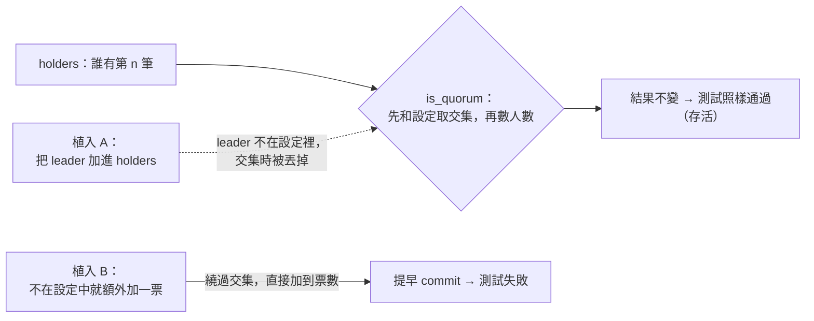

# 植入的錯誤「存活」了，但測試沒有問題

狀態：草稿

> 這篇的命令與輸出都實際執行過（2026-11-13），還沒有第二個人照著做一遍。
> 讀者設定：讀過 [教學 04](../04-mutation-checker-false-survivors/README.md) 第 2 節的 mutation 測試介紹即可。

發現日期：2026-11-13　｜　發現方式：mutation 測試（S4 新增案例的第一次執行，19 個中 1 個存活）　｜
影響的版本：`scripts/mutation_check.py` 的 S4 案例初稿，未曾 commit　｜　修正：commit `62e61d1`

## 1. 一句話說後果

mutation 測試報告說：「leader 不在設定中時不能把自己算進多數」這條規則，對應的測試抓不到植入的錯誤。實際上測試沒問題——**那個植入的錯誤根本沒有改變程式的行為**。

這種「改了程式碼、行為卻完全一樣」的植入，叫做**等價突變（equivalent mutant）**。這篇帶你看到它、看懂它為什麼不會被抓到，以及怎麼換一個真正會出錯的植入。

## 2. 需要的背景

**Mutation 測試。** 在程式的副本裡故意植入一個已知的錯誤，要求指定的測試失敗。測試失敗叫「抓到」（detected），測試照樣通過叫「存活」（survived）。
存活通常代表那個測試擋不住這個錯誤，需要加強。

**等價突變。** 有時候植入的「錯誤」在程式裡根本不會造成任何差別，例如被後面的檢查完全抵銷。這時任何測試都不可能抓到它，因為程式的行為沒有變。
存活不一定代表測試弱；要先確認植入的東西真的會改變行為。

**本篇用到的規則。** S4 規定：leader 被移除、還在交接期間時，它繼續複製 log，但 "does not count itself in majorities"（博論 §4.2.2）。
程式計算 commit 時，先找出「哪些節點已經有第 n 筆」，再問「這些節點是不是目前設定的多數」：

```rust
let holders = voters
    .ids()
    .filter(|id| self.matches[*id as usize] >= n)
    .fold(Voters::default(), Voters::with);
if self.state.term_at(n) == Some(self.state.term) && voters.is_quorum(holders) { … }
```

## 3. 親手重現

需要 Linux 或 WSL、Rust、Git。在專案根目錄執行：

```bash
docs/lessons/10-mutant-that-changed-nothing/repro.sh
```

約 2～3 分鐘（建置三個版本）。它在暫存目錄工作，結束時刪除。完整輸出在 [expected-output.txt](expected-output.txt)。

腳本取出 commit `62e61d1` 三份：不植入（對照組）、植入 A（當初的植入）、植入 B（改正後的植入），各執行一次測試 `removing_a_follower_and_then_the_leader`：

```text
== control: nothing planted
   test removing_a_follower_and_then_the_leader: pass

== mutant A: the leader is added to the holders of entry n
   test removing_a_follower_and_then_the_leader: pass  -> survived

== mutant B: a leader outside its configuration counts its own durable copy
   test removing_a_follower_and_then_the_leader: FAIL  -> detected
   assertion `left == right` failed: its own copy does not count
```

同一個測試，放過 A、抓到 B。

## 4. 為什麼會這樣

植入 A 想模擬的錯誤是「leader 把自己算進持有者」：

```rust
let holders = voters
    .with(self.id)        // 植入 A：把 leader 自己加進來
    .ids()
    .filter(|id| self.matches[*id as usize] >= n)
    …
```

但接下來的判斷 `voters.is_quorum(holders)` 是這樣寫的：

```rust
pub fn is_quorum(self, members: Voters) -> bool {
    !self.is_empty() && (self.0 & members.0).count_ones() as usize >= self.majority()
}
```

`self.0 & members.0` 先和**設定**取交集，再數人數。leader 不在設定裡，加進 `holders` 也會在交集時被丟掉。帶入測試裡的數值：

| 項目 | 值 |
|---|---|
| 節點 1 移除自己後的設定 | `{2}`，多數是 1 |
| 第 4 筆（新設定 entry）的持有者 | 節點 1 已落盤；節點 2 還沒收到 |
| 植入 A 的 `holders` | `{1}`（節點 1 被硬加進來） |
| `{2} & {1}` | 空集合 → 0 票 < 1 → 不 commit，**和沒植入時一樣** |



所以 A 不是「測試抓不到的錯誤」，而是「根本不是錯誤」。程式在兩個地方都只算設定內的成員：建 `holders` 時只看 `voters.ids()`，判斷多數時又取一次交集。
植入 A 只破壞了第一道，第二道仍然擋著。

植入 B 才真的寫出「不在設定中的 leader 把自己那份算進去」：它把票數算成「設定內的持有者人數＋（若自己不在設定中且已落盤）1」，直接和多數比，繞過交集。
這時第 4 筆在節點 2 還沒收到之前就 commit 了，測試的斷言 "its own copy does not count" 失敗。

## 5. 為什麼嚴重

這不是系統的 bug，使用者看不到任何影響。它影響的是**我們對測試品質的判斷**：

- **可能錯怪測試。** 看到存活，第一反應是去加強測試。若沒先確認植入有沒有改變行為，可能會為一個不存在的錯誤寫出多餘、甚至依賴實作細節的測試。
- **可能留下空洞。** 換個角度，報告上「這條規則有一個 mutation 案例」會讓人以為這條規則被檢查過了。植入 A 存活時，其實**沒有任何**植入真正測到「leader 不計自己」；
  若把 A 標成「等價、忽略」就結案，這條規則就沒有被 mutation 測試保護。
- **工具分不出兩種存活。** `mutation_check.py` 只能說「測試通過了」，無法區分「測試弱」和「植入等價」。每一個存活都需要人去看。

## 6. 怎麼修

把植入 A 換成真正會改變行為的植入 B，並在工具裡註明為什麼 A 不行：

```python
# A leader outside its configuration adds its own durable copy. (Adding it to
# `holders` would change nothing: is_quorum counts members only.)
("s4_leader_counts_itself_outside_configuration", …,
 "if self.state.term_at(n) == Some(self.state.term) && voters.is_quorum(holders) {",
 "if self.state.term_at(n) == Some(self.state.term) && holders.len() + usize::from(!voters.contains(self.id) && self.durable_index >= n) >= voters.majority() {",
 "removing_a_follower_and_then_the_leader", "raft-core"),
```

| 其他做法 | 為什麼沒選 |
|---|---|
| 刪掉這個案例 | 「leader 不計自己」這條規則就沒有任何植入在檢查 |
| 在報告裡新增「等價」類別，讓工具接受它 | 工具無法自動判斷是否等價，最後還是要人判斷；新增類別只是讓「存活」更容易被忽略 |
| 把 `is_quorum` 的交集拿掉，讓 A 變得有效 | 為了讓測試工具好寫而削弱程式的防線，本末倒置 |

## 7. 怎麼證明修好了

- 換成植入 B 後，單獨執行這個案例：對照組通過、植入 B 被抓到（2026-11-13，暫存副本中執行 `scripts/mutation_check.py s4_leader_counts_itself_outside_configuration`）。
- 第 3 節的三組對照：同一個測試放過 A、抓到 B，對照組通過。
- 完整驗收的 mutation 報告（`artifacts/reports/mutations.json`）中，這個案例判定為「抓到」。
- 首次失敗的紀錄：2026-11-13 第一次執行 S4 的 19 個案例，報告 `s4_leader_counts_itself_outside_configuration: SURVIVED (removing_a_follower_and_then_the_leader)`，其餘 18 個抓到。

## 8. 還沒解決的事

- 一般而言，判斷一個植入是不是等價，沒有自動的方法。本專案的做法是：每個存活都由人分析，結論寫進工具的註解。
- 兩道防線（建 `holders` 時只看成員、判斷多數時再取交集）是好事，但也代表「只改其中一處」的植入都會是等價的。設計植入時要找「所有防線之後」的那個點。
- 植入 B 只檢查了「不在設定中的 leader」這一種多算。其他多算的方式（例如重複計票）由 `majority_follows_the_configuration` 等測試負責，本篇沒有逐一列出。

## 9. 自我檢查與練習

解答在 [answers.md](answers.md)。

1. 植入 A 為什麼一定會存活？跟測試寫得好不好有關嗎？
2. 看到一個存活的植入時，第一步應該先確認什麼？
3. 為什麼不把 `is_quorum` 的交集拿掉，讓植入 A 變得有效？
4. 植入 B 繞過了哪一道防線？

**動手練習：拿掉第二道防線會怎樣？**

- 起點：commit `62e61d1`，`crates/raft-protocol/src/lib.rs` 的 `is_quorum`。
- 目標：把交集拿掉，改成 `members.0.count_ones() as usize >= self.majority()`（植入 C），預測 `raft-protocol` 與 `raft-core` 的測試中哪些會失敗，再實際執行。
- 怎麼知道做對了：你能說出哪些測試失敗、它們各自在檢查什麼；和解答的實測結果比對。

## 10. 面試時怎麼講

**兩分鐘版本**

- **情境**：我用 mutation 測試檢查每條安全規則都有測試在保護：在副本裡植入一個錯誤，要求指定的測試失敗。
- **怎麼發現**：成員變更新增的 19 個案例中，有一個存活，對應「被移除的 leader 不能把自己算進多數」。
- **根因**：不是測試弱。我植入的方式是「把 leader 加進持有者集合」，但判斷多數的函式會先和設定取交集，leader 不在設定裡就被丟掉了；植入沒有改變任何行為，是等價突變。
- **修法與取捨**：換成真正繞過防線的植入，直接在票數上加一，測試立刻抓到；並在工具裡寫下為什麼前一個植入無效。我沒有為了讓植入有效而拿掉程式的交集。
- **怎麼驗證**：同一個測試，對照組通過、植入 A 存活、植入 B 被抓到，三組都有記錄。
- **學到什麼**：「存活」是一個要調查的訊號，不是結論。調查的第一步是確認植入真的改變了行為；而好的防禦設計會讓很多植入變成等價，這是好事，但設計植入時要找所有防線之後的那一點。

**可能的追問**

- *「你怎麼確定 A 真的是等價，而不是你的測試剛好沒觸發？」* 從程式碼看，`is_quorum` 對任何不在設定裡的成員都取不到。我也實測過：把植入 A 和「拿掉交集」放在一起，
  同一個測試立刻失敗（commit 到 4，預期 3）；單獨放 A 時它通過，單獨拿掉交集時它也通過，但另外兩個測試會失敗（見解答）。
- *「等價突變多嗎？」* 本專案 45 個案例中目前發現這一個。它出現的地方正是有兩道防線的地方。
- *「工具能自動避免嗎？」* 一般情況下不行。比較實際的做法是要求每個存活都由人分析並記錄結論，就像這次寫在工具註解裡。
