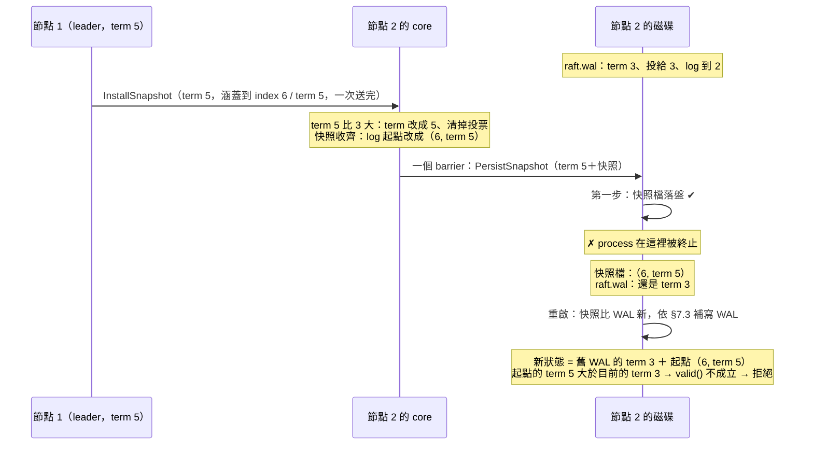

# 快照裝到一半被終止，節點從此開不了機

狀態：草稿

> 這篇的命令與輸出都實際執行過（2026-11-14），還沒有第二個人照著做一遍。
> 讀者設定：知道 Raft 的 term、投票與 log；讀過 [教學 03](../03-compaction-without-install-snapshot/README.md) 第 2 節（快照與 InstallSnapshot 是什麼）會比較順。

發現日期：2026-11-14　｜　發現方式：獨立審查（先由程式推演，再以真實 process 重現）　｜
影響的版本：tag `s2-snapshot-compaction-verified` 到 `s4-membership-verified`　｜　修正：本篇所在的 commit

## 1. 一句話說後果

一台落後的 follower 正在安裝 leader 送來的快照，process 剛好在某兩個步驟之間被終止；之後不管重開幾次，它都以
`snapshot is newer than the durable term` 拒絕啟動，只能靠人處理。

資料沒有壞，叢集其他節點也照常服務，所以這是**可用性**問題，不是資料遺失。這篇帶你用一行命令看到「重開兩次、拒絕兩次」，
再看它為什麼只在「快照用一則訊息就送完」的時候發生，以及為什麼跑了一千萬個事件的模擬器從來沒有走到這裡。

## 2. 需要的背景

**term 要先落盤。** Raft 的每個節點要把三樣東西寫進磁碟才能回覆別人：目前的 term、這個 term 投給誰、log（論文 Figure 2）。
本專案把這三樣放在一個檔案 `raft.wal` 裡。節點看到比自己大的 term 就跟上，並且清掉投票紀錄，因為那一票是舊 term 的。

**快照與 log 的起點。** log 不能無限長，所以節點會把「到第 S 筆為止的狀態」存成快照檔 `snapshot`，然後把 log 前面那段丟掉。
快照記著它涵蓋的最後一筆的 index 與 term；`raft.wal` 的檔頭也記著同一個位置，叫 base。兩個檔案必須對得上。

**安裝快照要寫兩個檔案。** follower 落後太多時，leader 直接送快照（InstallSnapshot，論文 Figure 13）。follower 收齊後要做兩件事：
先把快照檔落盤，再把 `raft.wal` 改寫成「從快照之後開始」。兩個檔案不可能在同一瞬間換好，中間一定有空檔。
規格 `docs/SNAPSHOT_COMPACTION.md` 的保證 G3 說：不管在哪一步被終止，重啟後都要能回復；§7.3 規定「快照比較新、WAL 還是舊的」時，重啟要把 WAL 補寫完。

**一個 barrier 做兩件事。** 本專案的 core 每處理一個事件，最多產生一個「請先落盤」的效果（barrier）。
如果快照**一則訊息就送完**（資料不超過 256 KiB），而且送的人 term 比 follower 大，那麼「提高 term」和「安裝快照」就在同一個 barrier 裡。
快照要分好幾塊送的時候不會這樣：第一塊到達時 term 就先單獨落盤了。

**valid。** 程式用 `DurableState::valid()` 檢查一份狀態合不合理，其中一條是：log 起點的 term 不能比目前的 term 大。這很合理，
因為一筆 term 5 的 entry 不可能出現在一個「現在才 term 3」的節點上。

## 3. 親手重現

需要 Linux 或 WSL、Rust、Git。在專案根目錄執行：

```bash
docs/lessons/11-install-from-a-newer-term/repro.sh
```

約 1～2 分鐘（兩個版本各建置一次）。它只在暫存目錄工作，結束時刪除。完整輸出在 [expected-output.txt](expected-output.txt)。

腳本把同一個測試檔 [interrupted_install.rs](interrupted_install.rs) 放進兩個版本裡執行。測試用的是正式的 `Core` 和 `Wal`，沒有網路：

1. 節點 2 的磁碟上是 term 3、投給節點 3、log 到 index 2。
2. 把一則「term 5 的 leader 送來、涵蓋到 index 6（term 5）、一次送完」的 InstallSnapshot 交給 core，看它要求落盤什麼。
3. 做出「快照檔已落盤、WAL 還沒改寫」的磁碟：讓另一個暫存目錄完整安裝一次，只把它的快照檔拿過來，放在沒動過的 WAL 旁邊。
4. 重新開啟兩次。

```text
== s4-membership-verified  (before the fix)
   1. on disk before: term 3 vote Some(3) last index 2
   2. core asks for 1 barrier: PersistSnapshot with term 5 and a snapshot ending at index 6 of term 5
   3. killed between the two steps: new snapshot file, old WAL
   4. restart 1: REFUSED: snapshot is newer than the durable term
   4. restart 2: REFUSED: snapshot is newer than the durable term

== current source  (after the fix)
   ...
   4. restart 1: STARTED with term 5 vote None log base index 6 of term 5
   4. restart 2: STARTED with term 5 vote None log base index 6 of term 5
```

看第 2 行：只有 **1 個** barrier，它同時帶著 term 5 和快照。再看第 4 行：修正前兩次都被拒絕。

**這在真實的節點上也發生過。** 審查時用未修改的 `raft-node`、三個真實 process 和專案自己的中斷點 `install_after_snapshot_before_wal` 做了一次：
節點 2 停在 term 2；其他兩台換了兩次 leader 到 term 4，並把 log 壓縮到 index 24；節點 2 回來後收到的第一則訊息就是 396 bytes 的快照，在中斷點被 `SIGKILL`。
之後兩次啟動都以 exit code 1 結束，stderr 是 `snapshot is newer than the durable term`；修正後同一個腳本兩次都啟動成功並追上其他節點。
那個腳本要開埠、跑真實叢集，沒有放進本篇的 `repro.sh`；它的做法寫在第 7 節。

## 4. 為什麼會這樣

用重現時的數字走一遍。



1. `crates/raft-core/src/lib.rs` 處理 InstallSnapshot 時，先因為 term 5 大於 3 而把 term 改成 5，接著發現這則訊息就是整份快照，
   於是把 log 起點換成快照的位置，要求一個 `PersistSnapshot`。**到這裡為止，term 5 只存在記憶體裡。**
2. `crates/raft-storage/src/lib.rs` 的 `Wal::install` 照規格的順序做：寫快照檔並落盤，再改寫 WAL。process 在兩步之間被終止。
3. 重啟時 `reconcile_snapshot` 看到快照的 index 6 大於 WAL 的起點 0，知道安裝做到一半，於是用**舊 WAL 的狀態**去接快照。
   舊 WAL 的 term 是 3。接出來的狀態是「目前 term 3，log 起點是 term 5 的 entry」。
4. 這份狀態過不了 `valid()`，修正前的程式回傳 `snapshot is newer than the durable term`。磁碟沒有被改動，所以下一次啟動走的是完全相同的路。

不成立的假設是：**「WAL 的 term 一定不小於任何已落盤快照的 term」**。寫這段程式的時候，這被當成「本程式的寫入順序不可能產生」的情況，
既有測試 `snapshot_and_wal_consistency_rules` 的最後一列甚至明文斷言它要被拒絕。它漏掉的是：term 和快照可以在同一個 barrier 裡，
而那個 barrier 寫的是兩個檔案。

**什麼時候會碰到（由程式推論，真實 process 重現了其中一種）。** 要同時滿足：

- 某個投票成員在一次換 leader 的前後都連不上，所以它磁碟上的 term 比新 leader 舊。
- 新 leader 在這段期間把它需要的 entry 壓縮掉了。leader 當選時把每個 follower 的進度設在 log 尾端，之後沒收過它的回覆；
  壓縮後那個位置已經不在 log 裡，所以它回來時收到的**第一則**訊息就是快照，而不是會讓它先把 term 落盤的 AppendEntries。
- 快照不超過 256 KiB，一則訊息送完。
- process 剛好在「快照檔落盤」與「WAL 改寫完成」之間被終止。

新加入叢集的節點不受影響：追趕一定從 AppendEntries 開始。

## 5. 為什麼嚴重

- **它違反了規格明文的保證。** G3 說安裝在任一步被終止都能回復，而且這個專案為那四個中斷點各寫了真實 process 的測試。
  這個 bug 就在其中一個中斷點上，只是測試用的快照和 WAL 剛好是同一個 term。
- **節點不會自己好。** 每次啟動讀到的是同樣的兩個檔案。三台的叢集少一台還能服務，但已經沒有容錯能力；再壞一台就停擺。
- **人工處置有陷阱。** 最直覺的做法是把這台的資料目錄清空再啟動，但 `docs/STORAGE_FORMAT_V2.md` 的 N4 說過：
  清空後用同一個編號回來的節點會忘記自己投過的票，在 Raft 中不安全。
- **不是安全性問題。** 節點是「拒絕啟動」，沒有帶著錯的狀態上線，也沒有回覆任何人。已 commit 的資料都還在其他節點上。
  時間窗也很窄（兩次 rename 之間）。所以嚴重度是「罕見，但發生了就要人來救」。

## 6. 怎麼修

重啟時，如果快照的 term 比 WAL 的 term 大，就把 term 提高到快照的 term、清掉投票，再補寫 WAL。

```rust
let mut next = adopt_snapshot(&self.state, found.base);
if next.term < found.base.term {
    next.term = found.base.term;
    next.voted_for = None;
}
```

為什麼這是安全的：

- 快照涵蓋的 entry 都已 commit，其中最後一筆的 term 是 5，所以 term 5 確實存在過。節點跟上一個確實存在的 term，本來就是 Raft 的規則。
- 這台節點在 term 5 沒有任何已落盤的投票（它的 WAL 還停在 term 3），被中斷的那一步的回覆也還沒送出（回覆排在 barrier 之後）。
  所以清掉投票不會讓它在 term 5 投第二次票。
- 它不一定回到「被中斷前」的 term：leader 可能已經是 term 7，而快照的最後一筆是 term 5，這時回復到的是 5。這沒有關係，leader 的下一則訊息會把它帶到 7。
  規格的 G3 因此改寫成「舊狀態，或位於快照且 term 不小於快照的 term」。

| 其他做法 | 為什麼沒選 |
|---|---|
| core 把「提高 term」和「安裝快照」拆成兩個 barrier | 可行，但 core 的規則是一步最多一個 barrier，要為這個情況開例外；既有測試 `a_higher_term_install_persists_term_and_snapshot_together` 也要反過來改 |
| 先改寫 WAL，再寫快照檔 | 會讓「WAL 從快照之後開始，快照卻不在」成為可能，那才是真的資料遺失；mutation 案例 `s2_wal_rewritten_before_snapshot` 就是在擋這個 |
| 維持拒絕，寫進操作手冊 | 這是程式自己造成的狀態，而且有安全的自動回復方式 |

模擬器的磁碟模型 `MockDisk::recover` 照抄了同樣的邏輯，一併修正。

## 7. 怎麼證明修好了

| 測試 | 檢查什麼 | 沒有修正時 |
|---|---|---|
| `interrupted_install_from_a_newer_term_raises_the_term`（raft-storage） | term 3 的 WAL 旁邊放一個 term 5 的快照：能開啟、term 變 5、沒有投票、檔頭的欄位正確，之後能正常寫入；快照不比 WAL 新時 term 與投票不變 | `a node must start after this interruption: snapshot is newer than the durable term` |
| `real_process_crash_during_install_from_a_newer_term_recovers`（真實 process） | 四個中斷點各 `SIGKILL` 一次，每次都要能啟動兩次，並且能把安裝做完 | 在 `install_after_snapshot_before_wal` 失敗，訊息相同 |
| `snapshot_and_wal_consistency_rules` 的最後一列 | 原本斷言「拒絕」，現在斷言「採用快照的 term」 | （這一列本身就是錯的期待） |
| 模擬器 `simulation_randomized_invariants` | 分塊大小隨種子在 7、13、4096 bytes 間變化；follower 安裝途中 crash 的機率從 1/100 提高到 1/10；並斷言「一則訊息送完的快照」確實出現過 | 見下一列 |
| mutation 案例 `sim_must_catch_interrupted_newer_term_install` | 把模擬器磁碟模型的修正拿掉，要求**模擬器自己**失敗 | 若有人把分塊改回固定 7 bytes，這個案例會存活，驗收就不會過 |
| mutation 案例 `s2_recover_refuses_newer_term_snapshot` | 把儲存層的修正拿掉，要求第一列的測試失敗 | |

修正前的失敗輸出（2026-11-14 實際執行）保存在 `artifacts/audit/independent-review-20261114/evidence/f1-red-before-fix.txt`；
`artifacts/` 不在版本控制內，所以它只存在做審查的那台機器上。

真實叢集的重現腳本在同一個資料夾的 `repro/repro_install_newer_term.py`。做法：三台、`--snapshot-every 3`；停掉一台 follower；
反覆停掉再啟動 leader，直到 term 至少多 2；寫入 18 筆讓 leader 壓縮；帶著中斷點環境變數啟動那台 follower，等標記檔出現後 `SIGKILL`；再啟動兩次。

## 8. 還沒解決的事

- 只測了 process 被終止。主機斷電時「rename 已完成但目錄還沒同步」之類的狀態，沿用 S1、S2 已聲明的限制，沒有實測。
- 「什麼時候會碰到」的四個條件中，真實 process 只重現了「停機跨越兩次換 leader」這一種；被網路隔離後回來的情況是由程式推論的。
- 模擬器現在會走到「一則訊息送完」的路徑，但它的磁碟是模型，不是真的檔案；真實檔案的行為由 raft-storage 的測試負責。
- 這次是靠人讀程式時問了一句「模擬器的設定讓哪些路徑永遠走不到」才發現的。其他固定的設定（每個種子只有 64 個用戶端操作、管理者一次只送一個請求）
  還擋著哪些路徑，留待 S6 檢查；清單在 `docs/INDEPENDENT_REVIEW_S1_S4.md`。

## 9. 自我檢查與練習

解答在 [answers.md](answers.md)。

1. 快照分成三塊送的時候，為什麼不會有這個問題？第一塊到達時磁碟上發生了什麼事？
2. 修正把 term 提高到「快照的 term」而不是「leader 的 term」。為什麼不直接回到 leader 的 term？回復時拿得到那個數字嗎？
3. 回復時為什麼要清掉投票？如果保留 term 3 的那一票（投給節點 3）並把 term 改成 5，會出什麼事？
4. 把寫入順序反過來（先 WAL 後快照）可以避開這個 bug。為什麼那樣更糟？
5. 既有測試明文斷言「快照比 WAL 的 term 新就拒絕」。一個測試把錯的行為寫成期待，你會怎麼在審查時發現？

**動手練習：讓模擬器回到看不見這個 bug 的樣子。**

- 起點：`crates/raft-sim/src/cluster.rs` 的 `SIM_CHUNKS`。在暫存副本裡把它改成 `[7, 7, 7]`（修正前的固定值）。
- 目標：先預測 `cargo test -p raft-sim --test invariants simulation_randomized_invariants` 會通過還是失敗、訊息是什麼，再實際執行。
- 怎麼知道做對了：和解答裡的實際輸出比對，並說出那個斷言是為了防止什麼。

## 10. 面試時怎麼講

**兩分鐘版本**

- **情境**：我的 Raft 實作有快照與 InstallSnapshot，規格保證「安裝在任何一步被中斷都能回復」，四個中斷點都有真實 process 的測試，模擬器也跑過一千萬個事件。
- **怎麼發現**：請另一個模型在新的 session 做獨立審查。它沒有先找 bug，而是先問「測試的設定讓哪些路徑永遠走不到」：模擬器的快照固定切成 7 bytes 一塊，
  所以「一則訊息送完」這條路徑從來沒被執行。沿著那條路徑讀程式，就看到 term 和快照在同一個落盤動作裡，而那個動作要寫兩個檔案。
- **根因**：兩個檔案之間被終止時，磁碟上是新快照配舊 WAL。回復程式用舊 WAL 的 term 去接快照，得到「起點的 term 比目前的 term 大」的狀態，判定不合理而拒絕。之後每次啟動都一樣。
- **修法與取捨**：回復時把 term 提高到快照的 term 並清掉投票。我考慮過在 core 拆成兩次落盤，但那要破壞「一步一個 barrier」的規則；也考慮過調換兩個檔案的寫入順序，那會製造真正的資料遺失。
- **怎麼驗證**：真實 process 在中斷點被 kill，修正前拒絕兩次、修正後啟動兩次並追上；模擬器的分塊大小改成隨種子變化，並加了一個「要求模擬器自己抓到」的 mutation 案例。
- **學到什麼**：隨機測試跑得再多，也只涵蓋它的設定走得到的地方；「固定的參數」本身就是一種盲點。還有，測試可能把錯的行為寫成期待，綠燈不代表期待是對的。

**可能的追問**

- *「為什麼提高 term 是安全的？」* 快照裡有 term 5 的已 commit entry，所以那個 term 存在過；這台在 term 5 沒有落盤過任何投票，也沒送出任何回覆。提高 term 而不投票，等於只是收到一則 term 5 的訊息。
- *「這個 bug 多容易遇到？」* 要四個條件同時成立，時間窗是兩次 rename 之間，所以罕見；但前兩個條件在小資料量下是常態，而且一旦發生不會自己恢復。我會說它是「低機率、高處理成本」。
- *「模擬器為什麼沒抓到？你怎麼確定現在抓得到？」* 它的分塊固定是 7 bytes。我只改那一個數字，第 249 個種子就失敗了。現在分塊隨種子變化，測試會斷言單一訊息的快照確實出現過，mutation 測試則確認拿掉修正時模擬器會失敗。
