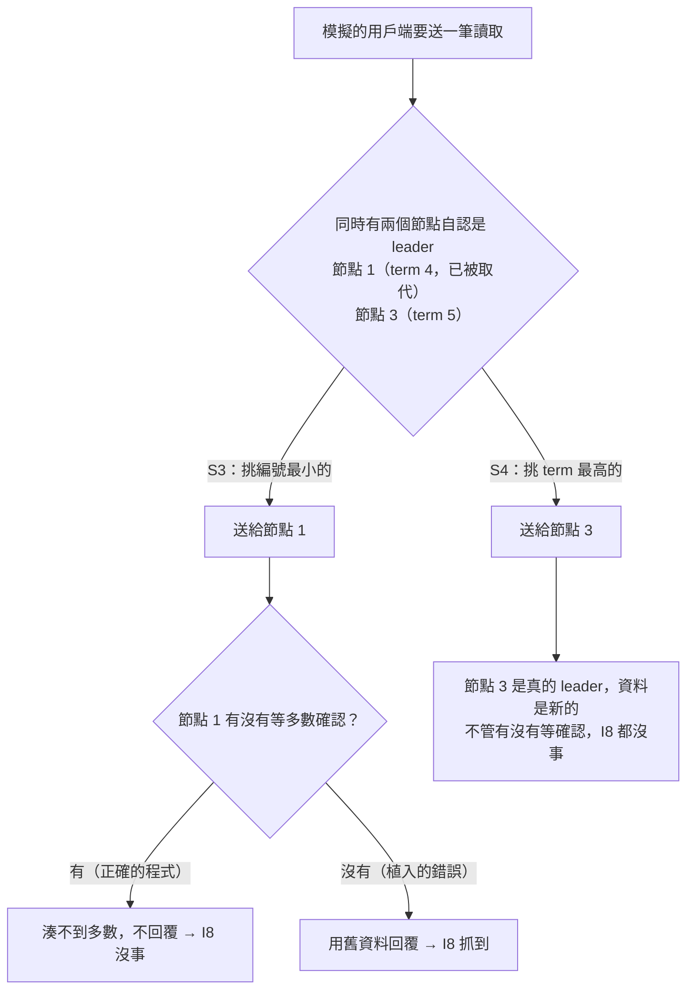

# 一千萬個事件全部通過，因為模擬器不再去問該問的節點

狀態：草稿

> 這篇的命令與輸出都實際執行過（2026-11-14），還沒有第二個人照著做一遍。
> 讀者設定：讀過 [教學 07](../07-test-silently-stopped-testing/README.md)（測試悄悄失效）與 [教學 04](../04-mutation-checker-false-survivors/README.md) 第 2 節（mutation 測試）。
> ReadIndex 只需要知道一件事，第 2 節會講。

發現日期：2026-11-14　｜　發現方式：獨立審查（讀模擬器的工作負載時起疑，再以植入錯誤驗證）　｜
影響的版本：tag `s4-membership-verified`（產品程式沒有錯，變弱的是模擬器）　｜　修正：本篇所在的 commit

## 1. 一句話說後果

S4 改了模擬器「把請求送給誰」之後，模擬器再也抓不到 ReadIndex 最重要的那種錯誤：一個已經被取代的 leader，拿舊資料回覆讀取。
它照樣跑完一千萬個事件、十個不變量全部成立，文件上也還寫著「這個錯誤會在第 266 個種子被抓到」。

產品程式本身是對的，所以沒有使用者受害。受害的是**證據**：我們以為有三道防線（單元測試、模擬器、真實 process 測試），實際上只剩一道。
這篇帶你在三個版本上植入同一個錯誤，看模擬器在 S3 抓得到、S4 抓不到、修正後又抓得到。

## 2. 需要的背景

**被取代而不自知的 leader。** 網路分成兩邊時，多數那邊會選出新 leader（term 比較大），少數那邊的舊 leader 一時還不知道，仍然自認是 leader。
同一時間可以有兩個節點自認是 leader，只是 term 不同。這本身沒有問題，Raft 保證的是舊的那個**做不成任何事**。

**ReadIndex 靠什麼擋住它。** S3 之後 GET 不寫進 log。leader 收到讀取後，要先送出一輪訊息並得到多數節點的回覆，確認「我現在還是 leader」，才能回覆
（`docs/READ_INDEX.md` §6.2）。舊 leader 湊不到多數，所以不會回覆。把這一步拿掉，舊 leader 就會拿它那份過期的資料回覆用戶端。

**模擬器與 I8。** `raft-sim` 用正式的 core 跑隨機的訊息延遲、遺失、crash 與網路分區，另有一個觀察者檢查不變量。
I8（讀取新鮮度）是：讀取開始時，觀察者記下「任何節點已知 commit 到哪裡」；回覆時用的位置不能比它小。

**工作負載。** 模擬器裡的用戶端是程式的一部分：每隔一陣子挑一個節點，送一筆讀取或寫入。**挑哪個節點**，就是這篇的主角。

## 3. 親手重現

需要 Linux 或 WSL、Rust、Git。在專案根目錄執行：

```bash
docs/lessons/12-simulator-stopped-asking-stale-leaders/repro.sh
```

約 5～8 分鐘（三個版本各建置一次 release 模擬器，各跑兩次 1,000 個種子）。它只在暫存目錄工作，結束時刪除。完整輸出在 [expected-output.txt](expected-output.txt)。

腳本對三個版本各做兩件事：原樣跑一次模擬器（對照組）；把 `raft-core` 裡「回合已被多數確認」這個條件拿掉，再跑一次。

```text
== s3-read-index-verified  (S3: requests go to the lowest-numbered node that believes it is leader)
   control (correct read path):      all 1000 seeds passed; reads answered: 20775
   mistake planted in raft-core:      FAILED at seed 266: I8 Read Freshness node=1 read=37 readIndex=31 < committed 32 at start

== s4-membership-verified  (S4: requests go to the leader with the highest term)
   control (correct read path):      all 1000 seeds passed; reads answered: 19294
   mistake planted in raft-core:      all 1000 seeds passed; reads answered: 20721

== current  (current source: any self-believed leader, plus reads aimed at deposed ones)
   control (correct read path):      all 1000 seeds passed; reads answered: 19271; requests that reached a deposed leader: 2502
   mistake planted in raft-core:      FAILED at seed 21: I8 Read Freshness node=3 read=1000011 readIndex=100 < committed 101 at start; requests that reached a deposed leader: 65
```

看中間那一組：植入了錯誤，1,000 個種子照樣全部通過，回覆的讀取還比對照組多（20,721 對 19,294），因為現在不用等確認了。
第一組的 266 就是 `docs/READ_INDEX.md` §13 當時記下的數字：那句話在寫的時候是真的。

## 4. 為什麼會這樣

三個版本裡，被植入錯誤的那一行完全相同。不同的是模擬器挑節點的那一行。

S3（`git show s3-read-index-verified:crates/raft-sim/src/cluster.rs`）：

```rust
&& let Some(node) = (0..3).find(|i| self.online[*i] && self.nodes[*i].role == Role::Leader)
```

「編號最小、自認是 leader 的節點」。如果節點 1 是被取代的舊 leader、節點 3 是新的，請求會送給節點 1。

S4 為了讓模擬的管理者找到「真正的」leader，加了一個函式，用戶端也順手改用它：

```rust
/// The leader with the highest term among online nodes, if any.
fn leader(&self) -> Option<usize> {
    (0..SLOTS).filter(|i| self.online[*i] && self.nodes[*i].role == Role::Leader)
        .max_by_key(|i| self.nodes[*i].state.term)
}
```



term 最高的自認 leader 一定是真的 leader，它的資料一定夠新。於是「等不等多數確認」對模擬器看到的結果沒有任何影響。
I8 的檢查還在、每次讀取也都真的檢查了，只是它要抓的那種情況再也不會出現。

這和教學 07 是同一種失效，只是藏得更深。教學 07 失效的是一個測試函式；這次測試函式 `simulation_randomized_invariants` 一個字都沒改，
變的是它呼叫的函式庫裡的一行。S4 做過「哪些測試把某個行為當工具」的檢查（`docs/MEMBERSHIP.md` §18.3），看的是測試，沒有看模擬器的工作負載。
mutation 測試也看不出來：每個植入的錯誤只指定一個單元測試去抓，那個單元測試一直抓得到。

## 5. 為什麼嚴重

- **文件上的證據變成假的。** `READ_INDEX.md` 的保證 G1 寫著「模擬器以此檢查（I8）」，§13 寫著第 266 個種子。S4 之後這兩句話對現有的程式都不成立，但沒有任何東西會提醒人去改。
- **防線只剩一道，而且沒有人知道。** 審查時把這個錯誤編進真實的節點程式，跑了 6 個真實 process 的讀取與故障測試，全部通過。
  原因是那些測試把舊 leader **完全**隔離：它收不到任何回覆，而讀取是在收到回覆時才檢查能不能回，所以植入的錯誤根本沒機會執行。
  剩下唯一抓得到的是單元測試 `replies_to_requests_sent_before_the_read_do_not_confirm_it`。
- **S6 會依賴這個模擬器。** 路線圖的 S6 是「所有功能同時開啟的模擬」。如果模擬器看不到過期 leader 的讀取，S6 跑再久也不會發現這一類問題。
- **產品沒有錯。** 把請求改成專門送給最舊的 leader 之後，正式的程式 1,000 個種子全部通過。所以這是測試的缺陷，不是線性一致性被破壞。不要把它講成「讀到舊資料的 bug」。

## 6. 怎麼修

模擬器的工作負載改兩處（`crates/raft-sim/src/cluster.rs`）：

1. 用戶端與管理者都在**所有**自認為 leader 的在線節點中隨機挑一個。真實的用戶端本來就分不出哪個是過期的。
2. 只要同時存在兩個自認的 leader，就以 1/4 的機率對 term 較低的那個**額外**發一筆讀取。

第 2 點不是多餘的。只做第 1 點時實測：1,000 個種子裡只有 43 次請求送到過期的 leader，植入的錯誤仍然全部通過（第 9 節的練習）。
兩個 leader 並存的時間很短，隨機碰上的機會太少；要測這件事，就得在它發生的時候主動去問。

另外讓這種失效以後看得見：

- 模擬器統計 `stale_leader_requests`（送到過期 leader 的請求數），測試斷言它大於零。工作負載哪天又繞開過期 leader，測試會直接失敗。
- 新增 mutation 案例 `sim_must_catch_unconfirmed_read`：植入的錯誤和既有案例相同，但指定由**模擬器**來抓。
- 新增真實 process 的測試 `test_a_leader_left_with_a_minority_does_not_answer_reads`：五台，舊 leader 身邊留一台 follower。
  那台 follower 還會回覆它，所以擋住舊資料的只剩「兩台不是五台的多數」這個計算。

| 其他做法 | 為什麼沒選 |
|---|---|
| 改回 S3 的「編號最小」 | 抓得到，但那是碰巧；節點 1 剛好是新 leader 時一樣測不到 |
| 一律送給 term 最低的 | 審查時試過，抓得到；但正常的請求也該送到正常的 leader，兩種都要有 |
| 只加斷言，不改工作負載 | 斷言會失敗，但不會讓模擬器變強 |

## 7. 怎麼證明修好了

- 第 3 節的第三組：同一個植入，在目前的版本第 21 個種子就被 I8 抓到；對照組通過，送到過期 leader 的請求 2,502 次。
- `sim_must_catch_unconfirmed_read` 在隔離的 mutation 執行中判定為「抓到」（對照組通過）。
- 真實 process：把植入的錯誤編進 `raft-node` 後執行 `tests/integration/test_read_index.py` 與 `test_faults.py`，新測試失敗，
  舊 leader 的回覆是 `{'status': 'OK', 'result': 'old', ...}`（它真的回了舊值），其餘 5 個照樣通過；正式的程式連跑 3 次都通過。
- 修正後以正式的 core 跑 1,000 個種子 × 10,000 個事件，I1～I10 全部成立。

## 8. 還沒解決的事

- 模擬器還有別的「太守規矩」的地方沒有處理：管理者一次只送一個成員變更，用戶端每個種子只有 64 個操作。
  審查時實測，有 17 個植入的錯誤只有單元測試抓得到（清單在 `docs/INDEPENDENT_REVIEW_S1_S4.md` §5）。這些留給 S6。
- `stale_leader_requests > 0` 只保證「有送到」，不保證「夠多」。門檻沒有訂，目前靠 mutation 案例把關。
- 這次能發現，是因為審查的人去讀了工作負載怎麼挑節點。沒有自動的方法能指出「某個改動讓某個不變量再也碰不到它要檢查的情況」。

## 9. 自我檢查與練習

解答在 [answers.md](answers.md)。

1. S4 的模擬器裡，I8 的檢查程式有被執行嗎？如果有，為什麼還說它失效了？
2. 為什麼「term 最高的自認 leader」回覆讀取時，等不等多數確認，結果都一樣？
3. 真實 process 的測試把舊 leader 完全隔離，植入的錯誤卻沒有被抓到。舊 leader 明明少了確認這一步，為什麼沒有回覆舊資料？
4. mutation 測試對每個植入的錯誤都回報「抓到」，為什麼它沒有發現模擬器變弱了？
5. 教學 07 的教訓是「檢查哪些測試把某個行為當工具」。S4 做了這個檢查，為什麼還是漏掉？

**動手練習：只做一半的修正夠不夠？**

- 起點：`crates/raft-sim/src/cluster.rs` 裡 `advance` 尾端那段「對 `deposed_leader()` 額外發讀取」的程式。在暫存副本裡讓那個條件永遠不成立，只留下隨機挑選；再植入第 3 節的錯誤。
- 目標：先預測 1,000 個種子裡模擬器抓不抓得到，再實際跑 `cargo run --release -p raft-sim -- --seeds 1000 --events 10000`，並看報告裡的 `stale_leader_requests`。
- 怎麼知道做對了：和解答的實際數字比對，並說出為什麼隨機挑選不夠。

## 10. 面試時怎麼講

**兩分鐘版本**

- **情境**：我的 Raft 有一個用正式程式碼跑的隨機模擬器，檢查十個不變量，每次驗收跑一千萬個事件。其中一個不變量專門檢查線性一致讀取。
- **怎麼發現**：獨立審查時，我沒有先看不變量寫得對不對，而是看模擬的用戶端把請求送給誰。它永遠送給 term 最高的 leader。
  而 ReadIndex 要防的是「已經被取代的 leader 回覆舊資料」；那個節點在模擬器裡永遠收不到讀取。
- **怎麼確認**：把「等多數確認」那個條件拿掉，在三個版本上各跑一次。上一個階段的模擬器在第 266 個種子抓到，這個階段的 1,000 個種子全過。
  再把同一個錯誤編進真實節點跑 process 測試，也全過。
- **根因**：上一個階段的模擬器挑「編號最小的自認 leader」，有時會挑到過期的。這個階段為了別的需求加了「取 term 最高」的函式，用戶端順手也用了它。測試函式本身一個字都沒改。
- **修法**：隨機挑任何一個自認的 leader，並在兩個 leader 並存時主動對舊的那個發讀取；另外把「有沒有測到」寫成斷言，再加一個指定由模擬器來抓的 mutation 案例。
- **學到什麼**：不變量成立有兩種原因：程式是對的，或是那個情況沒出現。隨機測試要同時回報「我看到了幾次該看的情況」。而且只靠隨機不夠，罕見又短暫的狀態要主動去戳。

**可能的追問**

- *「所以你的系統曾經讀到舊資料嗎？」* 沒有。正式的程式一直有等多數確認；我把請求全送給最舊的 leader 重跑，一千個種子都通過。壞掉的是偵測能力，不是產品。
- *「為什麼隨機挑選不夠？」* 我實測過：兩個 leader 並存很短暫，一千個種子只碰到 43 次，植入的錯誤照樣全過。主動發讀取之後是 2,502 次，第 21 個種子就抓到。
- *「怎麼避免再發生？」* 讓測試回報並斷言它的前提；再讓 mutation 測試裡有幾個案例指定「必須由模擬器抓到」。這樣模擬器變弱時，驗收會失敗，而不是繼續綠燈。
