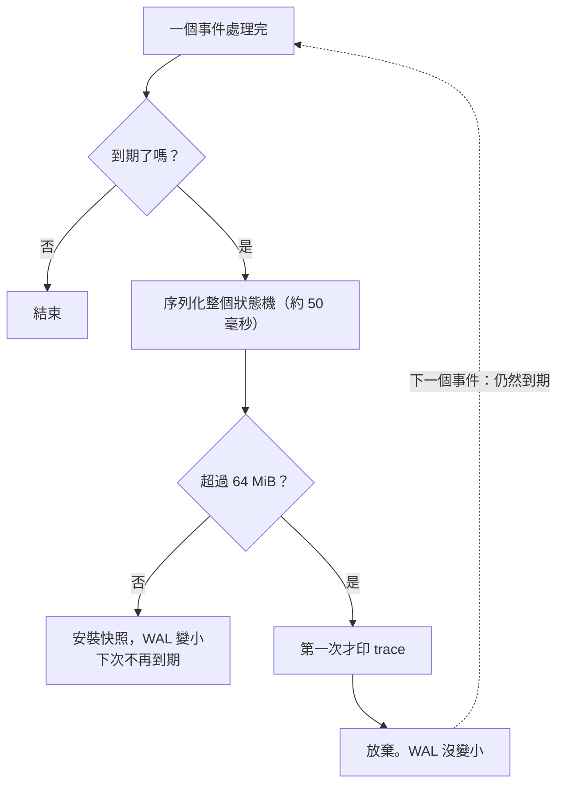

# 資料超過快照上限之後，節點每做一件事都先白做一次大工程

狀態：草稿

> 這篇的命令與輸出都實際執行過（2026-11-14），還沒有第二個人照著做一遍。
> 讀者設定：知道「快照」是把狀態機存成一個檔案、好丟掉舊的 log；讀過 [教學 03](../03-compaction-without-install-snapshot/README.md) 第 2 節更好。不需要懂 Raft 的選舉。

發現日期：2026-11-14　｜　發現方式：獨立審查（讀程式發現，再量測單次成本）　｜
影響的版本：tag `s2-snapshot-compaction-verified` 到 `s4-membership-verified`　｜　修正：本篇所在的 commit

## 1. 一句話說後果

KV 的資料量一旦超過快照的上限（64 MiB），節點每處理**一個事件**（一則訊息、一次 heartbeat）之後，都會把整個狀態機重新序列化一次，
發現還是太大，然後整份丟掉。規格寫的是「停止壓縮並記錄」，實際上是不停地做白工。

這是效能與可用性問題：沒有資料會壞。這篇帶你建一個剛好超過上限的狀態機，量出修正前 10 個事件白花 500 毫秒、修正後 52 毫秒，再看一個本來只想「少印幾行 log」的旗標是怎麼讓人以為問題已經處理了。

## 2. 需要的背景

**為什麼要做快照。** Raft 的 log 只增不減。節點定期把狀態機（這裡是一張 key-value 表加上每個用戶端的最後一筆請求）序列化成一份快照，之後就能丟掉快照涵蓋的那段 log。

**什麼時候做。** 節點程式在每個事件處理完之後呼叫 `maybe_compact`，它先問「到期了嗎」：一般模式是「WAL 檔案大於 1 MiB，也大於上次快照的 4 倍」；
測試模式（`--snapshot-every N`）是「上次快照之後又套用了 N 筆」。到期就序列化狀態機，交給 core 去安裝。

**上限。** 一份快照最多 64 MiB（`MAX_SNAPSHOT`），因為它要在節點之間傳送、要整份讀進記憶體。規格 `docs/SNAPSHOT_COMPACTION.md` 的 N1 說：
資料量本身沒有上限；序列化後超過 64 MiB 時，這台節點停止壓縮並記錄，log 從此恢復成長。

**「到期」不會自己消失。** 做了快照，WAL 被改寫變小，「到期」才會變回「沒到期」。如果快照沒做成，WAL 只會繼續變大，下一個事件來的時候仍然是「到期」。

**事件有多頻繁。** leader 每 100 毫秒送一次 heartbeat，每個 follower 各回一則訊息，再加上用戶端的請求。一台節點每秒處理幾十個事件是平常的事。

## 3. 親手重現

需要 Linux 或 WSL、Rust、Git，以及大約 1 GiB 的可用記憶體。在專案根目錄執行：

```bash
docs/lessons/13-oversize-snapshot-serialized-every-event/repro.sh
```

約 1～2 分鐘。它只在暫存目錄工作，結束時刪除。完整輸出在 [expected-output.txt](expected-output.txt)。
時間的數字會隨機器而不同；要看的是「每一次都花時間」和「只有第一次花時間」的差別。

腳本把 [oversize_actor.rs](oversize_actor.rs) 接在兩個版本的節點程式後面執行。它寫入 16,400 筆各 4 KiB 的資料，讓狀態機序列化後是 67,473,925 bytes（上限是 67,108,864），
然後連續 10 次做「一個事件處理完之後」會做的事，並計時。

```text
== s4-membership-verified  (before the fix)
   state machine image: 67473925 bytes; snapshot limit: 67108864 bytes
   after event  1: the snapshot check took   50 ms
   after event  2: the snapshot check took   50 ms
   ...
   after event 10: the snapshot check took   50 ms
   ten events: 500 ms spent on snapshot checks; snapshots taken: 0

== current source  (after the fix)
   after event  1: the snapshot check took   52 ms
   after event  2: the snapshot check took    0 ms
   ...
   ten events: 52 ms spent on snapshot checks; snapshots taken: 0
   serializations: 1; next attempt at applied index 32802
```

修正前每個事件 50 毫秒，而且 `snapshots taken: 0`：這些時間什麼都沒換到。

## 4. 為什麼會這樣

修正前的 `maybe_compact`（`crates/raft-node/src/main.rs`，節錄）：

```rust
if !due { return Ok(()); }
let data = self.kv.snapshot();                  // 序列化整個狀態機：這裡花 50 毫秒
if data.len() > MAX_SNAPSHOT {
    if !self.snapshot_too_large {
        self.snapshot_too_large = true;         // 只是為了不重複印同一行 trace
        self.trace("snapshot_too_large", ...);
    }
    return Ok(());                              // 放棄；但「到期」沒有改變
}
```



要知道「太大了」，就得先把它序列化出來；程式沒有別的辦法事先知道大小。放棄之後，讓「到期」成立的條件一個都沒變，所以下一個事件走的是同一條路。

`snapshot_too_large` 這個旗標讓程式**看起來**記住了這件事。讀到 `if !self.snapshot_too_large` 的人很容易以為「喔，處理過了，之後會跳過」。
實際上它只包住了印 trace 的那三行，序列化在它外面。規格的句子「停止壓縮並記錄」和這段程式的樣子對得上，和它的行為對不上。

代入實際情況（推論，沒有用真實叢集實測）：leader 每 100 毫秒一次 heartbeat，兩個 follower 各回一則，一秒至少 30 個事件，每個多 50 毫秒就是 1.5 秒的工作量塞進 1 秒。
節點會越來越慢，來不及送 heartbeat，follower 逾時改選；而三台的資料量一樣大，新的 leader 也在同樣的狀態。

## 5. 為什麼嚴重

- **規格說的和實際做的不一樣。** N1 承認「資料太大時不再壓縮」是一個限制，使用者讀了會以為只是 log 變長；實際上節點幾乎不能工作。聲明過的限制應該照聲明的樣子發生。
- **三台會一起進入這個狀態。** 資料是複製的，一台超過，其他兩台也差不多同時超過。這不是一台節點變慢，是整個叢集。
- **沒有任何測試會碰到。** 要 64 MiB 的資料才會發生，所有測試的資料量都小得多。
- **但它不是最先撞到的牆。** 一般模式下「到期」的門檻是 WAL 達到上次快照的 4 倍，也就是兩百多 MiB；在那之前，core 每個事件複製整份 log 的成本（已知問題，排在 S5）多半已經先拖慢節點。
  所以實際嚴重度是「低～中」：是真的缺陷，但它擋在另一個更早的限制後面。資料沒有遺失，也沒有違反任何安全性質。

## 6. 怎麼修

放棄之後記下「下一次嘗試要等到哪裡」，在那之前連序列化都不做：

```rust
if !due || applied < self.oversize_retry_at { return Ok(()); }
self.snapshot_attempts += 1;
let data = self.kv.snapshot();
if data.len() > self.snapshot_limit {
    self.oversize_retry_at = applied + (applied - base);   // 上次快照以來的筆數加倍
    self.trace("snapshot_too_large", ...);                 // 每次嘗試都記錄；現在很少發生
    return Ok(());
}
self.oversize_retry_at = 0;
```

為什麼是「加倍」：之後的刪除可能讓資料縮回上限以內，所以不能永遠不試；但每試一次就要付一次完整的序列化。
間隔每次加倍，總共付出的次數就只和 log 長度的對數成正比。重現時是在 index 16,401 放棄，下一次在 32,802。
安裝 leader 送來的快照時（代表有一份裝得下的狀態），這個紀錄歸零。

| 其他做法 | 為什麼沒選 |
|---|---|
| 放棄一次就永遠不再試 | 最接近規格的字面，但資料經過刪除縮小之後，節點也不會恢復壓縮 |
| 固定每隔 N 筆試一次 | N 小了仍然浪費，N 大了恢復得慢；合適的 N 和資料量有關 |
| 不序列化就先估計大小 | 要在狀態機裡隨時維護一個大小的估計值，每次寫入都要更新，還要和實際序列化結果對得上；為了一個邊界情況改動太大 |
| 把上限調高 | 只是把牆往後移 |

另外把上限改成 actor 的一個欄位（預設仍是 64 MiB），測試才能用 64 **bytes** 的上限和十筆小資料走完整條路徑，不必每次建一個 64 MiB 的狀態機。

## 7. 怎麼證明修好了

- 第 3 節：真的 64 MiB 狀態機，10 個事件從 500 毫秒降到 52 毫秒，序列化次數 1。
- 單元測試 `an_oversize_state_is_not_serialized_again_until_the_log_doubles`（上限設為 64 bytes）：
  放棄之後再呼叫 50 次，序列化次數不變；到達重試位置前不試、到達時剛好試一次、間隔加倍；把上限調回來之後，下一次嘗試就完成壓縮。
- mutation 案例 `s2_oversize_snapshot_serialized_every_event`：把那個條件拿掉，上面的測試以
  `an oversize state is not serialized again after every event`（left: 59，預期 9）失敗。
- 狀態查詢多了 `snapshot_attempts` 與 `snapshot_retry_at` 兩個欄位，真實節點上看得到它有沒有在重試。

## 8. 還沒解決的事

- **沒有用真實叢集跑到 64 MiB。** 第 4 節「節點越來越慢、改選」是由每個事件的成本推論的，沒有實測。
- 超過上限之後，這台節點的 log 仍然無限成長，落後的節點也無法靠快照追上。這是 N1 聲明的限制，這次沒有改變它，只是讓它照聲明的樣子發生。
- 第 5 節提到的另一道牆（每個事件複製整份 log）還在，排在 S5。
- 重試的間隔以「套用的筆數」計算，和資料實際有沒有變小無關；大量刪除之後，要等到下一個重試點才會恢復壓縮。

## 9. 自我檢查與練習

解答在 [answers.md](answers.md)。

1. 修正前的程式裡有一個 `snapshot_too_large` 旗標。它實際上控制什麼？為什麼它讓這個 bug 更難被看出來？
2. 為什麼「到期」的條件在放棄之後不會自己變回「沒到期」？
3. 重試間隔用「加倍」而不是「固定每 1,000 筆」。如果狀態機永遠超過上限，log 長到 100 萬筆時，兩種做法各序列化了大約幾次？
4. 這個 bug 要 64 MiB 的資料才會出現。修正後的單元測試只用了十筆小資料，它是怎麼做到的？這樣測有沒有漏掉什麼？
5. 規格 N1 的文字「停止壓縮並記錄」和修正前的程式，哪裡對得上、哪裡對不上？

**動手練習：把修正拿掉，看測試怎麼說。**

- 起點：`crates/raft-node/src/main.rs` 的 `maybe_compact`。在暫存副本裡把 `if !due || applied < self.oversize_retry_at {` 改成 `if !due {`。
- 目標：先預測 `cargo test -p raft-node an_oversize_state` 的失敗訊息裡，序列化次數會是多少（提示：測試先套用到第 10 筆，再空轉 50 次），再實際執行。
- 怎麼知道做對了：和解答的實際輸出比對，並說出那兩個數字各是怎麼來的。

## 10. 面試時怎麼講

**兩分鐘版本**

- **情境**：我的 Raft KV 會把狀態機做成快照來壓縮 log，快照有 64 MiB 的上限。規格寫明：超過上限就停止壓縮，log 會再成長，這是已聲明的限制。
- **怎麼發現**：獨立審查時讀到「超過上限就放棄」那段。放棄之前已經把整個狀態機序列化完了，而決定「要不要做快照」的條件在放棄之後不會改變。
  程式裡有一個「太大了」的旗標，但它只包住印 log 的那幾行。
- **怎麼確認**：建一個 67 MiB 的狀態機，連續十次做「事件處理完」之後的檢查並計時：每次 50 毫秒，十次 500 毫秒，一份快照都沒做成。節點每秒處理幾十個事件，這等於不能工作。
- **根因**：要知道大小就得先序列化；放棄之後沒有任何狀態記住「先別再試」。規格的句子和程式的樣子對得上，和行為對不上。
- **修法與取捨**：記下重試點，間隔每次加倍。不能永遠不試，因為刪除可能讓資料變小；也不能每次都試。加倍讓總成本只和 log 長度的對數成正比。
- **怎麼驗證**：把上限做成可設定，用 64 bytes 的上限寫單元測試；再用真的 64 MiB 量一次；加一個 mutation 案例。
- **學到什麼**：「已聲明的限制」也要測，否則它發生的方式可能和聲明的不一樣。一個名字取得像在解決問題的變數，會讓讀的人停止追問。

**可能的追問**

- *「這在實際上會先遇到嗎？」* 不會。到期的門檻是 WAL 達到上次快照的四倍，在那之前另一個已知的成本（每個事件複製整份 log）會先出現。我把它評為低到中，並照實寫在教學裡。
- *「為什麼不事先估計大小？」* 可以，但要讓狀態機隨時維護一個估計值，並保證和序列化的結果一致；為了一個邊界情況，這比一個重試點複雜得多，也多一個會出錯的地方。
- *「你怎麼測一個要 64 MiB 才出現的 bug？」* 把上限變成參數。邏輯錯誤和上限的數值無關，用 64 bytes 就能走完整條路徑；真的 64 MiB 只需要量一次，用來確認成本的量級。
