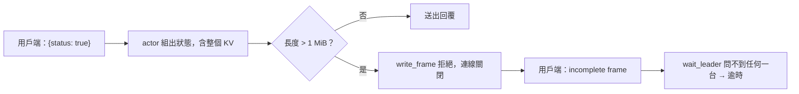

# 資料超過 1 MiB，節點就說不出自己的狀態

狀態：草稿

> 這篇的命令與輸出都實際執行過（2026-11-15），還沒有第二個人照著做一遍。
> 讀者設定：知道節點之間與用戶端都用「長度＋JSON」的訊框溝通即可。

發現日期：2026-11-14　｜　發現方式：S5 寫規格前量基準，量測腳本查詢狀態時連線被中斷　｜
影響的版本：V1 起　｜　修正：commit `dd1565f`

## 1. 一句話說後果

資料量超過大約 1 MiB 之後，節點不再回覆狀態查詢；而叢集工具靠狀態查詢找 leader，所以整套工具跟著失效——連「誰是 leader」都問不出來。

這篇帶你看到它、找出門檻在哪裡，以及為什麼這種「除錯用的功能」也值得修。

## 2. 需要的背景

**訊框（frame）。** 本專案所有連線都用同一種格式：4 bytes 的長度，接著那麼多 bytes 的 JSON。長度有上限 1 MiB（`MAX_FRAME`），超過就拒絕送出與接收，避免一個壞掉的長度欄位讓程式配置巨大的記憶體。

**狀態查詢。** 對用戶端連接埠送 `{"status": true}`，節點回覆一個 JSON：角色、term、commit index……以及**整個 KV 的內容**。它標著 `debug_only`，原本只用來在測試與帶讀中觀察小型叢集。

**誰在用它。** `tools/cluster.py` 的 `wait_leader` 逐一問每個節點的狀態，找出 `role` 是 `Leader` 的那台；`tools/kv_admin.py` 也一樣。

## 3. 親手重現

需要 Linux 或 WSL、Rust、Git，以及專案的 `.venv`。在專案根目錄執行：

```bash
docs/lessons/15-status-too-large-to-send/repro.sh
```

約 2 分鐘。它在 `artifacts/runs/` 底下建暫存目錄，結束時刪除。完整輸出在 [expected-output.txt](expected-output.txt)。

腳本建出 tag `s1-s4-review-verified` 與目前版本的節點程式，各啟動一個三台叢集，寫入 300 筆 4 KiB 的值（約 1.2 MiB），然後查詢狀態：

```text
== before the fix (s1-s4-review-verified)
   before: 300 values of 4 KiB written (about 1.2 MiB of data)
   status: NO ANSWER (EOFError: incomplete frame)
   Cluster.wait_leader: TIMED OUT (it asks every node for its status)

== after the fix (current source)
   after: 300 values of 4 KiB written (about 1.2 MiB of data)
   status: answered, role Leader, kv_omitted True, kv_bytes 1232591
   Cluster.wait_leader: found the leader
```

修正前，用戶端只看到連線被關掉（`incomplete frame`），沒有任何錯誤訊息；`wait_leader` 問遍三台都問不到，最後逾時。

## 4. 為什麼會這樣

修正前的狀態查詢：

```rust
json!({ ..., "kv": self.kv.values(), ... })   // 整個 KV
```

回覆在送出前由 `write_frame` 檢查長度：超過 1 MiB 就回傳錯誤，連線處理的執行緒直接結束、關掉連線。300 筆 4 KiB 的值序列化後是 1,232,591 bytes，超過 1,048,576。



這個上限本身是對的（它保護接收端）；錯的是把一個會無限成長的東西整個放進一個有上限的回覆裡。

## 5. 為什麼嚴重

- **不影響資料與正確性**：寫入、讀取、複製都正常，資料沒有遺失。
- **但會讓人看不見叢集**：維運或測試最需要知道「誰是 leader、commit 到哪裡」時，正是資料量大的時候。工具全部失效，也無法以 `tools/kv_admin.py` 做成員變更（它也靠狀態查詢找 leader）。
- **錯誤是安靜的**：節點不記錄、用戶端只看到連線中斷，很容易被誤判成網路或節點掛掉。

## 6. 怎麼修

KV 內容序列化後超過 256 KiB 時，回覆省略它（`kv` 為 `null`），並加上 `"kv_omitted": true` 與 `kv_bytes`；其餘欄位照常。小資料量時回覆與以前相同，既有測試不受影響。

```rust
let kv_bytes = serde_json::to_vec(&kv).map_or(0, |bytes| bytes.len());
let kv = if kv_bytes > STATUS_KV_BYTES { Value::Null } else { kv };
```

| 其他做法 | 為什麼沒選 |
|---|---|
| 放寬訊框上限 | 只是把門檻往後推，資料還會繼續長；上限保護接收端，不應為了除錯功能放寬 |
| 狀態查詢永遠不帶 KV | 小型叢集的測試與帶讀直接看 KV 很方便；改用門檻，兩者兼顧 |
| 分頁查詢 KV | 需要新的請求格式；除錯功能不值得 |

## 7. 怎麼證明修好了

- 節點單元測試 `queued_writes_share_one_barrier_and_status_survives_a_large_map`：寫入 96 筆 4 KiB 的值（約 400 KiB，超過 256 KiB 的門檻）後查詢狀態，斷言有回覆且 `kv_omitted` 為真。
- 真實 process 測試 `test_tools_keep_working_when_the_map_exceeds_a_frame`：寫入約 1.2 MiB 後，`wait_leader` 仍找得到 leader，狀態標明省略。
- Mutation 案例 `s5_status_embeds_any_map`：拿掉門檻時，單元測試必須失敗。
- 首次發現的紀錄：2026-11-14 S5 基準量測腳本在寫入約 1,000 筆 1 KiB 的值後查詢狀態，`EOFError: incomplete frame`（規格 `PERFORMANCE.md` §2）。

## 8. 還沒解決的事

- 其他欄位理論上也可能變大；目前沒有其他隨資料量成長的欄位，沒有一般化的檢查。
- 訊框太大時，節點仍然只是關掉連線、不記錄原因。這次只修了已知會變大的那一個回覆。
- 256 KiB 是拍定的門檻，沒有量測依據。

## 9. 自我檢查與練習

解答在 [answers.md](answers.md)。

1. 為什麼用戶端看到的是 `incomplete frame`，而不是一個明確的錯誤狀態？
2. 為什麼這個問題會讓成員變更也做不了？
3. 門檻設在 256 KiB，而不是剛好 1 MiB，有什麼好處？
4. 這個缺陷影響安全性、可用性，還是可觀察性？

**動手練習：門檻在哪裡？**

- 起點：`repro.sh` 用的舊版節點程式，與第 3 節「每筆 4 KiB 的值」。
- 目標：由第 3 節的 `kv_bytes`（300 筆 1,232,591 bytes）推算舊版從第幾筆開始無法回覆，再實際寫入門檻兩側的筆數驗證。
- 怎麼知道做對了：推算和實測一致；和解答比對。

## 10. 面試時怎麼講

**兩分鐘版本**

- **情境**：我在為 Raft KV store 量效能基準，寫入大約一千筆 1 KiB 的資料後，量測腳本查詢節點狀態時連線被中斷。
- **怎麼發現**：錯誤只有 `incomplete frame`，換一台節點也一樣；檢查回覆內容，發現狀態查詢把整個 KV 放進去，超過了 1 MiB 的訊框上限。
- **根因**：一個會無限成長的資料被放進有上限的回覆；而叢集工具都靠這個查詢找 leader，所以全部跟著失效。
- **修法與取捨**：超過 256 KiB 就省略 KV 並標明，其餘照常；沒有放寬訊框上限，因為那是保護接收端的。
- **怎麼驗證**：修正前後各寫 1.2 MiB 查詢一次；另有單元測試與 process 測試，以及植入錯誤的 mutation 案例。
- **學到什麼**：除錯功能也是介面；任何「整個放進去」的回覆，都要問它會不會隨資料成長。

**可能的追問**

- *「為什麼這麼久才發現？」* 之前的測試資料都很小，最大的也只有幾百筆短字串；第一次用接近真實的資料量量效能才碰到。
- *「節點有沒有因此出錯？」* 沒有，只是那一條連線被關掉；資料與複製都正常。
- *「其他回覆有沒有同樣的風險？」* 檢查過：其他回覆都是固定大小或有上限（讀取只回一個值、AppendEntries 以 512 KiB 為限）。
