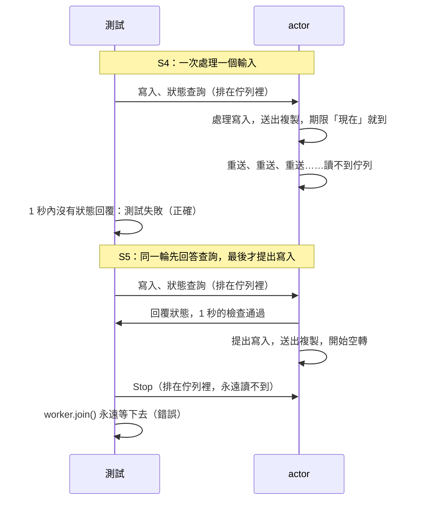

# 植入錯誤之後，守衛測試不失敗，而是永遠等下去

狀態：草稿

> 這篇的命令與輸出都實際執行過（2026-11-15），還沒有第二個人照著做一遍。
> 讀者設定：知道什麼是單元測試、什麼是「植入錯誤來檢查測試」（mutation）即可，不需要懂 Raft。

發現日期：2026-11-15　｜　發現方式：S5 的獨立審查（`claude-sonnet-5-5`）在安靜的機器上重跑完整的 mutation，三次都停在同一個案例　｜
影響的版本：S5 的 commit `e5f09c2`（S4 正常）　｜　修正：commit `be65999`

## 1. 一句話說後果

有一個測試專門抓「節點忙到不理人」。S5 之後，它遇到自己要抓的錯誤時不會失敗，而是永遠等下去；同時節點每秒寫出四十幾 MB 的紀錄，
跑 mutation 的工具把這些輸出全部留在記憶體裡，幾分鐘內整台 WSL 就撐不住。

這篇帶你在安全的限制下重現它（不會拖垮你的機器），看懂一個原本會失敗的測試為什麼變成卡住，以及怎麼讓「卡住」也變成看得見的結果。

## 2. 需要的背景

**Mutation 測試。** 故意在程式裡植入一個已知的錯（叫 mutant），再跑測試。測試失敗，表示它守得住這條規則；測試照樣通過，表示它沒在守。
本專案用 `scripts/mutation_check.py` 逐一植入錯誤，目前有 63 個案例。

**actor 迴圈。** 節點只用一個執行緒（actor）處理所有事情。迴圈每一圈先處理到期的計時器，再從佇列取出輸入：用戶端請求、狀態查詢、停止訊號等等。它同一時間只做一件事。

**重送期限（RPC deadline）。** leader 送出 AppendEntries 之後，記下一個期限（現在加上 `PEER_TIMEOUT`）。期限到了還沒收到回覆，就重送一次。

**這個守衛測試。** `saturated_outbound_pool_does_not_starve_status` 模擬「對外的連線全部佔滿」：先送一個寫入，讓 leader 必須複製；再送一個狀態查詢，要求 1 秒內得到回覆。
它要抓的錯是「actor 一直在處理計時器，永遠輪不到佇列」，也就是 mutation 案例 `saturated_pool_spin`：把重送期限寫成「現在」，於是送出就到期、到期就重送。

**同一輪（drain）。** S5 起，actor 一次從佇列取出所有排隊的輸入（最多 256 個）。它先處理狀態查詢這類輸入，最後才把這一輪的寫入合成一批提出（`docs/PERFORMANCE.md` §6.1）。

## 3. 親手重現

需要 Linux 或 WSL、Rust、Git 與專案的 `.venv`。在專案根目錄執行：

```bash
docs/lessons/16-a-guard-test-that-hangs/repro.sh
```

約 40 秒。腳本在 `artifacts/runs/` 底下建暫存目錄，結束時刪除。它取出三個版本：S4（`s1-s4-review-verified`）、修正前的 S5（`e5f09c2`）和目前的程式，
各自植入同一個錯誤，然後只跑這個守衛測試。每次都經過專案的 `scripts/capped_run.py`，上限 60 秒、輸出 256 MiB，超過就殺掉整組行程，所以不會拖垮機器。
完整輸出在 [expected-output.txt](expected-output.txt)：

```text
== S4 (s1-s4-review-verified), with the mistake planted
   the test FAILED after 1.1 s: pool saturation must not starve queued status: Timeout
   output: 44.5 MB (40 MB/s)

== S5 before the fix (e5f09c2), with the mistake planted
   KILLED after 6.3 s (output cap of 268435456 bytes reached); the test had neither failed nor passed
   output: 270.1 MB (43 MB/s)

== current source, with the mistake planted
   the test FAILED after 1.1 s: pool saturation must not starve a status asked while the write replicates: Timeout
   output: 43.0 MB (39 MB/s)
```

看三件事：

- S4 和目前的程式，測試 1 秒多就**失敗**。這是正確的結果：測試抓到了錯。
- 修正前的 S5，測試既沒有失敗也沒有通過，是被輸出上限**殺掉**的。沒有上限，它會一直跑下去。
- 三個版本的節點都在大量寫紀錄，每秒約 40 MB：錯誤讓 actor 不停重送，每送一次就寫一行 trace。差別只在測試會不會結束。

## 4. 為什麼會這樣

修正前，測試做四件事：

```rust
tx.send(Input::Client(寫入));       // 1. 先排一個寫入
tx.send(Input::Status(status_tx));  // 2. 再排一個狀態查詢
let worker = thread::spawn(move || actor.run());
status_rx.recv_timeout(Duration::from_secs(1))
    .expect("pool saturation must not starve queued status");
tx.send(Input::Stop);               // 3. 叫 actor 停下
worker.join();                      // 4. 等它真的停下
```

植入的錯誤讓每個 RPC 的期限都是「現在」。actor 迴圈先找到期的計時器，處理完就 `continue` 回到開頭；只要一直有到期的計時器，就永遠走不到讀佇列那一步：

```rust
loop {
    if let Some(key) = 已到期的 rpc_deadlines { 重送; continue; }  // 錯誤之下，這裡永遠有事做
    // ……其他計時器……
    // 讀佇列、處理輸入
}
```

S4 和 S5 的差別，在於寫入和狀態查詢誰先處理：



S5 的 drain 迴圈本身沒有錯，它只是改了同一輪裡的處理順序。這個測試卻暗中依賴舊的順序：它用「狀態查詢有沒有回覆」判斷 actor 有沒有被餓死，
而 S5 讓查詢在寫入之前就得到回答。測試還在跑，卻已經測不到它要測的事。這和[教學 07](../07-test-silently-stopped-testing/README.md)、
[教學 12](../12-simulator-stopped-asking-stale-leaders/README.md) 是同一類問題，只是這次不是「悄悄通過」，而是「悄悄卡住」。

**第二個問題：輸出全部存在記憶體裡。** 當時的 `mutation_check.py` 用 `subprocess.run(..., capture_output=True, timeout=600)`，子行程的輸出全部存在 Python 的記憶體裡。
節點的 trace 直接寫到行程的 stdout，libtest 的輸出擷取管不到它。審查者孤立重現時量到每秒約 52 MB，三分鐘就超過 8 GB，而這台 WSL 的記憶體上限約 8.9 GB
（推論：速率和中斷的時間吻合，沒有直接看到記憶體耗盡）。逾時也救不了：`timeout` 只殺直接的子行程 cargo，底下的測試執行檔會繼續跑。

## 5. 為什麼嚴重

- **節點本身沒有 bug**，資料和 Raft 的安全性都不受影響。出問題的是「檢查測試的機制」。
- **驗收做不完。** 完整的 mutation 執行每次都死在第 4 個案例，P10 之後的階段全部無法驗收。S5 的作者那次驗收也停在這裡，當時以為是 session 結束造成的，文件卻已經寫成「完成」（審查的 F1）。
- **失敗的樣子像是機器壞了。** 沒有錯誤訊息，也沒有失敗的測試名稱，只看到 WSL 重啟，很容易被當成環境問題放過。
- **守衛失效。** 哪天真的寫出「actor 被計時器餓死」的錯，這個測試不會告訴你，只會卡住。

## 6. 怎麼修

兩個問題分開修（commit `be65999`）。

**測試：寫入提出之後再問一次狀態，並且限時等 actor 停下。**

```rust
// 第二次查詢：這時寫入已經提出、正在複製
let status = again_rx.recv_timeout(Duration::from_secs(1))
    .expect("pool saturation must not starve a status asked while the write replicates");
assert_eq!(status["batched_writes"], 1, "the write was proposed; otherwise the pool was never used");
tx.send(Input::Stop).unwrap();
// 被餓死的 actor 永遠讀不到 Stop：限時，不要永遠等
let deadline = Instant::now() + Duration::from_secs(2);
while !worker.is_finished() {
    assert!(Instant::now() < deadline, "the actor did not stop");
    thread::sleep(Duration::from_millis(10));
}
```

`batched_writes == 1` 確認寫入真的提出了；否則連線池根本沒用到，測試又會悄悄失效。

**工具：每個 mutation 案例都經 `scripts/capped_run.py` 執行。** 它把命令放進自己的行程群組，只保留輸出的頭尾各 4 MiB；
超過 480 秒或 256 MiB 就殺掉整個群組，結果記為 `timeout` 或 `output_cap`，**不算偵測到**。

| 其他做法 | 為什麼沒選 |
|---|---|
| 把 actor 的處理順序改回 S4 那樣 | 那個順序是 group commit 的設計（先回答查詢、最後合批），不能為了讓測試過關而改產品的行為 |
| 只把 `timeout` 調短 | 擋不住記憶體：每秒 50 MB，600 秒就是 30 GB；而且只殺得到 cargo |
| 把輸出寫到檔案，不放記憶體 | 磁碟一樣會被灌滿，而且仍然需要時間上限 |
| 把 `timeout`／`output_cap` 算成偵測到 | 卡住不代表測試抓到錯；這樣會把「測試壞了」誤當成「測試有效」 |

## 7. 怎麼證明修好了

- 不植入錯誤時，修好的測試通過；植入 `saturated_pool_spin` 時，它 1.1 秒就失敗（第 3 節的第三段）。
- 修正後第一次跑完完整的 mutation：57 個案例全部偵測到，`saturated_pool_spin` 由修好的測試抓到（審查報告 §11）。S6 加到 63 個，同樣全部偵測到。
- `scripts/test_mutation_check.py` 新增 5 個測試：被殺掉的執行永遠不算偵測；輸出洪水在上限處截斷、只留頭尾；時間上限連子行程一起殺掉。
- 首次發現的紀錄：審查的孤立重現，`artifacts/audit/independent-review-20261115-s5/spin-probe/results.json`（S5 的 mutant 100 秒沒有結束，stdout 寫出 5.2 GB）。這個資料夾不在版本控制內。

## 8. 還沒解決的事

- 沒有一般化的方法能找出「依賴處理順序的測試」。這次是完整的 mutation 執行剛好停在這裡才發現；S5 補記 §14.4 檢查過「依賴舊行為的測試」，仍然漏掉了。
- `capped_run.py` 讓卡住的 mutant 變成看得見的 `timeout`，但不會讓它被偵測到。偵測仍然靠測試本身寫得對。
- 節點的 trace 沒有速率限制。這種錯誤讓它每秒寫幾十 MB，真實部署時一樣會灌滿磁碟（推論，沒有實測）。

## 9. 自我檢查與練習

解答在 [answers.md](answers.md)。

1. 為什麼 S4 的測試會失敗，S5 的同一個測試卻會卡住？用一句話說出關鍵的差別。
2. 修好的測試為什麼要斷言 `batched_writes == 1`？拿掉它會怎樣？
3. `subprocess.run(..., timeout=600)` 為什麼擋不住這次的問題？說出兩個原因。
4. 為什麼 `capped_run.py` 把 `timeout` 和 `output_cap` 都記成「沒有偵測到」？

**動手練習：只靠限時等待夠不夠？**

- 起點：目前的程式碼，`crates/raft-node/src/main.rs` 裡的 `saturated_outbound_pool_does_not_starve_status`。
- 目標：在副本中刪掉第二次狀態查詢（`again_tx` 那一段），保留限時等待停止；植入 `saturated_pool_spin`，經 `capped_run.py` 執行這個測試。先寫下你的推論，再看實際結果。
- 怎麼知道做對了：結果和推論一致，而且你說得出是哪一行讓測試結束的；再和解答比對。

## 10. 面試時怎麼講

**兩分鐘版本**

- **情境**：我的 Raft KV store 用 mutation 測試來檢查測試本身。做完 group commit 之後，完整的 mutation 執行每次都停在同一個案例，機器跟著重啟。
- **怎麼發現**：審查的人在安靜的機器上孤立重現，只跑那一個測試，加上時間、CPU 與記憶體的保護。S4 的程式兩秒內就失敗；S5 的程式 100 秒都不結束，stdout 寫出 5 GB。
- **根因**：兩個問題疊在一起。group commit 讓 actor 在同一輪先回答狀態查詢、最後才提出寫入，測試的檢查因此提早通過，之後永遠等不到 actor 停下；
  mutation 工具又把輸出全部放在記憶體裡，每秒 50 MB，幾分鐘就耗盡記憶體。
- **修法與取捨**：測試在寫入提出之後再問一次狀態，並且限時等待停止；工具改經一個有時間與輸出上限的包裝執行，被殺掉的一律不算偵測到。
  我沒有改 actor 的處理順序，因為那是產品的設計。
- **怎麼驗證**：修好之後，完整的 mutation 執行第一次跑完，57 個案例全部偵測到；包裝工具另有 5 個測試。
- **學到什麼**：優化改了處理順序，而測試暗中依賴那個順序。測試失敗時長什麼樣子，要事先設計好；檢查工具也要對失控的輸入設上限。

**可能的追問**

- *「為什麼作者自己沒發現？」* 作者那次驗收剛好停在這個案例，當時以為是 session 結束造成的；文件卻在驗收開始前就寫成完成。這是另一個教訓：沒有跑完的驗收，不能寫成通過。
- *「為什麼不在 actor 加一個『最多連續處理 N 個計時器』的上限？」* 那是改產品去配合一個植入的錯誤。真正的問題是測試沒有在對的時間點檢查。
- *「怎麼避免寫出這種測試？」* 寫守衛測試時，先植入它要抓的錯，看它怎麼失敗、多久失敗；任何等待都要有上限。
