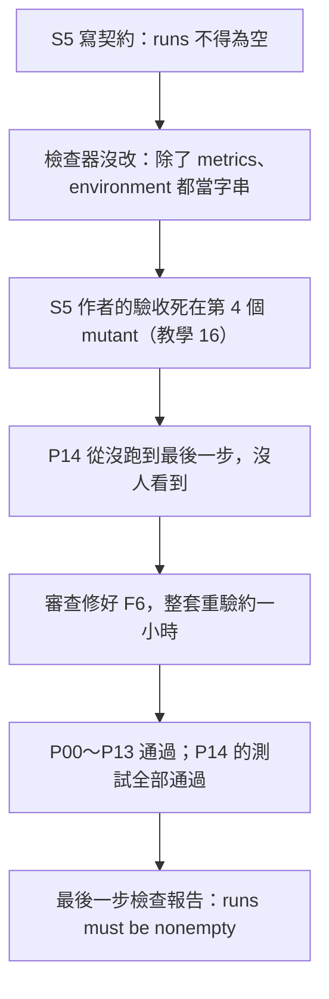

# 驗收契約寫了一條檢查器永遠做不到的要求

狀態：草稿

> 這篇的命令與輸出都實際執行過（2026-11-15），還沒有第二個人照著做一遍。
> 讀者設定：看得懂簡單的 Python 與 JSON 即可，不需要懂 Raft。

發現日期：2026-11-15　｜　發現方式：S5 的獨立審查修好 F6 之後整套重驗，最後一步失敗　｜
影響的版本：S5 的契約（commit `e5f09c2`）加上 V1 起的檢查器　｜　修正：commit `be65999`；預檢在 S6 加入

## 1. 一句話說後果

S5 的驗收契約要求效能報告的 `runs` 不得為空，可是檢查器只把它當成字串來檢查；`runs` 是一個清單，所以**再好的報告也過不了**，
S5 因此永遠拿不到「驗收通過」。這條要求從寫下的那一刻起就不可能被滿足，卻要等到一小時的整套驗收跑到最後一步才露出來。

這篇帶你用一秒鐘重現它，看懂「契約」與「檢查器」怎麼會彼此對不上，以及怎麼讓這種錯誤在幾秒內出現。

## 2. 需要的背景

**驗收契約（contract）。** `acceptance/final.json` 寫著每個階段必須通過的測試，以及每份報告必須滿足的規則。例如階段 14 對 `write-benchmark.json` 寫：

```json
{"required_nonempty": ["command", "environment", "runs"], "required_positive_integer": ["writes_per_run"]}
```

意思是：這三個鍵要存在而且不是空的；`writes_per_run` 要是正整數。

**檢查器（checker）。** `scripts/verify_gate.py` 讀契約、執行測試、檢查報告，全部通過才寫下一張 receipt（驗收收據）。契約說「要什麼」，檢查器決定「怎麼判斷」。

**「不是空的」要看型別。** 字串的空是 `""`，清單的空是 `[]`，物件的空是 `{}`。檢查器得先知道一個鍵應該是什麼型別，才知道怎麼判斷它空不空。

**報告長什麼樣。** `write-benchmark.json` 的 `runs` 是一個清單，裡面兩筆：修正前（`before`）與修正後（`after`）的量測。

## 3. 親手重現

需要 Git 與專案的 `.venv`。在專案根目錄執行：

```bash
docs/lessons/17-a-rule-the-checker-could-not-meet/repro.sh
```

一秒鐘。腳本取出 S5 當時（`e5f09c2`）的檢查器與契約，造一份格式和真實報告相同的 `write-benchmark.json`，分別交給舊的與目前的檢查器。
完整輸出在 [expected-output.txt](expected-output.txt)：

```text
== S5 checker (e5f09c2)
   runs holds two entries: REFUSED (Report write-benchmark.json: runs must be nonempty)
   runs is empty: REFUSED (Report write-benchmark.json: runs must be nonempty)

== current checker
   runs holds two entries: accepted
   runs is empty: REFUSED (Report write-benchmark.json: runs must be nonempty)
```

看第一段：`runs` 明明有兩筆，舊的檢查器卻說它是空的。好報告與壞報告得到**同樣的**結果，代表這條規則分不出好壞。目前的檢查器只拒絕空的清單。

## 4. 為什麼會這樣

S5 的檢查器（這段邏輯從 V1 起就是這樣）：

```python
for key in schema.get("required_nonempty", []):
    expected = dict if key in {"metrics", "environment"} else str
    if not isinstance(data.get(key), expected) or not data[key] or (expected is str and not data[key].strip()):
        raise ValueError(f"Report {path}: {key} must be nonempty")
```

它只認兩種型別：`metrics`、`environment` 是物件，**其他一律是字串**。V1 的報告裡，`required_nonempty` 列的鍵剛好都是這兩種，所以一直沒事。
S5 的契約第一次列了一個清單型別的鍵 `runs`：`isinstance([...], str)` 為假，檢查器就拋出「`runs` must be nonempty」。

錯誤藏了多久，取決於「第一次真的跑」是什麼時候：



契約與檢查器各自看起來都合理，錯在**兩者之間**：寫契約的人以為「不得為空」適用任何型別，寫檢查器的人當初只想到字串與物件。
沒有任何測試拿「格式和真實報告一樣的資料」去跑這條規則，所以要到真的驗收才碰到。

## 5. 為什麼嚴重

- **程式本身沒有錯**，報告也沒有錯。受影響的是「能不能宣稱驗收通過」：P14 永遠拿不到 receipt，也就不能打 S5 的 tag。
- **它誘使人削弱驗收。** 最快的「修法」是把 `runs` 從契約拿掉，驗收立刻通過，但那就少檢查了一件事。這個專案的規則是不為了通過而削弱測試。
- **代價高。** 錯誤只在整套驗收的最後一步出現。修改檢查器又會讓所有階段的 receipt 失效，必須從 P00 再跑一次，又是一小時。

## 6. 怎麼修

讓檢查器認得清單，**保留**「不得為空」這條要求（commit `be65999`）：

```python
REPORT_KEY_TYPES = {"metrics": dict, "environment": dict, "runs": list}
...
for key in schema.get("required_nonempty", []):
    expected = REPORT_KEY_TYPES.get(key, str)
```

S6 再補上預檢：`scripts/preflight_phase.py` 先拿磁碟上現有的報告跑一遍契約的報告規則，不寫 receipt。這類錯誤幾秒內就會出現，不必等一小時。
報告若來自別的來源（指紋不同），預檢只提醒，因為報告本來就在驗收前才重新產生。

| 其他做法 | 為什麼沒選 |
|---|---|
| 從契約拿掉 `runs` | 削弱驗收：少檢查一件事，只為了過關 |
| 把報告的 `runs` 改成物件 | 讓報告去遷就檢查器的缺陷；清單本來就是最自然的格式 |
| 檢查器遇到不認得的型別就放行 | 會讓真正空的報告也過關，等於沒有這條規則 |

## 7. 怎麼證明修好了

- `scripts/test_verify_gate.py` 的 `test_nonempty_keys_have_the_type_the_report_uses`：每個型別的空值都被拒絕。
- 同一檔的 `test_the_phase_14_write_benchmark_schema_accepts_a_report_shaped_like_the_real_one`：用**契約裡真正的那條規則**，檢查一份格式和真實報告相同的資料——這正是當初缺的測試。
- 修正後從 P00 整套重驗，P00～P14 全部通過，才打了 tag `s5-performance-verified`。
- S6 的 `scripts/test_preflight_phase.py`（4 個測試）：規則不符算問題、清單型別的 `runs` 通過、來源不同只提醒、較早階段的規則也會檢查。
- 首次發現的紀錄：審查的整套重驗，`artifacts/acceptance-final/phase-14.last-attempt.json`（不在版本控制內）；審查報告 F7。

## 8. 還沒解決的事

- 檢查器仍然假設沒列在 `REPORT_KEY_TYPES` 的鍵是字串。下一次有人在契約裡列一個新的清單或數字鍵，還會碰到同一個問題；差別是預檢會在幾秒內指出來。
- 報告還不存在時（例如新階段的第一份報告），預檢只能說「沒檢查」。真正的保證仍然是「契約寫好就實際跑一次 `verify_gate.py`」，交接文件已把這一條列為踩過的坑。
- 檢查器本身的測試是用手寫的資料；它們不會自動跟著契約新增的規則增加。

## 9. 自我檢查與練習

解答在 [answers.md](answers.md)。

1. 為什麼 V1 的報告從來沒有碰到這個問題？
2. 舊的檢查器拒絕了「有兩筆的 `runs`」，也拒絕了「空的 `runs`」。為什麼說這代表規則本身壞了，而不只是報告有問題？
3. 把 `runs` 從契約拿掉也能讓驗收通過。這樣做少了什麼保證？
4. 預檢遇到「報告來自別的來源」為什麼只提醒、不算問題？

**動手練習：還有沒有別條永遠過不了的要求？**

- 起點：`e5f09c2` 的檢查器與契約（`git show e5f09c2:scripts/verify_gate.py`、`git show e5f09c2:acceptance/final.json`），以及 `artifacts/reports/` 裡現有的報告。
- 目標：對契約裡每一條 `required_nonempty`，用**舊的**檢查器只檢查那一個鍵，列出哪些鍵在真實報告上永遠過不了。
- 怎麼知道做對了：你列出的清單和解答一致，並說得出每一個「過不了」的鍵在報告裡是什麼型別。

## 10. 面試時怎麼講

**兩分鐘版本**

- **情境**：我的專案用一份 JSON 契約描述驗收：要跑哪些測試、每份報告要滿足哪些規則，由一支檢查器執行。S5 加了一條規則：效能報告的 `runs` 不得為空。
- **怎麼發現**：審查的人修好另一個讓驗收中斷的問題之後，整套重驗跑了一小時，所有測試都通過，卻在最後一步檢查報告時失敗：`runs must be nonempty`。報告裡明明有兩筆。
- **根因**：檢查器判斷「不是空的」之前，先假設鍵的型別；它只認物件與字串，而 `runs` 是清單。契約和檢查器各自都合理，錯在兩者之間，而且從來沒有測試拿真實格式的資料跑過這條規則。
- **修法與取捨**：讓檢查器依一張型別表判斷，保留「不得為空」的要求；沒有把規則從契約拿掉，因為那是削弱驗收。之後再加一個預檢，用現有的報告先跑一遍契約的規則，幾秒就能發現同類錯誤。
- **怎麼驗證**：新增兩個測試，其中一個直接用契約裡那條規則檢查一份真實格式的報告；修正後從頭重驗全部通過。
- **學到什麼**：寫完一條驗收規則，要立刻拿真實的資料跑一次，不要等到整套驗收的最後一步；規則和執行規則的程式要放在一起測。

**可能的追問**

- *「為什麼作者沒發現？」* 作者的驗收在更早的地方就中斷了（教學 16），從來沒跑到這一步；文件卻已寫成完成。
- *「改檢查器為什麼要全部重跑？」* 每張 receipt 都記著檢查器與契約的雜湊；檢查器變了，舊的 receipt 就不能證明新的檢查器會讓它們通過。
- *「預檢能取代整套驗收嗎？」* 不能。它只檢查報告的結構，不寫 receipt；指紋不符時也只提醒。
