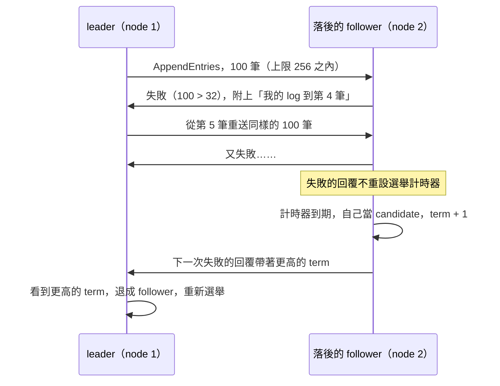

# 放寬了上限，卻沒有測試守著它

狀態：草稿

> 這篇的命令與輸出都實際執行過（2026-11-15），還沒有第二個人照著做一遍。
> 讀者設定：知道 Raft 的 leader 會把 log 複製給 follower 即可；其餘概念第 2 節會解釋。

發現日期：2026-11-15　｜　發現方式：S5 的獨立審查逐一植入錯誤（mutation），這一個存活　｜
影響的版本：S5（tag `s5-performance-verified`）之前沒有守衛；程式本身正確　｜　補上測試：S6（`docs/PERFORMANCE.md` §15）

## 1. 一句話說後果

S5 把「一個複製請求最多帶幾筆 log」從 32 筆放寬到 256 筆，卻沒有任何測試守著 follower 這一側的上限。把它改回 32，所有測試照樣通過；
可是一個落後超過 32 筆、又沒有快照可用的 follower，從此再也追不上，還會不斷抬高 term，干擾整個叢集。

這篇帶你親眼看到這個錯誤躲過整套測試、在真實叢集裡讓節點永遠追不上，以及只需要哪兩個數字的測試就能抓到它。

## 2. 需要的背景

**AppendEntries。** leader 用這個請求把 log 複製給 follower。請求裡有「前一筆的位置與 term」（`prev_log_index`、`prev_log_term`），以及接下來的幾筆 entry。
follower 檢查前一筆對得上，才接受這些 entry，回覆成功；對不上或請求不合規定，就回覆失敗。

**落後的 follower 怎麼追上。** leader 記得每個 follower 的下一個位置。follower 停機一陣子再回來，leader 就從它缺的那一筆開始，一次送一批，直到補齊。
如果它缺的部分已經被壓縮成快照（log compaction），leader 改送快照（InstallSnapshot）。這篇的情況是**還沒有快照**，只能從 log 追。

**批次上限。** 一個 AppendEntries 最多帶 `MAX_BATCH_ENTRIES` 筆（S5 起是 256，之前是 32），也不超過 512 KiB。送的一方（leader）照這個上限切批；
收的一方（follower）也檢查：超過上限的請求不合規定。兩邊有兩道檢查：訊息格式的 `Envelope::valid_for`，以及 core 處理 AppendEntries 時自己的檢查。

**安全性與活性（safety 與 liveness）。** 安全性是「不會發生壞事」，例如兩個節點對同一個位置 commit 了不同的 entry。活性是「好事終究會發生」，例如落後的節點終究會追上。
本專案的模擬器檢查 I1～I10 十條不變量，**全部是安全性**。

**Mutation 測試。** 故意植入一個錯誤再跑測試。測試照樣通過，表示沒有測試守著那一行（教學 16 第 2 節）。

## 3. 親手重現

需要 Linux 或 WSL、Rust、Git 與專案的 `.venv`。在專案根目錄執行：

```bash
docs/lessons/18-a-limit-nobody-tested/repro.sh
```

約 1 分鐘（第一次建置會久一些）。腳本在 `artifacts/runs/` 底下建暫存目錄，結束時刪除。它做三件事：

1. 取出 S5（`s5-performance-verified`），把 core 的上限改回 32，跑 raft-core 與 raft-protocol 的全部測試。
2. 對目前的程式植入同一個錯誤，跑 S6 新增的測試。
3. 各用「S5＋錯誤」與「目前的程式」啟動一個三台的真實叢集：停掉一個 follower、寫入 100 筆、再把它啟動，等它追上。

完整輸出在 [expected-output.txt](expected-output.txt)：

```text
== S5 (s5-performance-verified) with the limit back to 32
   raft-core and raft-protocol: 57 tests, all passed

== current source with the same mistake
   a_follower_accepts_a_full_batch_and_refuses_one_more: FAILED
     assertion `left == right` failed
       left: (Some((false, 0)), 1)
      right: (Some((true, 257)), 257)

== a real cluster, S5 with the limit back to 32
   node 2 stopped, 100 writes committed (last_applied 104, snapshot_index 0); node 2 started again
   node 2 NOT caught up after 15 s: role Candidate, term 27, last_applied 0
   node 1: role Follower, term 27, entries sent in AppendEntries 111734
   node 3: role Follower, term 26, entries sent in AppendEntries 199954

== a real cluster, current source
   node 2 stopped, 100 writes committed (last_applied 104, snapshot_index 0); node 2 started again
   node 2 caught up in 0.2 s
```

看三個地方：

- 第一段：57 個測試**全部通過**。整套測試看不出上限被改回 32。審查時另外跑過 `cargo test --workspace` 與 32 個整合測試，也全部通過。
- 第三段：node 2 過了 15 秒還是 `last_applied 0`，term 已經升到 27。另外兩台在 AppendEntries 裡合計送出 31 萬多筆 entry，而叢集的 log 只有 104 筆；
  多出來的幾乎都是一再重送給 node 2、又被拒絕的同一批（推論：計數也包含送給另一台正常 follower 的部分）。
- 第二段：S6 的新測試一跑就失敗。follower 回覆失敗（`false, 0`），log 停在 1；預期是成功、log 長到 257。

## 4. 為什麼會這樣

leader 這一側：node 2 缺 100 筆，leader 依 256 筆的上限，把 100 筆放進同一個 AppendEntries。

follower 這一側，core 處理 AppendEntries 時先檢查請求是否合規定（植入的錯誤就在第一行）：

```rust
let valid_entries = entries.len() <= 32        // 原本是 <= MAX_BATCH_ENTRIES（256）
    && ...;
if term == 0 || term != self.state.term || leader_id != from || !valid_entries {
    self.reply(from, rpc_id, Rpc::AppendResponse { success: false, ... });
    return;                                     // 注意：在 reset_election 之前就 return
}
self.step_down(term, effects);
self.reset_election(effects);                   // 合規定的請求才會重設選舉計時器
```

接下來會反覆發生：



兩件事疊在一起：

- **追不上**：leader 每次都送同樣的 100 筆，follower 每次都拒絕。leader 不會自己縮小批次，因為依它的規則 100 筆完全合法。
- **干擾叢集**：follower 拒絕時不重設選舉計時器，所以它一直發起選舉，term 一路往上。core 收到任何帶著更高 term 的訊息都會退位（`fn message` 開頭的
  `if term > self.state.term { self.step_down(...) }`），leader 因此一再下台、重新選舉。第 3 節看到的 term 27，就是 15 秒內反覆選舉的結果。

**為什麼整套測試都沒發現：**

- 送的一方有測試（`an_append_carries_at_most_one_batch`），收的一方沒有任何測試餵超過 32 筆的請求。
- 模擬器的不變量全是安全性。「落後的節點終究追上」是活性，沒有人檢查；而 follower 拒絕請求並不違反任何安全性。
- 整合測試裡唯一的「落後追趕」案例用 `snapshot_every=3`，走的是快照，不走 log。

這和[教學 07](../07-test-silently-stopped-testing/README.md)、[教學 12](../12-simulator-stopped-asking-stale-leaders/README.md) 是同一類：規則改了，測試卻沒有跟著去碰新的邊界。

## 5. 為什麼嚴重

- **安全性沒有受影響**：沒有任何 entry 被錯誤地 commit，資料是對的。
- **活性與可用性受影響**：落後超過 32 筆、沒有快照可用的 follower 永遠追不上；它持續抬高 term，讓 leader 一再下台，整個叢集的寫入會斷斷續續。
  這時若另一台也故障，剩下的兩台裡有一台永遠不接受複製，新的寫入湊不到多數，叢集等於停擺（推論，沒有實測）。
- **一行就能弄壞，卻沒有任何東西會響。** 這次只是植入的錯誤；但同樣的不一致在真實世界很容易出現，例如一半節點是舊版（上限 32）、一半是新版（送 256）的滾動升級。
  本專案只維護一個版本，沒有做混合版本的測試，這一點是推論。

## 6. 怎麼修

程式本身沒有錯，要補的是守衛（S6）：

- **core 單元測試** `a_follower_accepts_a_full_batch_and_refuses_one_more`：follower 收到剛好 256 筆的請求，必須成功、log 長到 257；收到 257 筆，必須不回覆、log 不變。
  只要兩個數字，就同時守住兩道檢查：core 自己的上限，以及 `valid_for` 的上限（core 收訊息時先呼叫它，不合規定的訊息直接丟掉）。
- **兩個 mutation 案例**：`s5_follower_limit_still_32`（core 的上限改回 32）、`s5_envelope_limit_still_32`（`valid_for` 的上限改回 32），都必須被上面的測試抓到。
- **真實 process 測試** `test_a_follower_far_behind_catches_up_from_the_log`：就是第 3 節的叢集情境，把審查者的探針收進正式測試，約 1.2 秒。

| 其他做法 | 為什麼沒選 |
|---|---|
| 在模擬器加一條活性的不變量（落後的節點在一段時間內必須追上） | 抓得到更多同類問題，但要定義「一段時間」並調整工作負載，是 S6 原本的大型強化；計畫縮減後不做，列在第 8 節 |
| leader 被拒絕時自動縮小批次 | 這是改協定來掩蓋兩邊上限不一致；正確的做法是讓兩邊一致，並用測試守住 |
| 只寫真實 process 測試 | 它要啟動叢集、等 15 秒才失敗；單元測試在毫秒內就指出是哪一道檢查 |

## 7. 怎麼證明修好了

- 不植入錯誤時，新的單元測試與 process 測試都通過（第 3 節第四段：0.2 秒追上）。
- 植入錯誤時，單元測試失敗（第 3 節第二段）。S6 的 mutation 執行：`s5_follower_limit_still_32` 與 `s5_envelope_limit_still_32` 都被偵測到。
- 首次發現的紀錄：審查者的 mutant `b_follower_limit_still_32` 在 `cargo test --workspace` 與 32 個整合測試下存活；探針 `test_zz_lag.py` 原版 1.16 秒通過、mutant 逾時
  （`artifacts/audit/independent-review-20261115-s5/evidence/lag_baseline.log`、`lag_mutant.log`，不在版本控制內；審查報告 F2）。

## 8. 還沒解決的事

- 模擬器仍然只檢查安全性。其他「節點永遠追不上」或「叢集永遠選不出 leader」的活性問題，這次的修正抓不到。
- 送的一方與收的一方用同一個常數 `MAX_BATCH_ENTRIES`，所以現在兩邊一致。但沒有任何機制在執行時發現兩邊不一致（例如不同版本的節點），只會表現成這篇的症狀。
- follower 拒絕不合規定的請求時，不記錄原因，也不重設選舉計時器。前者讓這種問題難查；後者是否該改，牽涉干擾防護的設計，這次沒有處理。

## 9. 自我檢查與練習

解答在 [answers.md](answers.md)。

1. 為什麼把上限改回 32，整套測試都還是通過？說出兩個原因。
2. 落後的 follower 為什麼會讓 term 一路升高？沿著程式說出是哪一行造成的。
3. 新的單元測試為什麼要同時測 256 與 257 兩個數字？只測 256 會漏掉什麼？
4. 這個錯誤違反的是安全性還是活性？為什麼模擬器的不變量抓不到它？

**動手練習：落後多少筆才會出事？**

- 起點：`repro.sh` 用的「S5＋上限 32」節點程式，以及 `probe.py`（第四個參數可以指定停機期間寫入幾筆）。
- 目標：先推論「落後 20 筆」與「落後 40 筆」各會怎樣，再實際執行驗證。
- 怎麼知道做對了：推論和實測一致；和解答比對。

## 10. 面試時怎麼講

**兩分鐘版本**

- **情境**：效能優化時，我把一個複製請求的上限從 32 筆放寬到 256 筆，送的一方有測試，收的一方沒有。
- **怎麼發現**：獨立審查逐一植入錯誤。把 follower 的上限改回 32，所有單元測試、模擬器與整合測試都通過；但另寫一個探針——停掉一個 follower、寫 100 筆、再啟動——它永遠追不上。
- **根因**：leader 依 256 的上限送 100 筆，follower 依 32 的上限每次都拒絕；而且拒絕時不重設選舉計時器，它就不斷發起選舉、抬高 term，讓 leader 一再下台。
  整套測試沒發現，是因為模擬器只檢查安全性，而整合測試的追趕案例走快照。
- **修法與取捨**：補一個只看兩個數字的單元測試（256 要接受、257 要拒絕），同時守住兩道檢查；再把探針收成正式的 process 測試，並登記兩個 mutation 案例。
  沒有讓 leader 在被拒絕時縮小批次，因為那是改協定去掩蓋不一致。
- **怎麼驗證**：植入錯誤時新測試立刻失敗；不植入時，落後 100 筆的 follower 0.2 秒追上。
- **學到什麼**：放寬或收緊任何上限時，邊界的兩側都要有測試，而且收發兩端都要測；只檢查安全性的測試，看不到「永遠不會發生」的好事。

**可能的追問**

- *「為什麼不是 bug，卻要寫成教學？」* 因為下一個改這一行的人不會知道它重要。沒有守衛的正確程式，和有 bug 的程式只差一次修改。
- *「真實系統會遇到嗎？」* 滾動升級時新舊版本的上限不同，就是同樣的情況；這個專案沒有測混合版本，所以這是推論。
- *「活性怎麼測？」* 在模擬器裡加「故障停止後一段時間內必須追上」這類條件；難處在定義時間界線並避免誤報。
