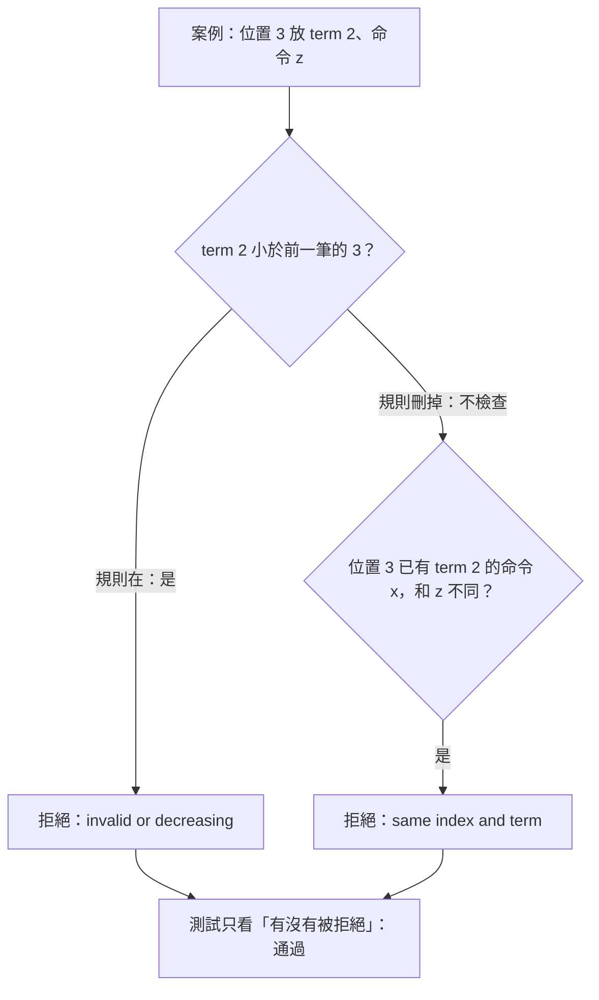

# 測試案例被別的規則先攔下，它要守的規則就沒人守

狀態：草稿

> 這篇的命令與輸出都實際執行過（2026-11-15），還沒有第二個人照著做一遍。
> 讀者設定：知道「表格式測試」（一張案例表跑同一段斷言）的寫法即可；Raft 的部分第 2 節會解釋。

發現日期：2026-11-15　｜　發現方式：S5 的獨立審查逐條移除 `validate_delta` 的規則，三條移除後測試照樣通過　｜
影響的版本：S5（tag `s5-performance-verified`）之前沒有守衛；程式本身正確　｜　補上案例：S6（`docs/PERFORMANCE.md` §15）

## 1. 一句話說後果

測試裡有一個案例，名字叫「entry 的 term 小於前一筆」，看起來守著這條規則；可是把這條規則從程式裡刪掉，測試照樣通過，
因為這個案例同時違反了另一條規則，被那一條擋下。另外兩條規則，一條完全沒有案例，一條只在空的 log 上才有作用。三條規則都可以悄悄消失。

這篇帶你看到同一個案例在「規則還在」與「規則刪掉」時被不同的規則拒絕，以及怎麼寫出只碰一條規則的案例。

## 2. 需要的背景

**Delta 與 `validate_delta`。** S5 起，節點落盤時只寫「這一步改了什麼」（`Delta`：新的 term、投票對象、從哪一筆開始截斷、要接上哪些 entry）。
儲存層在寫入前用 `validate_delta` 再檢查一次：term 不能倒退、同一個 term 不能改票、entry 的位置要接得上、entry 的 term 不能是 0、不能小於前一筆、不能大於目前的 term、命令要合法，
以及「同一個位置、同一個 term，卻是不同的命令」要拒絕。

**縱深防禦（defense in depth）。** core 本來就不會產生這些不合法的變動；儲存層再檢查一次，是為了萬一 core 有 bug，錯誤的狀態也寫不進磁碟。
所以這些規則平常不會被觸發，只有測試會去碰它們。

**表格式測試。** `invalid_deltas_are_refused_without_writing` 列了一張案例表，每個案例都是一個不合法的 Delta，斷言 `save_delta` 回傳錯誤、檔案沒被改動。
它只檢查「有沒有被拒絕」，不檢查「被哪一條規則拒絕」。

**同一個錯誤訊息。** `validate_delta` 逐筆檢查 entry 的五條規則寫在同一個 `if` 裡，共用一句訊息 `invalid or decreasing persistent state`；檢查 term 與投票的兩條也用同一句。只有「同位置同 term 不同命令」那一條有自己的訊息。

## 3. 親手重現

需要 Linux 或 WSL、Rust、Git。在專案根目錄執行：

```bash
docs/lessons/19-a-case-stopped-by-another-rule/repro.sh
```

不到 1 分鐘（第一次建置會久一些）。腳本在 `artifacts/runs/` 底下建暫存目錄，結束時刪除。它取出 S5（`s5-performance-verified`），
放進一個小程式 [`which_rule.rs`](which_rule.rs)：照測試的方式建出同樣的狀態，送出案例，印出 `save_delta` 回傳的錯誤訊息。
接著刪掉「entry 的 term 不能小於前一筆」這條規則，再印一次、再跑一次測試；最後對目前的程式刪掉同一條規則，跑 S6 補過案例的測試。
完整輸出在 [expected-output.txt](expected-output.txt)：

```text
== S5 (s5-performance-verified), every rule in place
   S5 case "entry term below the previous entry": refused, "invalid or decreasing persistent state"
   S6 case "new entry term below the previous entry": refused, "invalid or decreasing persistent state"

== S5 with the rule "an entry term is never below the previous one" removed
   S5 case "entry term below the previous entry": refused, "same index and term cannot identify different commands"
   S6 case "new entry term below the previous entry": ACCEPTED
   invalid_deltas_are_refused_without_writing: passed, so the rule can go unnoticed

== current source with the same rule removed
   invalid_deltas_are_refused_without_writing: FAILED
     new entry term below the previous entry
```

看 S5 的那個案例：規則還在時，它被「小於前一筆」擋下；規則刪掉後，它換成被「同位置同 term 不同命令」擋下。兩次都是「被拒絕」，所以測試兩次都通過。
S6 的案例在規則刪掉後被**接受**了，測試因此失敗。

## 4. 為什麼會這樣

測試的起始狀態：term 2，log 有三筆，位置 1～3，term 都是 2，命令都是寫入 `"x"`。S5 的案例：

```rust
Delta { term: 3, truncate_from: 2, append: vec![entry(2, 3, "y"), entry(3, 2, "z")], .. }
```

它從位置 2 起改寫：位置 2 放 term 3，位置 3 放 term 2。`validate_delta` 逐筆檢查：

```rust
for (offset, entry) in delta.append.iter().enumerate() {
    if entry.index != delta.truncate_from + offset as u64
        || entry.term == 0
        || entry.term < previous          // ← 要測的規則：3 之後不能接 2
        || entry.term > delta.term
        || !entry.command.valid()
    {
        return Err(invalid("invalid or decreasing persistent state"));
    }
    if state.entry(entry.index).is_some_and(|old| old.term == entry.term && old != entry) {
        return Err(invalid("same index and term cannot identify different commands"));
    }
    previous = entry.term;
}
```



問題出在案例的資料：位置 3 原本就是 term 2、命令 `"x"`。案例在同一個位置放了 term 2、命令 `"z"`，剛好也違反「同位置同 term 不同命令」。
寫案例的人想測第一條規則，卻選了一個同時違反兩條規則的資料；測試又只檢查「被拒絕」，於是第一條規則有沒有都一樣。

另外兩條規則的情況（審查逐條移除時發現，S6 的 mutation 執行再次確認）：

- **命令要合法**：案例表裡根本沒有不合法的命令。
- **term 不能是 0**：有前一筆時，term 0 一定小於前一筆，「小於前一筆」會先擋下；只有在**空的 log** 上，這條才有獨立的作用。案例表的 log 一直有三筆。

## 5. 為什麼嚴重

- **現在沒有 bug**：core 不會產生這三種變動，規則也都還在，磁碟上的資料是對的。
- **縱深防禦會悄悄退化**：這三條規則可以被刪掉或改壞，所有測試照樣通過。等到哪天 core 真的有 bug，最後一道防線已經不在了。
- **S5 換了生產路徑**：S1 留下的許多測試走舊的 `save`（用 `validate_change` 檢查），保護的是舊路徑；節點從 S5 起改走 `save_delta`，只靠這一個測試守著新路徑。

## 6. 怎麼修

補三個案例，每個只違反一條規則（S6）：

| 案例 | 只違反哪一條 |
|---|---|
| `good(4, vec![entry(4, 1, "y")])`：位置 4 是新的，term 1 不超過目前的 term 2 | 小於前一筆（前一筆是 term 2） |
| 位置 4 的寫入，key 比 `MAX_KEY` 長一個字元 | 命令要合法 |
| 空的 log 上，第一筆 entry 的 term 是 0 | term 不能是 0 |

每條規則另加一個 mutation 案例（`s5_delta_entry_term_may_decrease`、`s5_delta_command_unchecked`、`s5_delta_first_term_zero`），刪掉那條規則時測試必須失敗。

| 其他做法 | 為什麼沒選 |
|---|---|
| 斷言錯誤訊息（「被哪一條拒絕」） | 七條規則共用一句訊息，斷言訊息也分不出來；要先把訊息拆開，動到產品程式 |
| 每條規則回傳不同的錯誤種類 | 長期來看比較好，測試能直接說「被哪一條拒絕」；但要改儲存層的錯誤型別，超出這次的範圍，列在第 8 節 |
| 只靠 mutation 檢查，不補案例 | mutation 只會告訴你「沒人守」，補案例才是真的守住 |

## 7. 怎麼證明修好了

- 不刪規則時，補過案例的測試通過；刪掉「小於前一筆」時失敗在新案例（第 3 節第三段）。
- S6 的 mutation 執行：三個新案例全部被 `invalid_deltas_are_refused_without_writing` 偵測到。
- 首次發現的紀錄：審查者的 `repro/extra_mutants.py` 逐條移除九條規則，六條偵測到、三條存活（`artifacts/audit/independent-review-20261115-s5/`，不在版本控制內；審查報告 F3）。

## 8. 還沒解決的事

- 七條規則仍然共用一句錯誤訊息。下一個加案例的人，仍然無法從測試看出案例是被哪一條擋下的；只能靠逐條移除規則（mutation）來確認。
- 這次只對 `validate_delta` 逐條移除過規則。其他驗證函式（例如舊的 `validate_change`、快照的檢查）沒有用同樣的方法逐條檢查。
- 規則之間的「遮蔽」沒有自動化的檢查。現在的做法是每條規則各有一個 mutation 案例；新增規則時要記得同時新增案例。

## 9. 自我檢查與練習

解答在 [answers.md](answers.md)。

1. S5 的案例想測哪一條規則？它還違反了哪一條？
2. 為什麼「term 不能是 0」這條規則，只有在空的 log 上才有獨立的作用？
3. 如果測試改成斷言錯誤訊息，能不能抓到第 3 節的情況？為什麼還不夠？
4. 寫一個只違反「entry 的 term 不能大於目前的 term」的案例。

**動手練習：換一條規則刪刪看**

- 起點：`repro.sh` 的做法，以及 S5 測試裡的案例 `("term 0 entry", good(4, vec![entry(4, 0, "y")]))`。
- 目標：改成刪掉 `|| entry.term == 0` 這條規則，分別在 S5 與目前的程式上跑 `invalid_deltas_are_refused_without_writing`。先推論結果，再實際執行。
- 怎麼知道做對了：推論和實測一致，並說得出 S5 的 `term 0 entry` 案例是被哪一條規則擋下的；和解答比對。

## 10. 面試時怎麼講

**兩分鐘版本**

- **情境**：我的 Raft KV store 在儲存層對每次落盤做縱深防禦的檢查，有一個表格式測試列出各種不合法的變動，斷言它們都被拒絕。
- **怎麼發現**：獨立審查逐條刪掉檢查規則再跑測試。九條規則裡有三條刪掉後測試照樣通過，其中一條明明有一個以它命名的案例。
- **根因**：那個案例的資料同時違反了兩條規則；刪掉其中一條，另一條照樣擋下，而測試只檢查「被拒絕」，不檢查「被哪一條拒絕」。另外兩條，一條沒有案例，一條只在空的 log 上才有作用。
- **修法與取捨**：補三個案例，每個只違反一條規則，並為每條規則登記一個 mutation 案例。我考慮過讓每條規則回傳不同的錯誤，讓測試能直接斷言原因；那樣更好，但要改產品的錯誤型別，這次先不做。
- **怎麼驗證**：刪掉任何一條規則，補過的測試都會失敗；三個 mutation 案例都被偵測到。
- **學到什麼**：一個案例名稱不等於它測到那條規則。表格式測試的每個案例，最好只違反一條規則，並用 mutation 確認。

**可能的追問**

- *「為什麼原本的作者沒發現？」* 案例的名字和資料看起來都對；只有真的刪掉規則跑一次才會發現，而 S5 的 mutation 案例沒有涵蓋這三條。
- *「這些規則既然平常不會觸發，為什麼要守？」* 它們是最後一道防線。core 若有 bug，沒有它們，錯誤的狀態就會寫進磁碟，重開後也帶著。
- *「怎麼系統化地避免？」* 每條規則一個 mutation 案例；更進一步，讓錯誤能說出是哪一條規則，測試就能斷言原因。
