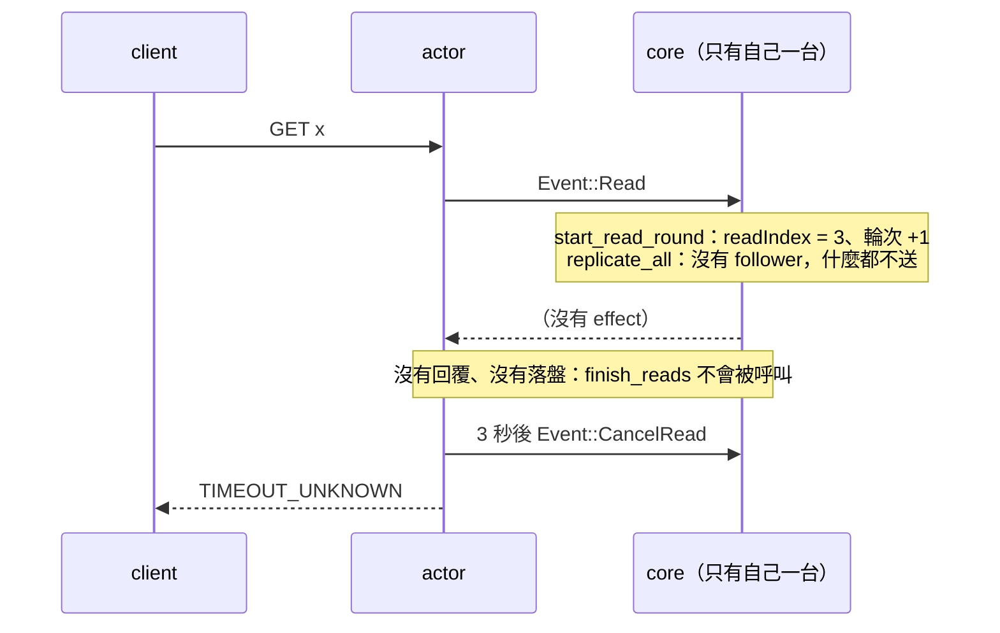

# 只有一台的叢集，寫得進去，卻讀不出來

狀態：草稿

> 這篇的命令與輸出都實際執行過（2026-11-17），還沒有第二個人照著做一遍。
> 讀者設定：讀過 [架構說明](../../ARCHITECTURE.md) 的「一次讀取」一節更好，沒讀過也跟得上。

發現日期：2026-11-17　｜　發現方式：最終複查時讀 `raft-core` 的讀取路徑，再用測試證實　｜
影響的版本：S4（`s4-membership-verified`）到 S9（`s9-public-verified`）　｜　修正：commit `3e63ce6`

## 1. 一句話說後果

叢集裡只有一台 voter（投票成員）時，PUT 照常成功，GET 卻一定等滿三秒，然後回 `TIMEOUT_UNKNOWN`。

剛用 `--bootstrap` 啟動、還沒用 `kv_admin.py add` 加入其他節點的叢集，就是這種狀態；把叢集縮回一台也是。
這篇帶你用一分鐘看到它，再追到少了哪一行。

## 2. 需要的背景

**voter（投票成員）。** 成員設定裡列出的節點。commit 一筆寫入、選出 leader、確認一次讀取，都要這些節點的多數同意。
一台時，多數就是 1：leader 自己就夠。

**ReadIndex 讀取。** 這個專案的 GET 不寫進 log。leader 收到 GET 時：

1. 先確認本任期已經 commit 過至少一筆 entry（剛當選的 leader 還不知道之前 commit 到哪裡）。
2. 記下當下的 commit index，叫做 readIndex。
3. 開一輪新的確認：送出一輪 AppendEntries，等多數回覆。回覆證明「到這一刻我還是 leader」。
4. 等狀態機至少套用到 readIndex，才從 KV 讀出值回答。

詳細推導在 [ReadIndex 規格](../../READ_INDEX.md) §6。

**core 與 actor。** `raft-core` 只做判斷：收到一個 `Event`，回傳一串 `Effect`，例如「送這則訊息」「這筆讀取可以回答了」（`ReadReady`）。
`raft-node` 的 actor 執行這些 effect。core 不會自己醒來：只有收到事件時，它才有機會產生 `ReadReady`。

## 3. 親手重現

需要建好的專案（見 [從零開始](../../SETUP.md)）。在專案根目錄執行：

```bash
docs/lessons/20-a-leader-alone-never-answers-reads/repro.sh
```

腳本在 `artifacts/runs/` 下的暫存目錄裡，把修正前的版本（tag `s9-public-verified`）建置一份，再用目前的原始碼建置一份。
兩份各啟動一個只有節點 1 的叢集，寫入 `x=A`，等 0.3 秒讓其他事情都結束，然後讀 `x` 並計時。實際輸出（完整的在 `expected-output.txt`）：

```text
== s9-public-verified (before the fix): one voter
   voters [1], node 1 is Leader of term 2
   Put x A -> OK
   Get x   -> TIMEOUT_UNKNOWN, result None, after 3.0 s
   node 1 status: reads_served 0, reads_waiting 0

== current source: one voter
   voters [1], node 1 is Leader of term 2
   Put x A -> OK
   Get x   -> OK, result 'A', after 0.0 s
   node 1 status: reads_served 1, reads_waiting 0
```

要看的是第四行：修正前的 GET 等了整整 3.0 秒才失敗，`reads_served` 是 0。3 秒是節點等一個 client 請求的上限（`CLIENT_TIMEOUT`）。
`reads_waiting` 是 0，因為逾時之後節點已經把這筆讀取丟掉了。

## 4. 為什麼會這樣

修正前的 `Core::read`（`crates/raft-core/src/lib.rs`）：

```rust
fn read(&mut self, id: u64, effects: &mut Vec<Effect>) {
    if self.role != Role::Leader { /* 回 NOT_LEADER */ }
    self.pending_reads.push(PendingRead { id, read_index: None, round: 0 });
    self.start_read_round(effects);   // 第 2、3 步：記下 readIndex、開新的一輪
}
```

`start_read_round` 把 readIndex 設成 commit index，輪次加一，然後叫 `replicate_all` 對每個 follower 送一則 AppendEntries。
一台的叢集沒有 follower，所以什麼都沒送出。

能把讀取變成 `ReadReady` 的只有 `finish_reads`。它在三個地方被呼叫：

| 呼叫的地方 | 什麼時候發生 | 一台的叢集閒著時 |
|---|---|---|
| `persisted` | 一次落盤完成 | 沒有寫入，就沒有落盤 |
| AppendResponse 分支 | follower 回覆 | 沒有 follower |
| InstallSnapshotResponse 分支 | follower 回覆快照分塊 | 沒有 follower |

三個都等不到，讀取就一直掛著，直到 actor 在 3 秒後送 `CancelRead` 把它忘掉。



`finish_reads` 本身其實早就算對了。它算的是「除了 leader 自己，還需要幾個 follower 確認」：

```rust
let needed = voters.majority().saturating_sub(usize::from(voters.contains(self.id)));
// 一台：majority 是 1，leader 是 voter，needed = 0，視為全部確認
```

一台時 `needed` 是 0，任何一輪都算已確認。只是沒有人去呼叫它。

如果那 3 秒內剛好有一筆 PUT 落盤，`persisted` 會呼叫 `finish_reads`，讀取就跟著完成。所以邊寫邊讀時看不出問題，閒著的時候才會卡住（這是讀程式推出來的，沒有另外做實驗）。

## 5. 為什麼嚴重

這是**可用性**問題，不是安全性問題：沒有讀到錯的值，只是讀不到。client 拿到 `TIMEOUT_UNKNOWN`，重試 GET 也沒有副作用（GET 不改資料）。

影響的範圍不大，但剛好落在新手最先碰到的地方：照 README 啟動節點 1 之後，如果先試一筆 GET 再去加其他節點，就會撞上。
README 的快速開始是先加節點再讀，所以照著做不會遇到；這也是它一直沒被發現的原因之一。

## 6. 怎麼修

在 `read` 的最後補一行：

```rust
    self.start_read_round(effects);
    // A leader that is the only voter is its own majority: no reply will
    // ever arrive to finish this read, so it is finished here (lesson 20).
    self.finish_reads(effects);
```

考慮過的做法：

| 做法 | 代價 | 結論 |
|---|---|---|
| `read` 結尾呼叫 `finish_reads` | 多台時多算一次，但新的一輪還沒有任何 follower 確認，什麼都不會提早回答 | 採用：改一行，判斷仍然只在 `finish_reads` 一處 |
| 在 `start_read_round` 裡特別處理「只有一台」 | 多一條只為一台存在的分支，和 `finish_reads` 的多數計算重複 | 不採用 |
| 每次心跳都呼叫 `finish_reads` | 讀取最多慢 100 毫秒；靠計時器間接完成，下一個人很難看懂為什麼 | 不採用 |

多台時這一行安全嗎？`start_read_round` 剛把輪次加一，所有 follower 的確認都還停在舊的輪次。
`finish_reads` 只回答「多數確認的輪次 ≥ 這筆讀取的輪次」的讀取，所以這一刻不會回答任何新的讀取；
本任期還沒 commit 時 readIndex 也還沒設定，同樣不會回答。

## 7. 怎麼證明修好了

| 測試 | 檢查什麼 | 沒有修正時 |
|---|---|---|
| `read_tests::a_single_voter_leader_answers_a_read_without_waiting`（raft-core） | 剛 bootstrap 的節點當選後，`Event::Read` 那一步就產生 `ReadReady` | `left: []`，沒有任何 `ReadReady` |
| `test_read_index.py::test_a_single_node_cluster_answers_reads_at_once`（真實 process） | 一台的叢集，GET 在 1 秒內回 OK | `TIMEOUT_UNKNOWN` |
| mutation 案例 `s10_single_voter_read_waits` | 把補上的那一行拿掉，上面第一個測試必須失敗 | （這個案例本身就是「沒有修正」） |

兩個測試都是先寫、先看到失敗，才修程式。執行：

```bash
cargo test -p raft-core a_single_voter_leader_answers_a_read_without_waiting
.venv/bin/python -m pytest -q tests/integration/test_read_index.py -k single_node
```

## 8. 還沒解決的事

- 為什麼模擬器沒抓到？模擬器的叢集也從一台開始，但它的讀取由隨機事件觸發，旁邊幾乎總有寫入或其他節點的回覆，`finish_reads` 遲早會被叫到。
  這是讀 `crates/raft-sim/src/cluster.rs` 得到的推論，沒有做實驗確認。模擬器也只檢查安全性（有沒有讀到錯的值），不檢查「讀取最後有沒有回答」（見教學 18）。
- 所有 ReadIndex 的測試原本都用三台或五台。這次補了一台的情況；兩台的叢集讀取要另一台確認，行為和三台相同，沒有另外加測試。

## 9. 自我檢查與練習

1. 一台的叢集裡，如果 GET 和 PUT 幾乎同時到達，修正前的 GET 會不會成功？為什麼？
2. `finish_reads` 裡的 `needed` 在兩台、三台、五台時各是多少？（leader 是 voter）
3. 如果 leader 不在自己的成員設定裡（正在移除自己），一台的計算會變成怎樣？
4. 為什麼補上的那一行不會讓三台的叢集提早回答讀取？用輪次說明。

**動手練習。** 用 `--bootstrap` 啟動節點 1（見 README 快速開始的第一行），先不要加其他節點。
用 `kv_client` 寫入一筆再讀出來，記下 GET 花了多久。接著在暫存目錄建置 tag `s9-public-verified` 的版本重做一次。
做對的話，你會看到和第 3 節相同的差別。

解答在 [answers.md](answers.md)。

## 10. 面試時怎麼講

下面是以作者的口吻寫的講稿，「我」指作者；你可以換成自己的經驗。

**兩分鐘版本：**

- 情境：Raft KV store，讀取用 ReadIndex，不寫 log；成員變更讓叢集可以只有一台。
- 怎麼發現：最後一次複查時讀讀取的路徑，發現能回答讀取的函式只在「收到回覆」或「落盤完成」時被呼叫。我問自己：沒有 follower 的時候誰會叫它？寫了一個一台的單元測試，馬上失敗。
- 根因：一台時 leader 自己就是多數，判斷函式其實算得對，只是沒有事件觸發它。
- 修法：讀取開始時也呼叫一次判斷函式。多台時新的一輪還沒有任何確認，所以不會提早回答。
- 驗證：單元測試、真實 process 測試，再加一個 mutation 案例確保有人拿掉這行會被抓到。
- 學到：測試的設定（都用三台）決定了哪些路徑永遠走不到；「判斷正確」和「判斷會被執行」是兩件事。

**可能的追問：**

- *「為什麼不是每次心跳都檢查？」* 可以，但讀取會慢最多 100 毫秒，而且靠計時器間接完成，下一個人不容易看懂。
- *「這會不會讀到舊值？」* 不會。一台的 leader 就是整個多數，同一個任期不可能有別的 leader；而且仍然要等本任期 commit 過、狀態機套用到 readIndex。
- *「怎麼確保其他函式沒有同樣的問題？」* 找出所有「只在收到回覆時才推進」的邏輯，問同一個問題：沒有 follower 時誰推進它？commit 的推進在 `persisted` 裡也會做，所以一台的寫入沒問題。
