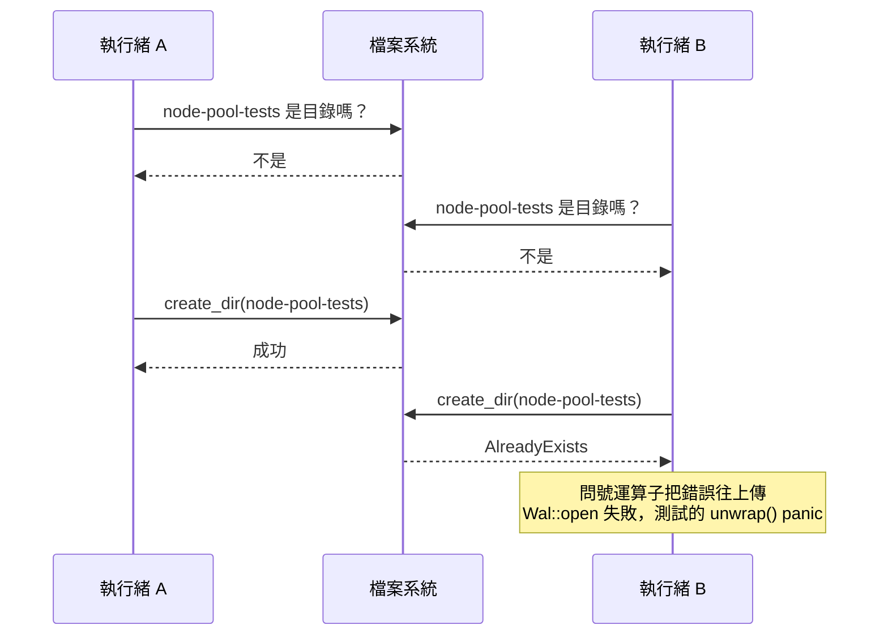

# 全新 clone 的第一次測試就失敗，第二次又好了

狀態：草稿

> 這篇的命令與輸出都實際執行過（2026-11-17），還沒有第二個人照著做一遍。
> 讀者設定：會寫一點 Rust，知道執行緒是什麼；不需要懂 Raft。

發現日期：2026-11-17　｜　發現方式：執行 `scripts/clean_rebuild.py`（把來源複製到新目錄，從頭建置、跑全部測試）　｜
影響的版本：`create_directory` 從 V1 就有這個競爭；S1～S4 審查之後有兩個、S5 起有三個測試同時開 WAL，才容易撞上　｜　修正：commit `3e63ce6`

## 1. 一句話說後果

在一份全新的 clone 上第一次跑 `cargo test`，`raft-node` 有三個測試失敗，訊息是 `File exists (os error 17)`；再跑一次就全部通過。

開發者自己的目錄裡早就有那些測試建立過的資料夾，所以從來沒看到；第一次 clone 專案的人卻很可能一開始就看到紅字。
同樣的競爭也會發生在正式執行：兩個節點同時啟動，而它們資料目錄的上一層還不存在時，其中一台會啟動失敗。
這篇帶你重現它，看懂「先檢查再建立」為什麼不安全。

## 2. 需要的背景

**WAL 的資料目錄。** `Wal::open(路徑, 節點編號)` 打開一個節點的資料目錄；目錄不存在就建立，連同不存在的上層目錄一起建。
建立後還要對目錄做 `fsync`（同步到磁碟），否則當機後「這個目錄存在」這件事可能消失。

**`fs::create_dir`。** 只建立一層目錄。目錄已經存在時回傳錯誤 `AlreadyExists`（Linux 的錯誤碼 17，`EEXIST`，訊息是 `File exists`）。

**cargo test 的平行執行。** 同一個測試執行檔裡的測試，預設同時在多條執行緒上跑。`raft-node` 有三個測試各自打開一個 WAL，
放在 `target/node-pool-tests/<各自的名稱>` 底下。三個測試共用 `target/node-pool-tests` 這一層。

**競爭（race condition）。** 結果取決於幾條執行緒誰先誰後。這種 bug 常常「多跑幾次就好了」，因為只有特定的先後順序才會出錯。

## 3. 親手重現

需要建好的專案（見 [從零開始](../../SETUP.md)）。在專案根目錄執行：

```bash
docs/lessons/21-a-fresh-clone-fails-its-first-test-run/repro.sh
```

腳本在 `artifacts/runs/` 下的暫存目錄裡做三件事：

1. 取出修正前的版本（tag `s9-public-verified`），加進一個測試：8 條執行緒等同一個訊號後，同時在一個還不存在的上層目錄底下各開一個 WAL，重複 20 輪，數有幾次被拒絕。
2. 在目前的原始碼做同樣的事。
3. 在修正前版本的全新副本跑 `raft-node` 的測試，就像第一次 clone 的人一樣。

實際輸出（完整的在 `expected-output.txt`）：

```text
== s9-public-verified (before the fix)
   first refusal: File exists (os error 17)
   opens refused: 140 of 160

== current source
   opens refused: 0 of 160

== the same race in a fresh copy of s9-public-verified: raft-node tests
   3 called `Result::unwrap()` on an `Err` value: Os { code: 17, kind: AlreadyExists, message: "File exists" }
   1 test result: FAILED. 3 passed; 3 failed; ...
```

要看兩個數字：修正前 160 次開檔有 140 次被拒；第三段的 3 個失敗，就是 `clean_rebuild.py` 看到的那 3 個。
被拒的次數每次跑會不一樣，因為它取決於執行緒的先後。

## 4. 為什麼會這樣

修正前的 `create_directory`（`crates/raft-storage/src/lib.rs`）：

```rust
fn create_directory(path: &Path) -> io::Result<()> {
    if path.is_dir() {
        return Ok(());              // ① 檢查：已經有了就不用建
    }
    // ……先遞迴建立上一層……
    fs::create_dir(path)?;          // ② 建立：別人在 ① 和 ② 之間建好了，這裡就回 AlreadyExists
    sync_directory(parent)?;
    sync_directory(path)
}
```

① 和 ② 之間有一段空檔。兩條執行緒 A、B 同時要建 `target/node-pool-tests`：



這種寫法叫「先檢查再動作」（check-then-act）：檢查的結果在動作之前就可能過期。

為什麼開發者的目錄裡看不到？`target/node-pool-tests` 在第一次跑測試時就建好了，之後測試結束也不會刪掉這一層。
三個測試再跑時，上層目錄已經存在，① 直接回傳，不會走到 ②。只有全新的 clone（或刪了 `target/`）才會走到。

## 5. 為什麼嚴重

測試這一側：第一次 clone 專案的人看到 3 個失敗，會懷疑程式本身有問題。對一個拿來展示的專案，這是最先被看到的印象。

正式執行這一側：README 的快速開始在三個 terminal 各啟動一台，資料目錄是 `data/node-1`、`data/node-2`、`data/node-3`。
如果 `data/` 還不存在、三台又在同一瞬間啟動，晚到的節點會因為 `File exists` 拒絕啟動。
人手動開三個 terminal 很難剛好同時，用腳本一次啟動就有可能。結果是節點起不來，不會讓資料錯誤；重新啟動就好。

## 6. 怎麼修

`create_dir` 回傳 `AlreadyExists`，而那個路徑現在確實是目錄時，就當作成功，照常同步：

```rust
    // Another node or thread may create the same directory between the check
    // above and this call (lesson 21); a directory is what we wanted.
    match fs::create_dir(path) {
        Err(error) if error.kind() == io::ErrorKind::AlreadyExists && path.is_dir() => {}
        result => result?,
    }
    sync_directory(parent)?;
```

考慮過的做法：

| 做法 | 代價 | 結論 |
|---|---|---|
| `AlreadyExists` 且是目錄就當成功 | 無；仍然同步上層與自己 | 採用 |
| 改用 `fs::create_dir_all` | 標準函式庫已處理這個競爭，但它不會對每一層做 `fsync`；當機後新建的目錄可能消失 | 不採用 |
| 每個測試用完全不同的上層目錄 | 只修測試，正式執行的競爭還在 | 不採用 |

為什麼還要加 `path.is_dir()`？`AlreadyExists` 也可能是「那裡有一個同名的**檔案**」。那種情況不能當成功，要照樣回報錯誤。

## 7. 怎麼證明修好了

| 測試 | 檢查什麼 | 沒有修正時 |
|---|---|---|
| `opens_racing_to_create_the_same_parent_all_succeed`（raft-storage） | 8 條執行緒同時在不存在的上層底下開 WAL，重複 20 輪，全部成功 | 連續 3 次執行都失敗，`File exists` |
| mutation 案例 `s10_directory_race_is_an_error` | 把 `match` 改回 `fs::create_dir(path)?`，上面的測試必須失敗 | （這個案例本身就是「沒有修正」） |

另外，刪掉 `target/node-pool-tests` 之後連跑兩次 `cargo test -p raft-node`，兩次都是 6 個測試全部通過。

```bash
cargo test -p raft-storage opens_racing_to_create_the_same_parent_all_succeed
```

## 8. 還沒解決的事

- 測試用 8 條執行緒、20 輪，修正前每次都失敗。但競爭本來就看機率：在更快或更慢的機器上，修正前的版本也可能剛好全部成功。這個測試能證明「修正後不再失敗」，不能保證在每台機器上都抓得到退步；mutation 案例在這台機器上抓到了。
- 為什麼之前沒發現：`clean_rebuild.py` 和 `tools/learning_demo.py` 都不在驗收契約裡，S5 之後沒人執行過（後者也從 S5 起就壞了，同一天修好）。驗收只在開發者自己的目錄跑，那裡永遠有舊的資料夾。
- 其他「先檢查再動作」的地方沒有逐一檢查。

## 9. 自我檢查與練習

1. 為什麼刪掉 `target/` 之後第一次跑測試可能失敗，第二次就不會？
2. 如果三個測試改成依序執行（`cargo test -- --test-threads=1`），修正前還會失敗嗎？
3. 為什麼不能看到 `AlreadyExists` 就一律當成功？
4. `fs::create_dir_all` 也處理了這個競爭，為什麼這個專案不用它？

**動手練習。** 在暫存目錄取出 tag `s9-public-verified`（`git archive s9-public-verified | tar -x -C <目錄>`），
在那裡跑 `cargo test -p raft-node --locked` 兩次。做對的話，第一次會看到 `File exists` 的失敗（不保證每台機器都會），第二次全部通過。
再刪掉那個副本裡的 `target/node-pool-tests`，加上 `-- --test-threads=1` 跑一次，看看結果和第 2 題的推理是否相符。

解答在 [answers.md](answers.md)。

## 10. 面試時怎麼講

**兩分鐘版本：**

- 情境：專案有一支腳本，把原始碼複製到新目錄從頭建置、跑全部測試，模擬「別人第一次 clone」。很久沒跑，最後一次複查時跑了一次。
- 現象：三個測試失敗，`File exists`；在我自己的目錄怎麼跑都過。
- 根因：建立目錄的函式先檢查「是不是已經有了」再建立，兩條執行緒同時建同一個上層目錄時，晚到的那條把「別人剛建好」當成錯誤。
- 修法：建立時遇到「已經存在而且是目錄」就當成功，仍然做 fsync。沒有改用 `create_dir_all`，因為它不會逐層 fsync。
- 驗證：8 條執行緒同時建立的測試，修正前每次都失敗；再加 mutation 案例。
- 學到：只在自己的環境跑的驗收，永遠帶著那個環境的歷史；要定期在乾淨的環境重建一次。

**可能的追問：**

- *「為什麼不加鎖？」* 競爭的雙方可能是不同的 process（兩個節點），process 內的鎖擋不住；而且作業系統的 `mkdir` 本身就是原子的，只要正確解讀它的結果。
- *「AlreadyExists 時不 fsync 可以嗎？」* 建立的人會 fsync，但我們不知道它做完沒有。多做一次 fsync 很便宜，所以照做。
- *「怎麼找出其他同類問題？」* 搜尋所有「先檢查檔案狀態、再依結果動作」的地方，問：兩個 process 同時做會怎樣？
